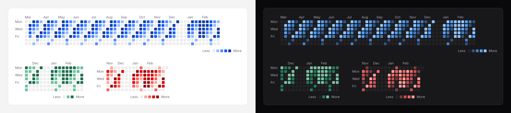

# Activity heatmap

A count for every day, as a grid of shaded squares: a week per column, a day
per row. Read for rhythm and streaks, with each day's number a hover (or a
screen reader) away.



## Use it

```blade
<x-ds::activity-heatmap label="Contributions in the last year" :data="$countsByDay" />

<x-ds::activity-heatmap label="Deploys" :data="$deploys" :weeks="16" unit="deploy" series="3" />

<x-ds::activity-heatmap label="Commits" :data="$commits" href="/commits/{date}" :weekStartsOn="0" />
```

`data` is counts by day: `['2026-03-03' => 12, …]`. A day that is not there
is zero. From an Eloquent query:

```php
$countsByDay = $user->commits()
    ->where('created_at', '>=', now()->subYear())
    ->selectRaw('date(created_at) as day, count(*) as n')
    ->groupBy('day')
    ->pluck('n', 'day');
```

## Props

| Prop | Type | Default | What it does |
|---|---|---|---|
| `data` | array | `[]` | Counts by day. Keys are dates Carbon reads; two keys for one day add up. |
| `from` | date | `weeks` back from `to` | The first day shown. |
| `to` | date | today | The last day shown. |
| `weeks` | int | `53` | How many weeks, when there is no `from`. 53 is a year. |
| `weekStartsOn` | `0` `1` | `1` | Sunday or Monday at the top, as on [date picker](date-picker.md). |
| `levels` | int or array | `5` | How counts become shades; see below. |
| `tone` | `neutral` `accent` `success` `warning` `danger` | `accent` | The hue. |
| `series` | `1` to `8` | — | The [chart-series](../../specs/chart-series.md) hue, beside other charts. Wins over `tone`. |
| `label` | string | — | What it shows. The table's caption and the scrolling region's name. Required. |
| `unit` | string or `[singular, plural]` | `contribution` | The thing counted: "12 contributions on 3 March 2026". |
| `showMonthLabels` | bool | `true` | Month names over the weeks. |
| `showWeekdayLabels` | bool | `true` | Mon, Wed and Fri down the side. |
| `href` | string | — | A link for each day with a count; `{date}` becomes its `Y-m-d`. |
| `summary` | string | generated | The caption's sentence after the label, in place of the total and busiest day. |

### Levels

- **A number** (2 to 5, counting "none"): the days with anything are split into
  equal shares by count, so the shades spread over the data whatever its size.
  `levels="3"` is none, some, a lot.
- **A list** such as `[1, 5, 10, 20]`: the lowest count of each shade above
  none, for a scale that means the same thing on every page.

The five shades are one hue, from the surface to full strength, measured to stay
apart in both themes.

## Narrow screens

The grid never squeezes. It scrolls sideways inside its own box, and starts
scrolled to the most recent weeks, with no script. The box is focusable so a
keyboard can scroll it.

## Accessibility

- It is a real table. Each **week** is a row and each weekday a column, in the
  source: a screen reader goes through it in time order, each day under its
  weekday. CSS turns it so weeks are columns on screen.
- Each day says its count in words, "12 contributions on 3 March 2026", and
  the same text is its native tooltip. A day with nothing says "No
  contributions on …".
- The caption gives the label and a sentence: the total, the range and the
  busiest day.
- The "Less … More" legend is hidden from screen readers, which hear every
  count in words already.
- With `href`, days with a count are links (Tab stops); empty days are not.

## Don't

- **Don't use it for under a few weeks.** A bar [sparkline](sparkline.md) says
  more with less.
- **Don't use it for values that go negative.** The shades run one way, from
  none to most.
- **Don't pick a `tone` to mean good or bad.** It is a count; `danger` is for
  things like incidents, where more is worse.
- **Don't set `href` on a year of busy days without thinking of Tab.** Every
  day with a count is a stop.

More in [specs/activity-heatmap.md](../../specs/activity-heatmap.md).
