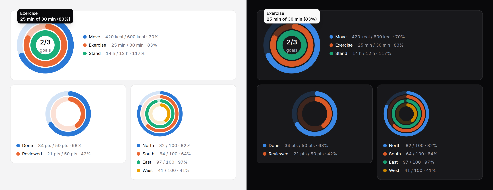

# Activity rings

Up to four concentric rings, each progress toward a goal of its own —
calories, minutes and hours today; each region against its target — with a
number or an icon in the middle.



> **Needs Alpine** and the package's script for the readout and keyboard
> access to each ring. Without them the rings are a correct static image with
> a generated text alternative. See
> [getting started](../getting-started.md#3-add-the-script).

## Rings, a gauge, or a circular progress?

| | Use it for |
|---|---|
| **Activity rings** | Two to four goals read together, each against its own target. |
| [Gauge](gauge.md) | One reading in a range that rises and falls, with bands (CPU, latency): a `meter`. |
| [Progress](progress.md) (`variant="circle"`) | One task's completion toward done: a `progressbar`. |

One ring alone is almost always a progress or a gauge.

## Use it

```blade
<x-ds::activity-rings label="Today" :rings="[
    ['label' => 'Move', 'value' => $kcal, 'max' => 600, 'format' => ['suffix' => ' kcal']],
    ['label' => 'Exercise', 'value' => $minutes, 'max' => 30, 'format' => ['suffix' => ' min']],
    ['label' => 'Stand', 'value' => $hours, 'max' => 12, 'format' => ['suffix' => ' h']],
]">
    <x-slot:centre>
        <span class="text-title font-semibold text-fg">2/3</span>
        <span class="text-meta text-fg-muted">goals</span>
    </x-slot:centre>
</x-ds::activity-rings>

{{-- Against 100 by default --}}
<x-ds::activity-rings label="Quarter's target by region" size="sm" legend="below" :rings="$percentByRegion" />
```

## Props

| Prop | Type | Default | What it does |
|---|---|---|---|
| `rings` | array | `[]` | Outermost first, four at most: rows with `label`, `value`, `max` (default 100) and an optional `tone`, `series` or `format`; or `['North' => 82, …]` against 100. A negative value, a `max` of zero or a fifth ring throws. |
| `label` | string | — | What the rings measure. Starts the summary, captions the table. |
| `size` | `sm` `md` `lg` | `md` | 128, 160 or 208px across. |
| `thickness` | `sm` `md` `lg` | `md` | Each ring's width; narrowed automatically so four still leave a hole. |
| `legend` | `beside` `below` `none` | `beside` | The legend: name, "value / goal · share". |
| `format` | array | `[]` | How numbers read, for every ring without a `format` of its own; [counter's keys](counter.md#format). |
| `summary` | string | generated | The text alternative, in place of the generated one. |
| `table` | bool | `false` | Also give ring, value, goal and share as a visually hidden table. |
| `interactive` | bool | `true` | With the script: the readout and keyboard access. |
| `empty` | string | `No data to show` | The empty state's title. |

| Slot | What it does |
|---|---|
| `centre` | A number or an icon in the middle, inset to the innermost ring. Not hidden: say in it only what the summary or the legend also says. |

**Past the goal, a ring is drawn full and stops.** The real figure is written
wherever the ring is named — "14 / 12 · 117%" in the legend, "Stand 14 of 12
(117%)" in the summary — rather than drawn as a second lap, which only colour
could tell apart from the first.

## Accessibility

- Without the script the rings are `role="img"`, named with every ring:
  "Today: Move 420 kcal of 600 kcal (70%), Exercise 25 min of 30 min (83%),
  Stand 14 h of 12 h (117%)."
- With it, one Tab stop: any arrow moves ring to ring, Home and End to the
  ends, Escape puts the readout away. The focus ring goes round the whole set
  and the ring being read brightens its track.

## Don't

- **Don't compare the rings with each other.** Each is against its own goal.
- **Don't use it for the parts of a whole.** Use a donut.
- **Don't pass more than four.** It throws: use a bar chart.

More in [specs/activity-rings.md](../../specs/activity-rings.md).
