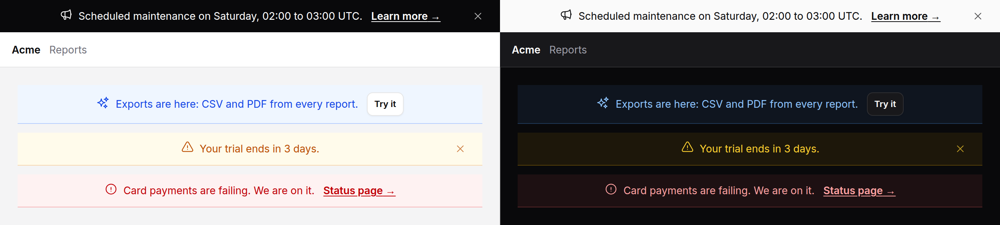

# Announcement bar

A full-width banner above the app's own chrome, for something everyone on the
page should know: scheduled maintenance, a trial about to end, a new feature.
Optionally dismissible, and when dismissed it can stay dismissed.



> `dismissible` and `dismissKey` need [Alpine](../getting-started.md#alpine)
> and the package's [script](../getting-started.md#3-add-the-script).
> Everything else on this page is plain Blade.

## Use it

At the top of the layout, above the header:

```blade
<body>
    <x-ds::announcement-bar tone="warning" dismissKey="maintenance-2026-11-21" href="{{ route('status') }}">
        Scheduled maintenance on Saturday 21 November, 02:00 to 03:00 UTC.
    </x-ds::announcement-bar>

    <header>…</header>
```

`dismissKey` makes it dismissible and remembers the dismissal in the browser's
`localStorage` under that key, so the bar stays away on every later page. **A
new announcement takes a new key**: putting the date or a version in the key is
the easy way to make sure nobody misses the next one.

`dismissible` alone lets the reader close it for this page only.

### With an action

`href` adds a link after the message, worded by `actionLabel`. For anything
else, use the `action` slot. A button in it marked `data-ds-dismiss` closes the
bar as the ✕ does:

```blade
<x-ds::announcement-bar tone="accent" icon="sparkles" dismissKey="exports-launch">
    Exports are here: CSV and PDF from every report.
    <x-slot:action>
        <x-ds::button size="sm" variant="secondary" href="{{ route('exports.index') }}">Try it</x-ds::button>
        <x-ds::button size="sm" variant="ghost" data-ds-dismiss>Got it</x-ds::button>
    </x-slot:action>
</x-ds::announcement-bar>
```

### Remembered on the server

The bar dispatches `dismiss` from itself, bubbling, so you can also record it
against the account:

```blade
<x-ds::announcement-bar dismissKey="trial-{{ $team->id }}" @dismiss="fetch('{{ route('notices.dismiss', 'trial') }}', { method: 'POST', headers: { 'X-CSRF-TOKEN': '{{ csrf_token() }}' } })">
```

and leave the bar out of the page for that account from then on.

## Props

| Prop | Type | Default | What it does |
|---|---|---|---|
| `tone` | string | `neutral` | `neutral` (the inverse surface, dark on light), `accent`, `success`, `warning`, `danger`. |
| `icon` | string\|false | per tone | A Heroicon name; `false` for none. |
| `label` | string | `"Announcement"` | The region's name, listed among the page's landmarks. |
| `dismissible` | bool | `false` | A close control, for this page only. |
| `dismissKey` | string | — | Remember the dismissal in `localStorage` under this key, and hide the bar before it paints on later loads. Implies `dismissible`. |
| `href` | string | — | A link after the message. |
| `actionLabel` | string | `"Learn more"` | The link's words. |
| `sticky` | bool | `false` | Stay at the top of the window as the page scrolls. |
| `urgent` | bool | `false` | `tone="danger"` only: announce it at once, as an alert. |
| `nonce` | string | Vite's | The CSP nonce for the small inline check `dismissKey` writes. |

Slots: the default slot (the message) and `action`. Any other attribute goes on
the bar.

## What it does

- **Closes** on the ✕, or a `data-ds-dismiss` button in the action slot, by
  collapsing its height over 150 ms. With reduced motion it is simply gone.
- **Stays closed** with `dismissKey`. The value stored is `1`; remove the key,
  or change it, to show the bar again.
- **Never flashes.** A dismissed bar is hidden before the browser paints it,
  by a few bytes of inline script that runs as the bar is parsed, so the page
  below does not jump on load. Under a Content Security Policy that blocks
  inline scripts without a nonce, pass `nonce` (or let it take Vite's); without
  one, the check is blocked and the bar is put away a moment later, when Alpine
  starts.
- **Without the script** the ✕ is not shown at all, rather than shown doing
  nothing. A `data-ds-dismiss` button of yours in the action slot is yours to
  hide.

## Accessibility

- A **landmark**: `role="region"` named by `label`, so a screen reader lists it
  and can jump to it, and reads it in place.
- **Not a live region**, deliberately. A bar that is on the page when it loads
  should not interrupt whatever a screen reader is saying, and a trial reminder
  never should. The exception is `tone="danger"` with `urgent`: `role="alert"`,
  announced at once, for an outage the reader must hear about now.
- The ✕ is named "Dismiss" and draws the system focus ring. Once collapsed,
  nothing in the bar can take focus.
- The message is centred, and with a ✕, centred on the bar rather than on
  what is left of it.

## Don't

- **Don't stack them.** One bar at a time; a second announcement waits.
- **Don't use it for a message about one form or one record.** That is an
  [alert](alert.md) where the problem is.
- **Don't mark news `urgent`.** Only an outage interrupts.
- **Don't reuse a key** for a different announcement: everyone who closed the
  old one will never see the new one.
- **Don't rotate messages through it.** One message, and it stays put until
  dismissed.

More in [specs/announcement-bar.md](../../specs/announcement-bar.md).
