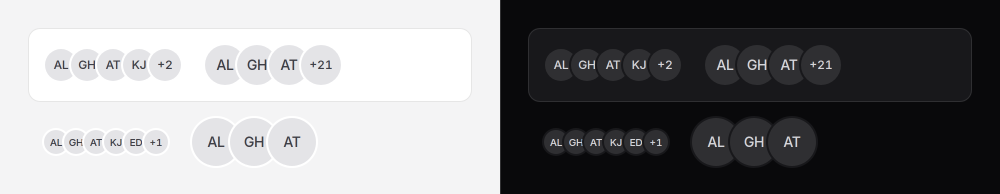

# Avatar group

A few faces from a larger set, overlapping: who is on a project, who has seen
a document.



## Use it

```blade
<x-ds::avatar-group
    label="Project members"
    :avatars="$project->members->map(fn ($u) => ['name' => $u->name, 'src' => $u->avatar_url])"
    :max="4"
/>
```

When you load only the first few, pass the real count as `total`:

```blade
<x-ds::avatar-group
    :avatars="$project->members()->take(3)->get()->map(fn ($u) => ['name' => $u->name])"
    :total="$project->members_count"
    :href="route('projects.members', $project)"
/>
```

## Props

| Prop | Type | Default | What it does |
|---|---|---|---|
| `avatars` | array | `[]` | The people or things, in order: each `name`, and optionally `src` and `square`, the same as [avatar](avatar.md). Arrays or objects. |
| `max` | int | — | Show at most this many, then a "+K" chip. Without it, all are shown. |
| `size` | `xs` `sm` `md` `lg` | `sm` | Passed to every avatar and to the chip. |
| `label` | string | — | Names the group for a screen reader: "Project members". |
| `total` | int | the number of `avatars` | The real count, when `avatars` holds only the first few. |
| `href` | string | — | Makes the "+K" chip a link, to wherever the full list lives. |

The avatars are the real [avatar](avatar.md) component, unchanged: images,
initials, square for a company.

## On any ground

Each avatar sits on an opaque `surface` backing with a ring of the same colour,
which makes the overlap read as a cut-out. On a panel the ring disappears into
it; on the sunken page ground it shows as a thin light outline, which still
separates the faces. Both themes, no prop.

## Accessibility

A screen reader hears **one sentence**, not a run of images and a number:

> Project members, group: Ada Lovelace, Grace Hopper, Alan Turing, and 3 more

- Every avatar is decorative; the sentence (visually hidden) is what is read.
- `label` makes the stack a named `group`. Without it there is no group role,
  and the sentence is read on its own.
- The "+K" chip is not interactive unless you pass `href`. As a link it is
  named "3 more", and the sentence leaves the count out so it is not said
  twice.

## Don't

- **Don't put a whole list in it.** It is a summary. Past a handful, use `max`
  and link to the list.
- **Don't wrap each avatar in its own link.** Overlapping targets are too small
  and too close to press reliably; link the chip, or put the list behind the
  group.
- **Don't rely on the faces alone.** If who it is matters, write the names
  somewhere as well.

More in [specs/avatar-group.md](../../specs/avatar-group.md).
