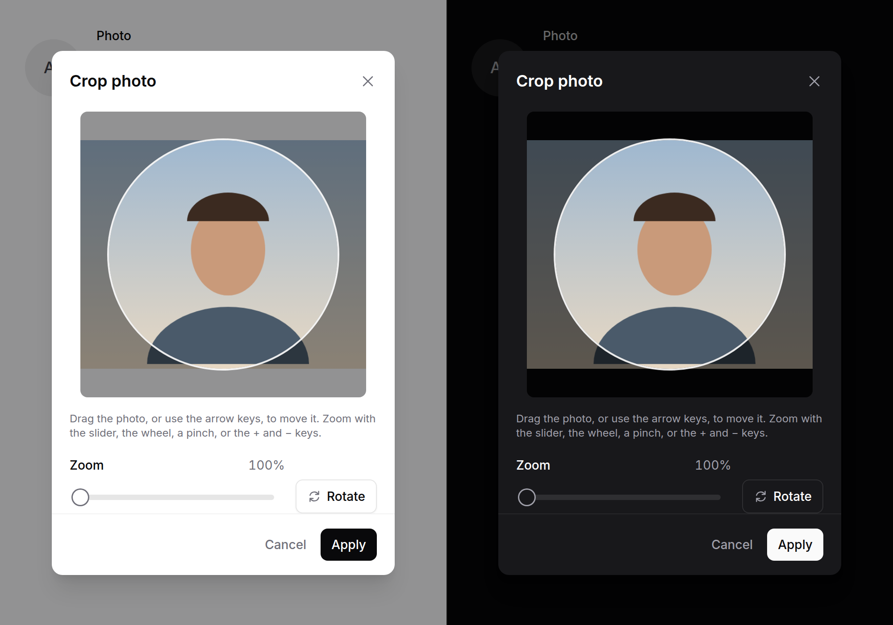

# Avatar upload

A profile photo or a logo: the current avatar, Change and Remove, and a crop
dialog that makes whatever was chosen a square of a known size.



> **Needs Alpine** and the package's script. See [getting started](../getting-started.md#3-add-the-script).
> Without them it is a plain file input that posts the original photo, and a Remove checkbox.

## Use it

```blade
<form method="post" action="{{ route('profile.photo') }}" enctype="multipart/form-data">
    @csrf
    <x-ds::avatar-upload name="photo" :src="$user->photo_url" :alt="$user->name"
                         :maxSize="2 * 1024 * 1024" :error="$errors->first('photo')" />
    <x-ds::button type="submit">Save</x-ds::button>
</form>
{{-- posts photo (a 512 × 512 JPEG), or photo_remove=1 --}}
```

```php
$request->validate([
    'photo' => ['nullable', 'image', 'mimes:jpeg,png,webp', 'max:2048'],
]);

if ($request->boolean('photo_remove')) {
    $user->deletePhoto();
} elseif ($request->hasFile('photo')) {
    $user->updatePhoto($request->file('photo')); // already cropped, with the script
}
```

**It does not upload anything.** The crop goes into the real file input, so
your form posts it, or Livewire uploads it:

```blade
<x-ds::avatar-upload name="photo" wire:model="photo" :alt="$name"
                     :src="$photo?->temporaryUrl() ?? $user->photo_url" />
```

Without the script the reader's original file posts instead, so crop on the
server too (or check the dimensions).

A company or a project takes a square:

```blade
<x-ds::avatar-upload name="logo" label="Logo" shape="square" :src="$team->logo_url"
                     :alt="$team->name" outputType="image/png" :outputSize="256" />
```

## Props

| Prop | Type | Default | What it does |
|---|---|---|---|
| `name` | string | *required* | The file field's name. |
| `label` | string | `Photo` | Names the control, beside the avatar. |
| `src` | string | — | The current photo's URL. |
| `alt` | string | — | Who or what is pictured: the photo's alt text, and the initials without one. |
| `shape` | `circle` \| `square` | `circle` | The crop's mask and the avatar's shape. |
| `accept` | string | `image/jpeg,image/png,image/webp` | As on a file input; checked in the browser. |
| `maxSize` | int | — | Bytes. |
| `outputSize` | int | `512` | The crop's width and height in pixels. |
| `outputType` | string | `image/jpeg` | `image/jpeg`, `image/png` or `image/webp`. |
| `quality` | float | `0.9` | 0 to 1, for JPEG and WebP. |
| `rotate` | bool | `true` | A Rotate button in the crop dialog. |
| `removable` | bool | `true` | A Remove button while there is a photo. |
| `removeName` | string | `{name}_remove` | What Remove posts as `1`. |
| `uploading` | bool | `false` | Your upload, in progress: an overlay on the avatar. |
| `progress` | int | — | With `uploading`: 0 to 100, or none for a spinner. |
| `size` | `lg` \| `xl` | `xl` | 48 or 64px. |
| `help` / `error` / `disabled` | | | As on every field. |

## Events

`crop` fires from the component after Apply, with `{ blob, width, height }`,
for a host that wants the image itself (to show it elsewhere, say). The file
input dispatches `input` and `change` as it would for a chosen file.

```blade
<x-ds::avatar-upload name="photo" x-on:crop="preview = URL.createObjectURL($event.detail.blob)" />
```

## Keyboard

In the crop area: the arrow keys move the photo (Shift: further), + and −
zoom. The zoom slider is a native slider. Nothing needs a drag.

## Accessibility

The component is a group named by its label. The crop dialog is
[`ds::modal`](modal.md): it traps focus and gives it back to Change. The crop
area is a focusable group with its instructions as its description. Errors are
said in a polite live region.

## Don't

- **Don't trust the browser's checks.** Validate type, size and dimensions on
  the server; without the script nothing was cropped or checked.
- **Don't upload from `crop` and post the form as well.**
- **Don't use it for documents or several files** — that is
  [file upload](file-upload.md).

More in [specs/avatar-upload.md](../../specs/avatar-upload.md).
