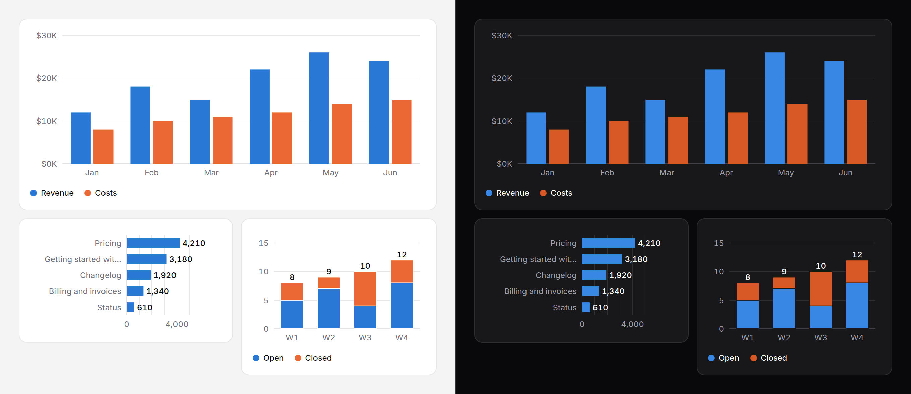

# Bar chart

Values compared across categories: one series or several, side by side or
stacked, vertical or horizontal. A complete, accessible SVG from the server;
hover and keyboard reading on top.



> **Needs Alpine** and the package's script for the readout, keyboard access
> to each bar and the legend toggles. Without them the chart is a correct
> static image with a generated text alternative. See
> [getting started](../getting-started.md#3-add-the-script).

## Use it

```blade
{{-- One series --}}
<x-ds::bar-chart label="Signups by month" :data="['Jan' => 120, 'Feb' => 180, 'Mar' => 150]" />

{{-- Several: a row per category, keyed by series --}}
<x-ds::bar-chart label="Revenue and costs" :data="$months" :format="['prefix' => '$', 'suffix' => 'K']" />

{{-- Or lists, with the names in `series` --}}
<x-ds::bar-chart :data="['W1' => [5, 3], 'W2' => [7, 2]]" :series="['Open', 'Closed']" :stacked="true" :showValues="true" />

{{-- Many categories, or long names --}}
<x-ds::bar-chart label="Views by page" :data="$pages" orientation="horizontal" :showValues="true" />
```

`$months` is `['Jan' => ['Revenue' => 12, 'Costs' => 8], …]`.

## Props

| Prop | Type | Default | What it does |
|---|---|---|---|
| `data` | array | `[]` | `['Jan' => 12, …]` for one series; `['Jan' => ['Revenue' => 12, 'Costs' => 8], …]` or `['Jan' => [12, 8], …]` for several. `null` is a missing bar. |
| `series` | array or string | — | The series' names, in order. They take [series-1, series-2…](../../specs/chart-series.md). Eight at most; a ninth throws. |
| `label` | string | — | What the chart shows. Starts the generated summary and captions the table. |
| `orientation` | `vertical` `horizontal` | `vertical` | Horizontal for many categories or long names. |
| `stacked` | bool | `false` | One bar per category with the series stacked, instead of side by side. |
| `height` | `sm` `md` `lg` | `md` | The plot's height (128, 192, 256px) when vertical; each category's band (24, 32, 40px) when horizontal. |
| `format` | array | `[]` | How numbers read on the axis, the bars, the readout and the summary; [counter's keys](counter.md#format). |
| `yTicks` | int or array | about 5 | Roughly how many ticks on the value axis, on round numbers, or the values themselves. |
| `showValues` | bool | `false` | Each bar's value at its end; a stack's total when stacked. |
| `tone` | `neutral` `accent` `success` `warning` `danger` | — | For **one** series whose colour means something. Ignored with several. |
| `summary` | string | generated | The text alternative, in place of the generated one. |
| `table` | bool | `false` | Also give every value to assistive technology as a visually hidden table. |
| `interactive` | bool | `true` | With the script: the readout, keyboard access and legend toggles. `false` for a chart that is only a picture. |
| `empty` | string | `No data to show` | The empty state's title when there is nothing to draw. |

## At any width

The chart fills its container, and its **text never scales**: tick labels and
names stay 12px in a 320px sidebar and on a wide screen. What gives way
instead, measured on the chart's own box:

- category labels drop out in halves, every second, then every fourth, the
  first always kept;
- printed values on side-by-side bars hide together once a bar is narrower
  than its number;
- names longer than 96px (120px horizontal) end in an ellipsis, with the full
  name on hover and in the readout, the summary and the table.

If labels are dropping out or truncating at the widths you care about, that
is the chart asking to be **horizontal**: a band per category, and names that
read across. The image above has one at 320px.

## The data it handles

- **Empty**, or nothing numeric: the [empty state](empty-state.md), titled by `empty`.
- **One bar**: one bar, centred.
- **All zero**: the axis 0 to 1 and the zero line; no bars.
- **Negatives**: bars hang below the zero line, which is drawn darker.
- **Missing values**: no bar in that slot; the others keep their place.

The value axis always includes zero, because a bar measured from anything
else misleads.

## Accessibility

- Without the script the chart is `role="img"`, named by a summary written
  from the data: "Revenue and costs. Revenue: highest May at $26K, lowest
  Jan at $12K. Costs: …". Pass `summary` when the point is something else.
- With it, the chart is one Tab stop. The arrows along the categories move
  bar to bar; the arrows across move to the same category in the next series
  (down a group, up a stack); Home and End go to the ends; Escape puts the
  readout away. Each bar is named "Jan, Revenue: $12K".
- Legend entries become toggle buttons. Hiding a series re-scales nothing.
- `table` adds every value as a hidden table, a column per series.

## Don't

- **Don't rotate long labels.** Use `orientation="horizontal"`.
- **Don't use `tone` to colour several series.** It is for one series whose
  colour means something.
- **Don't draw more than a few series side by side.** Past three or four the
  groups are hard to read; stack them, or draw one chart per series.
- **Don't compare parts of a whole with it when the whole matters more.** A
  stacked bar shows both; a [donut](donut-chart.md) shows only the parts.

More in [specs/bar-chart.md](../../specs/bar-chart.md).
