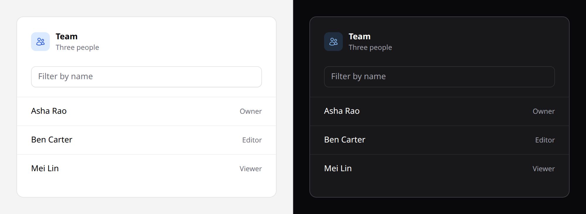

# Bleed

The way out of a panel body's inset, for something that must touch the panel's
edge. `PanelBleed` in React.



## Use it

```blade
<x-ds::panel title="Team" icon="users">
    <x-ds::input name="q" placeholder="Filter by name" />

    <x-ds::bleed class="mt-4 border-t border-divider">
        <ul class="divide-y divide-divider">
            @foreach ($members as $member)
                <li>
                    <x-ds::panel-row :href="route('members.show', $member)">
                        {{ $member->name }}
                    </x-ds::panel-row>
                </li>
            @endforeach
        </ul>
    </x-ds::bleed>
</x-ds::panel>
```

## Props

None. It is a `<div>`, and anything you pass lands on it, so spacing and a
divider go in `class`, as above.

## Why it exists

**A panel's body is always inset** at `px-5 sm:px-6`, and so is a
`panel-row`. A list dropped straight into a panel is therefore inset twice: its
text drifts right of the heading, and its dividers and row hover stop short of
the border, which reads as a rendering bug rather than a design.

The bleed's margins, `-mx-5 sm:-mx-6`, cancel the body's inset exactly. The row's
own padding then puts its text back on the heading's left edge, while the row's
background and the rules between rows run to the border.

The alternative, a panel whose body has no inset, used to be a mode, and it was the
default. It left 52 panels in the first consuming application with forms, empty
states and toolbars flush against their border, because nothing in them was a
row. So the inset is unconditional, and the bleed is the one way out of it.

Most list panels need both at once: in the same application, **26 of 33** held a
list *and* a toolbar, a button, an empty state or pagination. The toolbar keeps
the inset; only the list bleeds.

## Dividers

Nothing draws them for you. Put `divide-y divide-divider` on the list, or
directly on the bleed when the rows are its only children:

```blade
<x-ds::panel title="Recent reports" action="View all" actionHref="/reports">
    <x-ds::bleed class="divide-y divide-divider">
        <x-ds::panel-row href="/reports/1">Q3 revenue</x-ds::panel-row>
        <x-ds::panel-row href="/reports/2">Churn by cohort</x-ds::panel-row>
    </x-ds::bleed>
</x-ds::panel>
```

## Accessibility

It adds nothing to the accessibility tree: no role and no label. The list inside
it is still a list only if you write it as one, so a `<ul>` of `<li>`s is worth
the two extra tags when a screen reader user benefits from hearing
"list, 12 items".

## Don't

- **Don't use it outside a panel body.** It negates the panel's inset, and
  nothing else's. Anywhere else it pushes its content 20–24px past its container
  on both sides.
- **Don't expect it to reach the top or bottom.** It is horizontal only; the
  body's vertical padding stays.
- **Don't bleed a form, an empty state or a toolbar.** They are what the inset is
  for. Bleed only what has to touch the border.
- **Don't add `px-*` back on the bleed.** Rows carry their own padding; padding
  on the bleed insets them twice again.
- **Don't nest one bleed in another.** There is one inset to negate.

More in [specs/panel.md](../../specs/panel.md#reaching-the-edge).
