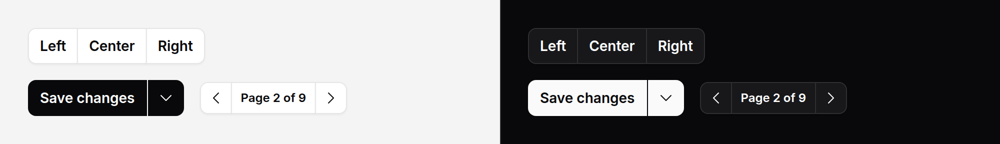
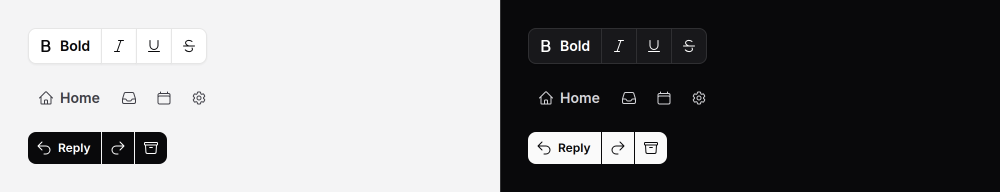

# Button group

Related buttons joined into one shape: pagination steps, text alignment, a
save button with its options. The inner corners square off and neighbouring
borders become a single line.



No script. The group sets the size and variant of every [button](button.md)
inside it, and any button can still set its own.

## Use it

```blade
<x-ds::button-group label="Pages" size="sm">
    <x-ds::button :href="$paginator->previousPageUrl()" iconOnly aria-label="Previous page">
        <x-ds::icon name="chevron-left" />
    </x-ds::button>
    <x-ds::button :href="$paginator->nextPageUrl()" iconOnly aria-label="Next page">
        <x-ds::icon name="chevron-right" />
    </x-ds::button>
</x-ds::button-group>
```

The buttons are ordinary `ds::button`s: `type="submit"` inside a form, `href`
for links, `wire:click` for Livewire. The group adds no behaviour.

Vertical:

```blade
<x-ds::button-group label="Zoom" orientation="vertical" size="sm">
    <x-ds::button iconOnly aria-label="Zoom in" wire:click="zoomIn"><x-ds::icon name="plus" /></x-ds::button>
    <x-ds::button iconOnly aria-label="Zoom out" wire:click="zoomOut"><x-ds::icon name="minus" /></x-ds::button>
</x-ds::button-group>
```

### Split button

The main action, then a [dropdown](dropdown.md) whose trigger is the last
segment. Set the variant on the group, so both halves match and part by a
hairline:

```blade
<form method="post" action="{{ route('posts.update', $post) }}">
    @csrf
    <x-ds::button-group label="Save options" variant="primary">
        <x-ds::button type="submit">Save changes</x-ds::button>
        <x-ds::dropdown>
            <x-slot:trigger>
                <x-ds::button iconOnly aria-label="More save options">
                    <x-ds::icon name="chevron-down" />
                </x-ds::button>
            </x-slot:trigger>
            <x-ds::dropdown-item :href="route('posts.draft', $post)">Save as draft</x-ds::dropdown-item>
        </x-ds::dropdown>
    </x-ds::button-group>
</form>
```

The trigger needs no extra prop: it takes the group's size, variant and end
corners through the dropdown that wraps it. The menu needs Alpine, as every
dropdown does; the group does not.

### Expanding

A row of icon buttons where the one under the pointer, the one with keyboard
focus, and the pressed or current one open to show their labels:



```blade
<x-ds::button-group label="Text style" expanding>
    <x-ds::button icon="bold" :aria-pressed="$bold ? 'true' : 'false'">Bold</x-ds::button>
    <x-ds::button icon="italic" :aria-pressed="$italic ? 'true' : 'false'">Italic</x-ds::button>
    <x-ds::button icon="underline" aria-pressed="false">Underline</x-ds::button>
</x-ds::button-group>

<x-ds::button-group label="Views" expanding variant="ghost">
    <x-ds::button icon="home" :href="route('home')" aria-current="page">Home</x-ds::button>
    <x-ds::button icon="inbox" :href="route('inbox')">Inbox</x-ds::button>
</x-ds::button-group>
```

Every button needs `icon`; its slot is the label that folds away. No script:
the labels open with CSS, animating the grid track, and only with motion
allowed.

- **The group fills its container.** The width a label opens into is already
  the group's, so nothing beside it moves. Put it in a box of the width you
  want it to have.
- **On a touch screen** there is no hover, so only the pressed or current
  button is open; the others open while focused from a keyboard.
- **Every button keeps its label as its accessible name.** The label is there,
  only collapsed to no width, never `display: none`.
- Horizontal only. `orientation="vertical"` with `expanding` throws.

## Props

| Prop | Type | Default | What it does |
|---|---|---|---|
| `label` | string | — | What the buttons do together ("Pages", "Save options"). The group's accessible name. Required. |
| `size` | string | — | `sm`, `md` or `lg` for every button inside that does not set its own. Unset, buttons keep their `md` default. |
| `variant` | string | `secondary` | `primary`, `secondary`, `ghost` or `danger` for every button inside that does not set its own. |
| `orientation` | string | `horizontal` | `horizontal` or `vertical`: which way the buttons run and the joins fall. |
| `expanding` | bool | `false` | Icon buttons whose labels open on hover, focus, and while pressed or current. Every button needs `icon`. Horizontal only. |

`id`, `class` and anything else go on the group's `div`.

## What it does

- **Joins.** The first button keeps its start corners and the last its end
  corners; everything between is square. Outlined buttons overlap by one
  pixel, so two borders read as one line. Filled ones (`primary`, `danger`)
  have no border to share, so a 1px gap of the page shows between them.
- **Hover and focus** lift the button above its neighbours, so its border and
  focus ring are never half covered.
- **Settings flow to buttons only.** A button reads the group's size and
  variant, and nothing else does; a button elsewhere, such as in a modal with
  `size="lg"`, keeps its own defaults.

## Accessibility

- `role="group"` named by `label`, so a screen reader announces the set before
  its first button.
- Each button keeps its own name: give icon-only ones an `aria-label`.
- Every button is its own Tab stop. If the set should be one stop with arrow
  keys, it is a [toolbar](toolbar.md).

## Don't

- **Don't use it to choose one of several.** That is a
  [segmented control](segmented-control.md) or a [toggle group](toggle-group.md),
  which carry the chosen state.
- **Don't set a filled variant on single buttons in an outlined group.** Set
  it on the group, or the hairline between filled buttons is lost.
- **Don't group unrelated actions** for the look. Spacing between separate
  buttons says they are separate.
- **Don't wrap anything but buttons** (and a dropdown around one). The joins are
  set on the group's direct children.

More in [specs/button-group.md](../../specs/button-group.md).
