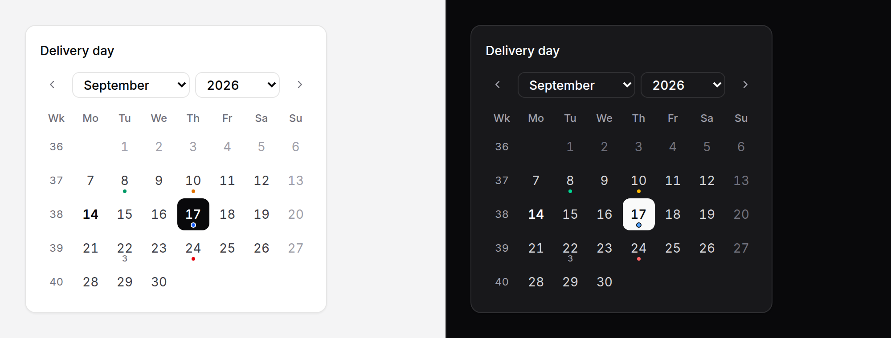

# Calendar

A month grid that is always visible: pick a day, a range or several days on a
booking page, a dashboard or a sidebar, with markers for the days that have
something on.



> **Needs Alpine** and the package's script. See [getting started](../getting-started.md#3-add-the-script).
> Without them the grid is still drawn, correct, by the server, and native date fields under it post the value.

## Use it

```blade
<x-ds::calendar name="delivery_on" label="Delivery day" :value="old('delivery_on', $order->delivery_on)"
                :min="now()" :disabledDays="[0, 6]" />
{{-- posts delivery_on=2026-09-10 --}}

<x-ds::calendar name="stay" aria-label="Stay" :range="true" :months="2" :value="[$from, $to]" />
{{-- posts stay_start=2026-09-08 and stay_end=2026-09-20 --}}

<x-ds::calendar name="days_off" aria-label="Days off" :multiple="true" :value="$daysOff" />
{{-- posts days_off[]=2026-09-01&days_off[]=2026-09-15 --}}
```

The names are the date picker's: a range posts `{name}_start` and `{name}_end`.

```php
$request->validate([
    'stay_start' => ['required', 'date'],
    'stay_end' => ['required', 'date', 'after_or_equal:stay_start'],
    'days_off' => ['array'],
    'days_off.*' => ['date'],
]);
```

## Props

| Prop | Type | Default | What it does |
|---|---|---|---|
| `name` | string | — | Field name. Without one, nothing posts (bind it instead). |
| `label` | string | — | Shown above, and names the calendar. Without it pass `aria-label`. |
| `value` | date \| array | — | `Y-m-d` or a `DateTimeInterface`; `[from, to]` with `range`; a list with `multiple`. |
| `range` | bool | `false` | A start and an end. |
| `multiple` | bool | `false` | Any number of days. |
| `min` / `max` | date | — | Earliest / latest selectable day. |
| `disabledDates` | array | `[]` | Days that cannot be chosen. |
| `disabledDays` | array | `[]` | Weekdays that cannot be chosen, `0` = Sunday … `6` = Saturday. |
| `months` | `1`–`3` | `1` | Months side by side; they stack when there is no room. |
| `month` | `Y-m` | the value's, or today's | The first month shown. |
| `weekStartsOn` | `0`–`6` | the locale's | First day of the week. Named as on the date picker. |
| `locale` | string | the app's | Day and month names, from Carbon. |
| `showWeekNumbers` | bool | `false` | ISO week numbers down the side. |
| `showOutsideDays` | bool | `false` | The neighbouring months' days in the first and last weeks. |
| `today` | date \| `false` | `now()` | The day marked as today, in the app's timezone. `false` marks none. Never the browser's clock. |
| `events` | array | `[]` | Date => a tone (`neutral` `accent` `success` `warning` `danger`) for a dot, or a count. |
| `size` | `sm` `md` `lg` | `md` | 32, 36 or 44px days. `lg` is a comfortable touch target. |
| `jump` | bool | `true` | Month and year selects in the header. |

`wire:model` and `x-model` go on the component and bind the value: a
`Y-m-d` string (`''` when empty), `[from, to]`, or a list. A reader's choice
dispatches `input` and `change` (plain events, bubbling) from the field that
holds it.

## Events for the month in view

`month-change` fires with `{ year, month }` whenever the months in view
change, so a Livewire component can load just that month:

```blade
<x-ds::calendar aria-label="Bookings" wire:model.live="day" :month="$month" :events="$events"
                x-on:month-change="$wire.showMonth($event.detail.year, $event.detail.month)" />
```

```php
public function showMonth(int $year, int $month): void
{
    $this->month = sprintf('%04d-%02d', $year, $month);
    $this->events = Booking::countsByDay($year, $month); // ['2026-09-03' => 4, …]
}
```

The new markers are drawn after the re-render. Pass `month` back so the
server renders the month the reader is looking at.

There is **no `day` slot**: the grid is rendered once and redrawn by the
script for every other month, so markup Blade wrote for one month would be
wrong after the first press of next. Markers are data the script can redraw.

## Keyboard

| Key | Does |
|---|---|
| ← → ↑ ↓ | A day, a week |
| PageUp / PageDown | A month; with Shift, a year |
| Home / End | Start / end of the week |
| Enter / Space | Choose |

The grid is one Tab stop: the chosen day, or today, or the first of the month.

## Accessibility

Each month is an ARIA grid named by its month, each day a button named by its
full date and marker ("Thursday 3 September 2026, 2 events"), with
`aria-selected` on its cell and `aria-current="date"` on today. Disabled days
stay focusable with `aria-disabled`, so the arrows can cross them. A live
region says the month when it changes.

## Don't

- **Don't use it for a date of birth** — three selects or a text field.
- **Don't let the browser decide what today is.** Pass `today` for a user's
  own timezone; the default is the server's.
- **Don't rely on it to enforce `disabledDates` without the script.** The
  fallback date fields know `min` and `max` only; validate on the server.
- **Don't use `multiple` for a range.**

See also [date picker](date-picker.md), whose popover is this grid, and the
[spec](../../specs/calendar.md).
