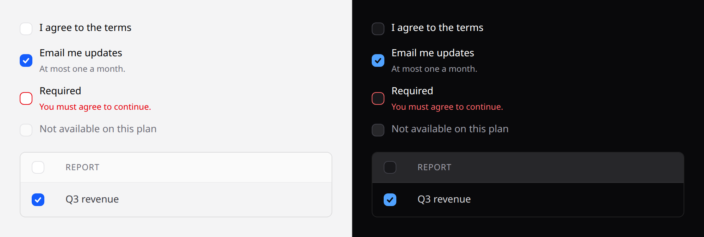

# Checkbox

One independent yes/no. Not one of a set — that is [radio](radio.md).



> `indeterminate` is the one prop here that needs
> [Alpine](../getting-started.md#alpine). Everything else on this page works in a
> plain Blade view with no JavaScript at all.

## Use it

```blade
<x-ds::checkbox name="terms" label="I agree to the terms" />
```

## Props

| Prop | Type | Default | What it does |
|---|---|---|---|
| `label` | string | *required* | The clickable label. |
| `help` | string | — | Guidance under the label. |
| `error` | string | — | Validation message. |
| `checked` | bool | `false` | |
| `indeterminate` | bool | `false` | The "some children are checked" state. |
| `hideLabel` | bool | `false` | Keeps `label` as the accessible name but does not show it. Only inside a table whose row already names the thing. |
| `disabled` | bool | `false` | |

`name`, `value`, `wire:model` and anything else pass through to the input.

## The label is the touch target

`label` is required and renders a real `<label for>`, so **its whole width is
clickable**. On a phone that is most of the target — the 18px box on its own is
well under the 44px minimum.

## Hidden label

`hideLabel` is for one place: **a select column in a table whose row already
names the thing.** "Select Invoice 42" written out beside "Invoice 42" says it
twice, so the label stays in the DOM as the control's accessible name, and is
not shown.

```blade
<x-ds::table>
    <thead>
        <tr>
            <th scope="col" class="w-12 px-4 py-3">
                <x-ds::checkbox label="Select all" :hideLabel="true" wire:model.live="selectAll" />
            </th>
            <th scope="col" class="px-4 py-3 text-left">Invoice</th>
        </tr>
    </thead>
    @foreach ($invoices as $invoice)
        <x-ds::table-row>
            <x-ds::table-cell>
                <x-ds::checkbox :label="'Select '.$invoice->number" :hideLabel="true"
                                wire:model.live="selected" :value="$invoice->id" />
            </x-ds::table-cell>
            <x-ds::table-cell>{{ $invoice->number }}</x-ds::table-cell>
        </x-ds::table-row>
    @endforeach
</x-ds::table>
```

Write the label as the action and the thing: "Select Invoice 42", not "Select"
on every row. A screen reader moving down the column hears the label alone, so
forty rows of "Select, checkbox" is forty identical controls.

With the visible label gone, so is most of the touch target. The hidden label
therefore still takes presses, as a **44px square centred on the box**, behind
it: a press on the box reaches the input, a press beside it reaches the label.
Keep the cell at least that wide (`w-12`) so the square does not overlap the
next column.

Everywhere else, show the label. A checkbox in a form with no visible label is
a question with no words.

## Examples

**With Laravel validation:**

```blade
<x-ds::checkbox
    name="terms"
    label="I agree to the terms"
    :checked="old('terms')"
    :error="$errors->first('terms')"
/>
```

**A "select all" that reflects a partial selection:**

```blade
<x-ds::checkbox
    name="all"
    label="Select all"
    :checked="$allSelected"
    :indeterminate="$someSelected && ! $allSelected"
/>
```

`indeterminate` is a DOM property with no attribute form, so the component sets
it with `x-init` — which needs Alpine and an `x-data` scope above it. Without
one the box renders **unchecked**, which is exactly what a screen reader
announces: the feature is absent rather than lying about the state.

## Accessibility

- The real `<input type="checkbox">` is styled with `appearance-none`, not
  replaced by a decorated `<span>`. That keeps the browser's focus behaviour and
  Windows high-contrast rendering, both of which the substitution trick loses
  invisibly.
- `error` sets `aria-invalid` and wires `aria-describedby`.
- `disabled` uses the real attribute, so the field genuinely does not submit.

## Don't

- **Don't use one for a two-way choice.** "Send as HTML / Send as plain text" is
  a radio pair; a checkbox makes the reader work out what unchecked means.
- **Don't use it as a switch.** A switch applies immediately; a checkbox is
  submitted. If it takes effect on click it needs a different control.
- **Don't rely on a table column header as the label.** The header is not
  programmatically associated, and the touch target collapses to 18px. In a
  select column, give each box its own label and `hideLabel` — see above.
- **Don't use `hideLabel` outside a table row.** Something visible has to say what
  the box is.
- **Don't attach a group-level error to one checkbox.** See [radio](radio.md).

More in [specs/checkbox.md](../../specs/checkbox.md).
