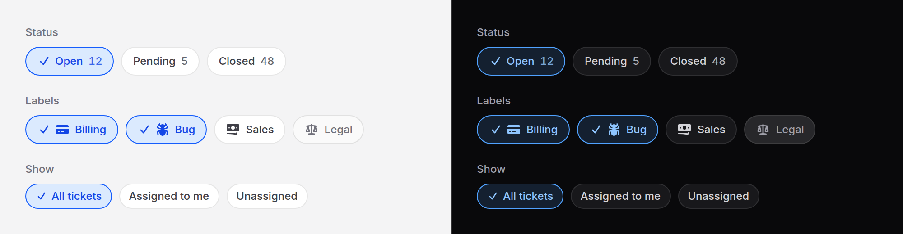

# Chip group

A row of pressable filters: a status, a few labels, a time range. Each chip is
a real radio or checkbox, so the group posts with the form and binds like
any other input.



No script. For a pill that only shows something, use [badge](badge.md).

## Use it

One of several, as radios:

```blade
<x-ds::chip-group name="status" label="Status">
    <x-ds::chip value="open" :checked="$status === 'open'" :count="$counts['open']">Open</x-ds::chip>
    <x-ds::chip value="closed" :checked="$status === 'closed'">Closed</x-ds::chip>
</x-ds::chip-group>
```

Any number, as checkboxes, posting `labels[]`:

```blade
<x-ds::chip-group name="labels" label="Labels" :multiple="true">
    @foreach ($labels as $label)
        <x-ds::chip :value="$label->id" :icon="$label->icon" :checked="in_array($label->id, $chosen)">
            {{ $label->name }}
        </x-ds::chip>
    @endforeach
</x-ds::chip-group>
```

Or links, for filtering by moving to a URL; a group of links is a `nav`:

```blade
<x-ds::chip-group label="Show">
    <x-ds::chip :href="route('tickets.index')" :active="! request('mine')">All</x-ds::chip>
    <x-ds::chip :href="route('tickets.index', ['mine' => 1])" :active="(bool) request('mine')">Mine</x-ds::chip>
</x-ds::chip-group>
```

A group is all inputs or all links. Mixing them throws when the view renders.

## Livewire and Alpine

Put the binding on the group. It is written onto every chip's input, which is
where Livewire and Alpine read a radio or checkbox group from:

```blade
<x-ds::chip-group name="labels" label="Labels" :multiple="true" wire:model.live="labels">
    …
</x-ds::chip-group>
```

With `multiple` the bound value is an array of the chosen values; without, a
string. Pass `:checked` from the same data, so the first paint is right before
Livewire or Alpine starts.

## Props

`ds::chip-group`:

| Prop | Type | Default | What it does |
|---|---|---|---|
| `name` | string | — | Shared by every chip. With `multiple`, `[]` is added. Not needed for links. |
| `label` | string | — | What the chips choose. The group's legend, or the nav's name. Required. |
| `hideLabel` | bool | `false` | Keep `label` as the accessible name only, for a row that is plain from what is around it. |
| `multiple` | bool | `false` | Checkboxes instead of radios. |
| `size` | string | `md` | `sm` (28px), `md` (32px), `lg` (40px), for every chip. |

`id`, `class` and anything else go on the fieldset (or nav); `wire:model` and
`x-model` go on the inputs.

`ds::chip`:

| Prop | Type | Default | What it does |
|---|---|---|---|
| `value` | string | — | What the chip posts when chosen. Required for an input chip. |
| `checked` | bool | `false` | Chosen on the first paint. |
| `icon` | string | — | A Heroicons name, drawn before the words. |
| `count` | int, string | — | After the words, for how many the filter leaves. |
| `disabled` | bool | `false` | Cannot be chosen, or followed. |
| `href` | string | — | Makes it a link chip. |
| `active` | bool | `false` | The link chip for the view on screen: drawn chosen, `aria-current="true"`. |

The chip's words are its slot. On an input chip, `class` goes on the pill and
anything else on the input.

## What it does

- **Choosing** fills the pill with the accent tint and opens a check before
  the words. The check grows from no width over 150 ms, so the words slide
  across rather than jumping; with reduced motion it is instant.
- **The keyboard** is native. Radios: Tab into the group, the arrow keys move
  the choice, skipping disabled chips. Checkboxes: Tab between chips, Space
  toggles.
- **Disabled** chips are greyed and skip the keyboard. A disabled link chip
  loses its `href`.

## Accessibility

- Inputs: a `fieldset` named by its `legend`, each chip a `label` around an
  `sr-only` input, so its name is its words and count ("Open 12").
- Links: a `nav` named by the label; the current chip carries
  `aria-current="true"`.
- Chosen is shown by the check as well as by colour.
- Focus is a ring around the whole pill.

## Don't

- **Don't use chips for actions.** A chip chooses; a [button](button.md) does.
- **Don't mix links and inputs in one group.** It throws: one moves to a new
  page, the other waits for the form.
- **Don't put many dozens in a row.** For a long list, a [combobox](combobox.md)
  or a [select](select.md) with search.

More in [specs/chip-group.md](../../specs/chip-group.md).
