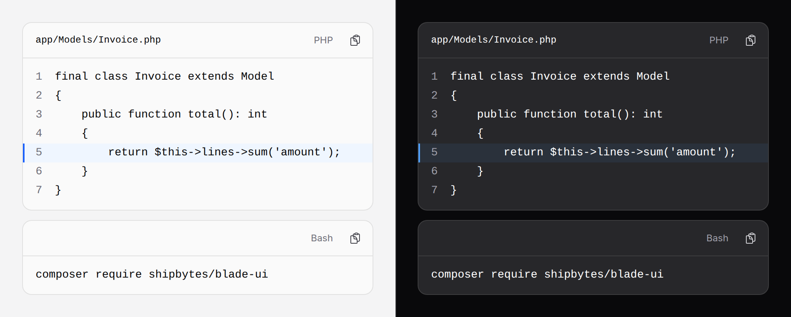

# Code block

Code to read and copy: a snippet, a curl example, a config file. Line numbers,
highlighted lines, a height limit and a Show more. Nothing is highlighted: bring
your own highlighter, or none.



> Plain Blade. The copy button and `expandable` need Alpine and the package's
> script (see [getting started](../getting-started.md#3-add-the-script));
> without them the code still shows and scrolls.

## Use it

```blade
<x-ds::code-block language="PHP" filename="routes/web.php" :lineNumbers="true" highlight="3"
    :code="$snippet" />
```

## The indentation trap

The slot is escaped and keeps its whitespace, but **Blade trims the slot**, so
the first line loses its indentation and the rest keep theirs:

```blade
{{-- Wrong: line 1 starts at column 0, lines 2 and 3 keep 8 extra spaces --}}
<div>
    <x-ds::code-block>
        if ($paid) {
            return;
        }
    </x-ds::code-block>
</div>
```

Write the slot flush left, or pass `:code`, which is never trimmed. Pass a
variable through `:code` too: the slot is escaped, so `{{ $snippet }}` in it is
escaped twice and shows `&lt;` where the code has `<`.

```blade
<x-ds::code-block language="Bash" :code="'composer require shipbytes/blade-ui'" />
<x-ds::code-block language="JSON" :code="file_get_contents(base_path('composer.json'))" :maxHeight="12" />
```

Nothing is dedented for you, and one trailing newline is dropped.

## Bring a highlighter

`:html` takes a highlighter's output and renders it **unescaped** in the same
frame. Its own `pre` and `code` are taken off; line numbers and `highlight`
still work.

```php
// Phiki, or Shiki through a build step: any highlighter with a CSS-variables theme.
$html = (new Phiki)->codeToHtml($code, Grammar::Php, Theme::CssVariables);
```

```blade
<x-ds::code-block language="PHP" :html="$html" />
```

The copy button copies the HTML's text: the code as written, without the tags.
`:html` and `:code` together throw; pass one.

Point the highlighter's CSS variables at the package's tokens, and the code
matches the system in light and dark:

```css
[data-ds-code] {
    --shiki-foreground: var(--ds-code-fg);
    --shiki-token-comment: var(--ds-code-comment);
    --shiki-token-keyword: var(--ds-code-keyword);
    --shiki-token-string: var(--ds-code-string);
    --shiki-token-constant: var(--ds-code-constant);
    --shiki-token-function: var(--ds-code-function);
    --shiki-token-parameter: var(--ds-code-parameter);
    --shiki-token-punctuation: var(--ds-code-punctuation);
    --shiki-token-link: var(--ds-code-link);
}
```

Every token colour passes AA on the block's ground in both themes.
**Never pass user input to `:html`.**

## Long code

`maxHeight` is in lines; past it the block scrolls. `expandable` adds a
**Show more** that lifts the limit, shown only when there is more:

```blade
<x-ds::code-block language="YAML" :code="$workflow" :maxHeight="10" :expandable="true" :lineNumbers="true" />
```

## Props

| Prop | Type | Default | What it does |
|---|---|---|---|
| `code` | string | — | The code, escaped and untrimmed. In place of the slot. |
| `html` | string | — | Highlighted HTML, unescaped. Not with `code`. |
| `language` | string | — | Shown in the header. A label only. |
| `filename` | string | — | Shown in the header, in monospace. |
| `label` | string | the filename, else "*language* code", else "Code" | The scroll region's accessible name. |
| `copy` | bool | `true` | A copy button. |
| `lineNumbers` | bool | `false` | Numbers that are never selected or copied. |
| `highlight` | string\|array | — | Lines to mark: `"3,7-9"` or `[3, 7, 8, 9]`. |
| `wrap` | bool | `false` | Long lines wrap rather than scroll sideways. |
| `maxHeight` | int | — | At most this many lines tall. |
| `expandable` | bool | `false` | A Show more past `maxHeight`. |
| `moreLabel` / `lessLabel` | string | `Show more` / `Show less` | Its words. |

## Accessibility

- `<pre><code>`, always left to right, even on a right-to-left page.
- The scroll box is a named region you can Tab to, so the keyboard can scroll it.
- Line numbers are not read out, selected or copied.
- Copy says "Copied" to a screen reader.

## Don't

- **Don't put a whole file on a page without `maxHeight`.**
- **Don't pass user input to `:html`.** Use `:code`, which escapes.
- **Don't use it for a command in a sentence.** That is `<code>`.

See also [kbd](kbd.md). More in [specs/code-block.md](../../specs/code-block.md).
