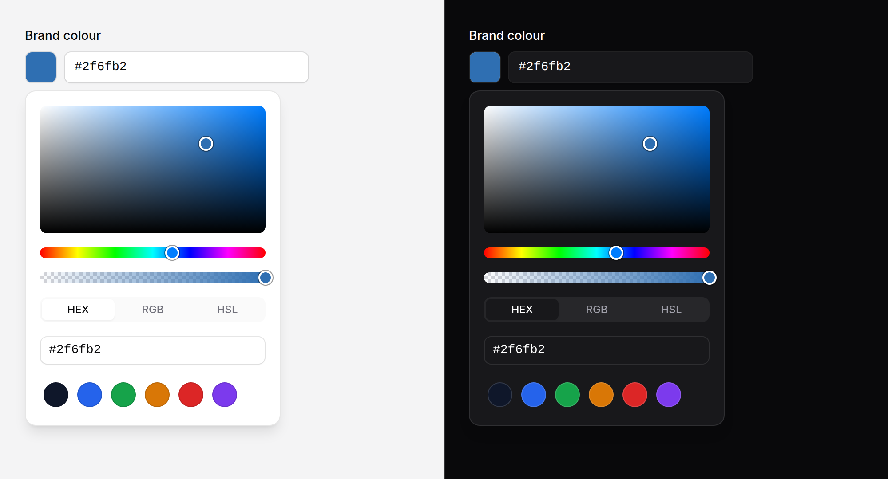
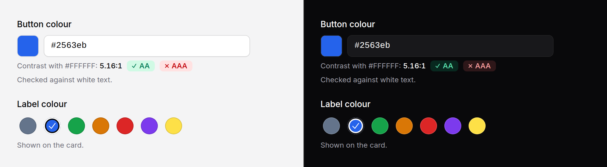

# Colour picker

Choose a colour from a panel, by typing it in any common form, or from a set of
presets, with the contrast against your background shown as you go.



> **Needs Alpine** and the package's script. See [getting started](../getting-started.md#3-add-the-script).
> Without them it is the browser's own colour input beside the text field, posting
> `#rrggbb`. `presetsOnly` needs neither.

## Use it

```blade
<x-ds::color-picker name="brand" label="Brand colour" :value="$team->brand" />

{{-- Opacity too, posted as #rrggbbaa --}}
<x-ds::color-picker name="overlay" label="Overlay" value="#0f172a80" :alpha="true" />

{{-- Posted as rgb(), with presets, and checked against white --}}
<x-ds::color-picker
    name="accent"
    label="Accent"
    format="rgb"
    :swatches="['#2563eb' => 'Blue', '#16a34a' => 'Green', '#dc2626' => 'Red']"
    contrastWith="#ffffff"
    :eyedropper="true"
/>

{{-- Just the presets: native radios, no script --}}
<x-ds::color-picker
    name="label_colour"
    label="Label colour"
    :presetsOnly="true"
    :swatches="['#64748b' => 'Grey', '#2563eb' => 'Blue', '#16a34a' => 'Green', '#d97706' => 'Amber', '#dc2626' => 'Red']"
    value="#2563eb"
/>

<x-ds::color-picker name="brand" label="Brand colour" wire:model.live="brand" />
```



## What it posts

| `format` | `alpha` off | `alpha` on |
|---|---|---|
| `hex` | `#336699` | `#336699ff` |
| `rgb` | `rgb(51, 102, 153)` | `rgba(51, 102, 153, 0.5)` |
| `hsl` | `hsl(210, 50%, 40%)` | `hsla(210, 50%, 40%, 0.5)` |

An empty field posts `""`. Text that is not a colour is left as typed, marked
invalid, and posts `""` too. `wire:model` and `x-model` bind the same string.
**Without the script** the native colour input posts `#rrggbb`, whatever
`format` and `alpha` say: a native colour input has no alpha.

## Props

| Prop | Type | Default | What it does |
|---|---|---|---|
| `name` | string | — | The field the colour posts under. |
| `label` | string | — | The field's label. |
| `value` | string | — | Any colour it reads (below). |
| `alpha` | bool | `false` | An opacity slider and field; the alpha posts too. |
| `format` | `hex` \| `rgb` \| `hsl` | `hex` | What posts, and the tab the panel opens on. |
| `swatches` | array | `[]` | Presets: a list of colours, or colour ⇒ name. The name is what a screen reader says; without one it says the hex. |
| `eyedropper` | bool | `false` | A button that picks a colour off the screen, shown only where the browser has the EyeDropper API (Chrome and Edge today). |
| `contrastWith` | string | — | A colour to measure against: the WCAG ratio, with AA (4.5:1) and AAA (7:1) marks. |
| `presetsOnly` | bool | `false` | Only the swatches, as a radio group. No panel, no text field, no script. |
| `placeholder` | string | `"#000000"` | The text field's. |
| `help` | string | — | Guidance under the field. |
| `error` | string | — | Replaces `help`, marks the field invalid. |
| `disabled` | bool | `false` | |

Anything else (`id`, `required`) goes on the text field; `class` on the root.
With `presetsOnly`, on each radio.

## What it reads

Typing is forgiving: `abc`, `#ABC`, `336699`, `#33669980`, `rgb(51, 102, 153)`,
`rgb(51 102 153 / 50%)`, `hsl(210deg 50% 40%)`, `teal`. The sixteen basic CSS
names work (and `grey`); the other 132 do not. Leaving the field writes a
colour back as hex. Text that is not a colour is never rewritten: it stays as
you typed it, and the field is marked invalid until it is one.

The same reading is in PHP, for a value you hold:

```php
use Shipbytes\BladeUi\Support\Colour;

$c = Colour::parse('hsl(210 50% 40%)');  // [51, 102, 153, 1.0], or null
Colour::write($c, 'rgb');                // "rgb(51, 102, 153)"
Colour::ratio(Colour::contrast($c, Colour::parse('#fff')));  // "5.99"
```

## In the panel

- **The square** sets saturation (across) and brightness (up). Drag it, or use
  the arrow keys: Shift moves by 10, Page Up and Page Down change brightness
  by 10, Home and End take saturation to its ends.
- **The hue bar** and **the opacity bar** drag the same way; arrows, Page keys,
  Home and End work on them too.
- **HEX, RGB, HSL** switch the fields under them. They do not change what
  posts: `format` does.
- **Presets** are checked when the colour is theirs.

## Accessibility

- Each of the square and the bars is a slider a screen reader names and reads:
  "Saturation, Brightness: Saturation 62%, Brightness 80%", "Hue: 210°".
- The swatch is a button that says the colour ("Brand picker: #336699"), opens
  a [popover](popover.md) and takes focus back when it closes.
- The contrast line says "passes" or "fails" for each level in words, and
  describes the text field. It is not read out on every change.
- Presets are a radio group named "Presets", each radio named by its name.

## Don't

- **Don't trust the posted string.** Validate it on the server like any text.
- **Don't read the AA mark as "accessible".** It measures one pair of colours
  for normal-size text; large text needs only 3:1, and the colour may end up
  on other backgrounds.
- **Don't use the full picker for a handful of colours.** `presetsOnly` is
  quicker to use and needs no script.

More in [specs/color-picker.md](../../specs/color-picker.md).
