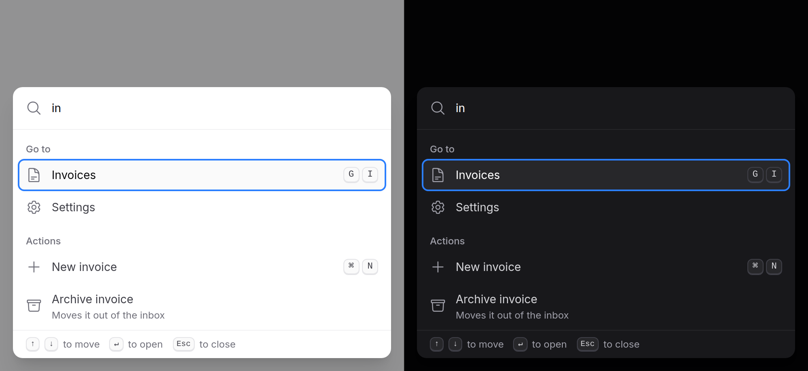

# Command palette

A searchable list of actions and destinations that opens over the page on a
shortcut: Cmd+K on a Mac, Ctrl+K elsewhere.



> **Needs Alpine** and the package's script. See [getting started](../getting-started.md#3-add-the-script).
> Without them it stays closed and does nothing, so give every destination in it a visible link too, such as a search page.

## Use it

```blade
<x-ds::command-palette name="main" @archive="archive($event.detail.value)">
    <x-ds::command-group label="Go to">
        <x-ds::command-item label="Invoices" :href="route('invoices.index')" icon="document-text" keywords="bills receipts" />
        <x-ds::command-item label="Customers" :href="route('customers.index')" icon="users" shortcut="G+C" />
        <x-ds::command-item label="Settings" :href="route('settings')" icon="cog" />
    </x-ds::command-group>

    <x-ds::command-group label="Actions">
        <x-ds::command-item label="New invoice" action="create-invoice" icon="plus" />
        <x-ds::command-item label="Archive this invoice" action="archive" :value="$invoice->id" icon="archive-box">
            Moves it out of the inbox
        </x-ds::command-item>
    </x-ds::command-group>
</x-ds::command-palette>
```

Put it once in the layout. Typing filters the options (by label, then by
`keywords`), the arrows move, Enter follows the link or dispatches the
action, and the palette closes.

## Open it from a button

The trigger is yours. A button that says what the shortcut is:

```blade
@php $mac = str_contains(request()->userAgent() ?? '', 'Mac OS'); @endphp

<x-ds::button variant="secondary" x-data x-on:click="$dispatch('open-command-palette', { name: 'main' })">
    <x-ds::icon name="magnifying-glass" size="4" />
    Search…
    <x-ds::kbd :keys="$mac ? ['⌘', 'K'] : ['Ctrl', 'K']" :separator="$mac ? '' : '+'" />
</x-ds::button>
```

`open-command-palette` and `close-command-palette` are window events; the
palette whose `name` matches `detail.name` answers. From Livewire:
`$this->dispatch('open-command-palette', name: 'main')`.

## Props

### `command-palette`

| Prop | Type | Default | What it does |
|---|---|---|---|
| `name` | string | — | Which palette an `open-command-palette` event opens. Left out, it answers events that name none |
| `shortcut` | string \| `false` | `mod+k` | `mod` is Cmd on a Mac and Ctrl elsewhere; also `ctrl`, `cmd`, `alt`, `shift`, and a bare key such as `/`. `false` for none |
| `placeholder` | string | `Type a command or search…` | |
| `label` | string | `Command palette` | The dialog's, the field's and the list's accessible name |
| `emptyText` | string | `No results` | Shown and announced when nothing matches |
| `loading` | bool | `false` | A spinner in the field, the list `aria-busy`, no empty row |
| `filter` | bool | `true` | Filter and rank in the browser. `false` when the server searches |

A `footer` slot draws a row under the list, for hints.

### `command-group`

| Prop | Type | Default | What it does |
|---|---|---|---|
| `label` | string | *required* | The heading, and the group's name |

### `command-item`

| Prop | Type | Default | What it does |
|---|---|---|---|
| `label` | string | *required* | What it says, and what typing matches first |
| `href` | string | — | A link. Stays a real link: Ctrl+press opens a tab, `wire:navigate` works |
| `action` | string | — | Or the event it dispatches, bubbling, with `{ value }` |
| `icon` | string | — | A Heroicons name |
| `shortcut` | string \| array | — | Drawn with [kbd](kbd.md): `"G+C"` or `['⌘', 'K']`. A label only: the palette does not bind it |
| `keywords` | string \| array | — | More words it is found by |
| `disabled` | bool | `false` | Shown, passed over by the arrows, does nothing |
| `value` | string | — | The action's `detail.value` |

The item's slot is a second, muted line. Anything else you put on an item
(`wire:click`, `@click`, `wire:key`) lands on the option, and Enter clicks it.

## Events

| Event | From | Detail |
|---|---|---|
| `search` | the palette, debounced 200 ms | `{ query }` |
| an item's `action` | the item, bubbling to the window | `{ value }` |

## Search on the server (Livewire)

The palette does no fetching. It dispatches `search`; the component searches
and re-renders the options, and the palette keeps up: the filter runs over
what arrives and the active option stays active if it is still there.

```php
class CommandSearch extends Component
{
    public string $query = '';

    public function render()
    {
        return view('livewire.command-search', [
            'customers' => strlen($this->query) < 2
                ? collect()
                : Customer::where('name', 'like', "%{$this->query}%")->limit(8)->get(),
        ]);
    }
}
```

```blade
<div>
    <x-ds::command-palette name="main" :filter="false" x-on:search="$wire.set('query', $event.detail.query)">
        <x-ds::command-group label="Customers">
            @foreach ($customers as $customer)
                <x-ds::command-item
                    wire:key="customer-{{ $customer->id }}"
                    :label="$customer->name"
                    :href="route('customers.show', $customer)"
                    wire:navigate
                />
            @endforeach
        </x-ds::command-group>

        <x-slot:footer><span wire:loading>Searching…</span></x-slot:footer>
    </x-ds::command-palette>
</div>
```

`:filter="false"`, because the server already chose what matches: filtering
again in the browser would hide customers it found by email. Give every item a
`wire:key`. Pass `:loading="true"` while a first, deferred load is pending.

## Keyboard

| Key | |
|---|---|
| Cmd+K / Ctrl+K | Open, and close again |
| ↓ ↑ | Next and previous option, wrapping |
| Home, End | First and last option |
| Enter | Follow or run the active option |
| Escape | Empty the query; on an empty field, close |

## Accessibility

A modal dialog on the same layer as [modal](modal.md): focus moves to the
field and stays there, Tab is trapped, the page behind does not scroll, and
focus goes back where it was on close. The field is an ARIA combobox whose
`aria-activedescendant` names the active option; "No results" is announced.
Disabled options are passed over.

## Don't

- **Don't make it the only route.** Nobody finds a shortcut they were never
  shown; keep the links on the page.
- **Don't nest controls in an option.** An option is one action.
- **Don't filter in the browser when the server searched** (`:filter="false"`).
- **Don't use a bare letter as the shortcut.** It would fire on every key
  typed outside a field.
