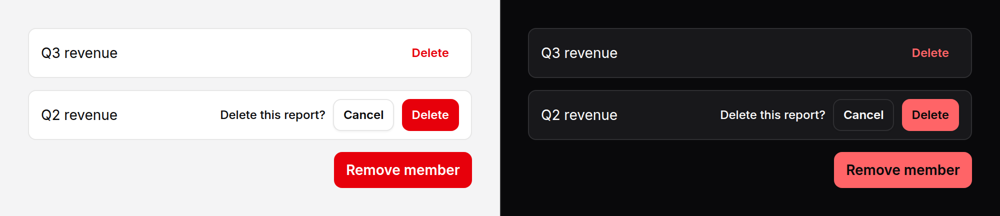

# Confirm button

A destructive button that asks before it acts, in its own place: press
Delete and it becomes "Are you sure? Cancel Delete". For a row action or a
settings line where a dialog would be more ceremony than the action deserves.



> **Needs Alpine** and the package's script. See [getting started](../getting-started.md#3-add-the-script).

## Use it

Inside a form, as a submit button:

```blade
<form method="POST" action="{{ route('reports.destroy', $report) }}">
    @csrf
    @method('DELETE')
    <x-ds::confirm-button question="Delete this report?" loading />
</form>
```

The first press only asks. The second, on the confirm control, submits the
form: the confirm control is `type="submit"`, so `@method('DELETE')` and the
CSRF field go with it like any other submit.

With Livewire, or your own Alpine, put the action on the tag. Everything you
write there except `class` lands on the **confirm control**, never on the
first press:

```blade
<x-ds::confirm-button type="button" wire:click="delete({{ $member->id }})" label="Remove" size="sm" variant="ghost" />

<x-ds::confirm-button type="button" @confirm="remove(item)" @cancel="note = 'Kept'" />
```

## Which confirmation do I use?

Four ways to guard a destructive action, from the lightest to the heaviest.
Pick by what is lost and how often people do it.

| | [Hold button](hold-button.md) | [Confirm button](confirm-button.md) | [Confirm popover](confirm-popover.md) | [Modal](modal.md) |
|---|---|---|---|---|
| **Use for** | A frequent action, cheap to undo, where a second press is too slow | A row action or a setting: delete a draft, remove a member | One thing whose consequence needs a sentence, or type-to-confirm | A decision that stops the page: deleting an account, a bulk action |
| **What it asks** | Nothing: holding is the confirmation | "Are you sure?" in the button's place | A title, the consequence, optionally the name to type | Anything: a title, a body, fields |
| **Room it takes** | The button's own | The button's, growing to fit the question | A card beside the trigger | The screen |
| **Leaves the page usable** | Yes | Yes | Yes, and closes when you look away | No: modal, focus trapped |
| **Keyboard and screen reader** | Hold Space or Enter, or press twice | Two presses, focus on Cancel between them | Focus on Cancel or the field | Focus trapped in the dialog |
| **Without the script** | Inert: a press does nothing | Inert: the confirm control is never shown | Never opens | Needs Alpine anyway |

Two rules hold for all of them. **Check on the server**: none of these is
security, they guard against a slip of the hand. And **prefer undo** where you
can build it: a toast with Undo beats any question, because people learn to
click through questions.

## Props

| Prop | Type | Default | What it does |
|---|---|---|---|
| `label` | string | `"Delete"` | The button's words at rest. |
| `confirmLabel` | string | `label` | The confirm control's words. |
| `cancelLabel` | string | `"Cancel"` | The safe choice's words. |
| `question` | string | `"Are you sure?"` | Asked in the button's place, and announced. |
| `variant` | string | `danger` | The button at rest: `primary`, `secondary`, `ghost`, `danger`. `secondary` and `ghost` are drawn in the danger tone. The confirm control is always `danger`. |
| `size` | string | `md` | `sm`, `md`, `lg`, as [button](button.md); every part takes it. |
| `timeout` | number | `5` | Seconds before an unanswered question puts itself away. The count stops while the pointer is over it or focus is in it, and starts again from the top once both have gone. `0` never times out. |
| `loading` | bool | `false` | After the confirm press, show a spinner on it and refuse every later press, until the page changes. For a form that submits, or a row the action removes. |
| `type` | string | `submit` | The confirm control's type. `button` for one that only dispatches `confirm` or carries a `wire:click`, **inside a form it must not submit**. |

`class` goes on the wrapper, to place the whole thing in your row. Everything
else (`id`, `name`, `value`, `form`, `wire:click`, `@click`, `@confirm`,
`@cancel`, `data-*`) goes on the confirm control.

## Events

Both from the confirm control, bubbling.

| Event | When |
|---|---|
| `confirm` | The confirm control was pressed. Dispatched before the click reaches its own listeners and the form. |
| `cancel` | The question went away unanswered: Cancel, Escape, or the timeout. |

## What it does

- **Asks in place.** The button is swapped for the question, Cancel and the
  confirm control. Focus moves to **Cancel**, the safe choice, and the
  question is said through a polite live region.
- **Puts itself back** on Cancel, on Escape, or after `timeout` seconds left
  alone. Cancel and Escape give focus back to the button; the timeout never
  moves focus, since nobody was there.
- **Acts on the confirm control.** With `loading` it then shows a spinner and
  ignores further presses, Escape and the timeout; without, it is back at rest
  once the click is done. A page restored by the browser's Back button comes
  back at rest, not mid-spinner.

### The width changes, on purpose

The question is wider than the button. Rather than reserve that width all the
time, the component grows while it asks: **toward the inline end**, never
taller, never wrapping. So place it where that is expected:

- **At the end of an end-aligned row** (a table's action cell, a panel row's
  trailing actions, a dialog footer), it opens into the free space: its end
  edge stays put and nothing after it moves. Anything before it in the row
  slides along by the difference, as it would for any wider button.
- **In a start-aligned row with neighbours after it**, those neighbours move
  while it asks. If they must not, give the component its own end-aligned
  box, or use a [confirm popover](confirm-popover.md), which takes no room in
  the row at all.

## Accessibility

- Every part is a real `button`. The first press is `type="button"`, so it
  can never submit.
- Focus goes to Cancel when it asks, back to the button when it is cancelled,
  and stays put when it times out.
- Escape cancels, and is stopped only when it did cancel: at rest it still
  reaches a dialog around the button.
- The question is announced through a polite live region outside the buttons,
  so it is not folded into a button's name.
- While busy, the confirm control carries `aria-busy` and `aria-disabled`,
  and Cancel is disabled.

## Without the script

It **fails safe**. The confirm control is rendered hidden and only the script
shows it, so a page without the script, or without Alpine, has no way to reach
the action at all: the button is visible and a press does nothing. Your
`wire:click` or `@click` is on the hidden control, never on the button.

## Don't

- **Don't use it for something that cannot be undone and matters.** Deleting
  an account is a [modal](modal.md), or a [confirm popover](confirm-popover.md)
  with type-to-confirm.
- **Don't leave `type` as submit inside a form it must not send**, a Livewire
  form with `wire:submit` included. Pass `type="button"`.
- **Don't put it in a start-aligned row of things that must not move.** See
  above.
- **Don't trust it on its own.** Check permission and intent on the server.

More in [specs/confirm-button.md](../../specs/confirm-button.md).
