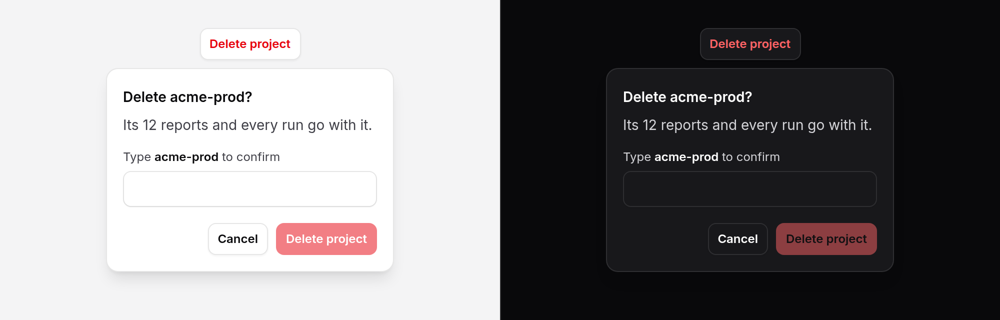

# Confirm popover

A small confirmation card anchored to the button that asked for it: a
question, what happens if you go ahead, and Cancel or Confirm. With
`confirmText`, the reader types a name before Confirm will press. Built on
[popover](popover.md).



> **Needs Alpine** and the package's script. See [getting started](../getting-started.md#3-add-the-script).

## Use it

Inside the form that does the work:

```blade
<form method="POST" action="{{ route('projects.destroy', $project) }}">
    @csrf
    @method('DELETE')
    <x-ds::confirm-popover
        title="Delete {{ $project->name }}?"
        description="Its {{ $project->reports_count }} reports and every run go with it. This cannot be undone."
        confirmLabel="Delete project"
        :confirmText="$project->slug"
        loading
    >
        <x-slot:trigger>
            <x-ds::button variant="secondary" tone="danger">Delete project</x-ds::button>
        </x-slot:trigger>
    </x-ds::confirm-popover>
</form>
```

The trigger is your own button. Confirm is `type="submit"`, so the form's
`@method('DELETE')` and CSRF field go with it.

With Livewire or your own Alpine, put the action on the tag; everything but
`class` lands on **Confirm**:

```blade
<x-ds::confirm-popover title="Revoke this key?" tone="neutral" confirmLabel="Revoke" type="button"
    wire:click="revoke({{ $key->id }})">
    <x-slot:trigger><x-ds::button size="sm" variant="ghost">Revoke</x-ds::button></x-slot:trigger>
</x-ds::confirm-popover>
```

Not sure this is the right guard? See
[which confirmation do I use?](confirm-button.md#which-confirmation-do-i-use)

### Type to confirm

`confirmText` adds a field above the buttons and keeps Confirm disabled until
the field holds exactly that text, letter case included. `strict="false"`
relaxes it to ignore letter case and the spaces around it. **Check it on the
server as well**: the field posts nothing (it has no name), and a disabled
button is no security.

Enter in the field confirms when the text matches and does nothing when it
does not. It never submits the surrounding form some other way.

### Closing it yourself

Pass `open`, as on [popover](popover.md), to own the state: with `loading`,
the card stays open with a spinner after the press, and closing it is how you
say the action is done.

```blade
<div x-data="{ rotateOpen: false }">
    <x-ds::confirm-popover open="rotateOpen" title="Rotate the key?" confirmLabel="Rotate" type="button" loading
        @confirm="await rotate(); rotateOpen = false">
        <x-slot:trigger><x-ds::button size="sm">Rotate</x-ds::button></x-slot:trigger>
    </x-ds::confirm-popover>
</div>
```

## Props

| Prop | Type | Default | What it does |
|---|---|---|---|
| `title` | string | `"Are you sure?"` | The question, which names the dialog. |
| `description` | string | — | The consequence, read with the name when it opens. |
| `confirmLabel` | string | `"Delete"` | Confirm's words. |
| `cancelLabel` | string | `"Cancel"` | The safe choice's words. |
| `tone` | string | `danger` | `danger`: Confirm is the danger button. `neutral`: the primary one. |
| `confirmText` | string | — | Type to confirm: the text the reader must type before Confirm enables. |
| `confirmPrompt` | string | `"Type :text to confirm"` | The field's label; `:text` is replaced by `confirmText`, in bold. |
| `strict` | bool | `true` | `false`: the typed text may differ in letter case and in spaces around it. |
| `loading` | bool | `false` | After the press, keep the card open with a spinner on Confirm and refuse every later press, until it closes. |
| `type` | string | `submit` | Confirm's type. `button` inside a form it must not submit. |
| `placement` | string | `bottom-start` | As [popover](popover.md): the preferred side, flipped when it lacks room. |
| `width` | string | `md` | As [popover](popover.md): `sm`, `md`, `lg`. |
| `open` | string | — | As [popover](popover.md): an assignable Alpine reference holding the open state. |

Slot: `trigger`. `class` goes on the wrapper; everything else (`id`, `name`,
`value`, `wire:click`, `@confirm`, `@cancel`) goes on Confirm.

## Events

Both from Confirm, bubbling.

| Event | When |
|---|---|
| `confirm` | Confirm was pressed. Before the click reaches its own listeners and the form. |
| `cancel` | It closed without a confirmation: Cancel, Escape, a press outside, or focus leaving it. |

## What it does

- **Opens** from the trigger, beside it and on screen, like any popover.
- **Focus** lands on **Cancel**, the safe choice, or on the field when there
  is one to type in.
- **Cancels** on Cancel, Escape, a press outside, and Tab away. Cancel and
  Escape give focus back to the trigger.
- **Confirms** on Confirm, then closes and gives focus back, unless
  `loading` keeps it open.
- **Starts afresh** each time it opens: the field empty, Confirm disabled.

## Accessibility

- `role="alertdialog"`, named by the title and described by the consequence,
  so a screen reader reads both when it opens. Not modal: nothing is trapped,
  but leaving it cancels it, so the page behind is never used while it asks.
  The [spec](../../specs/confirm-popover.md) has the reasoning.
- The trigger carries `aria-expanded` and `aria-controls`, as on a popover.
- The type-to-confirm field has a real label, the prompt, and no
  autocomplete, autocorrect or spellcheck.
- While busy, Confirm carries `aria-busy` and `aria-disabled`, and Cancel is
  disabled.

## Without the script

It **fails safe**: the card never opens, so Confirm cannot be reached.

## Don't

- **Don't use it when the page must wait for the answer.** That is a
  [modal](modal.md).
- **Don't make type-to-confirm the habit.** Keep it for the irreversible and
  the large. Asked every time, people stop reading what they type.
- **Don't rely on `confirmText` alone.** Check it on the server.
- **Don't leave `type` as submit inside a form it must not send.**

More in [specs/confirm-popover.md](../../specs/confirm-popover.md).
