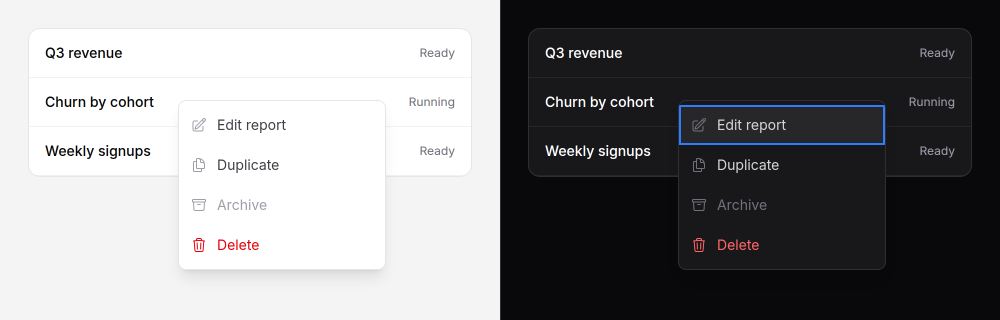

# Context menu

A menu of actions on a thing, opened where the reader is pointing at it: a
right-click on a row or a card, a long press on a touch screen, or Shift+F10
(or the Menu key) on the item that has focus. It uses the same panel, items
and keys as the [dropdown](dropdown.md).



> **Needs Alpine** and the package's script. See [getting started](../getting-started.md#3-add-the-script).
> Without the script the region keeps the browser's own menu.

## Use it

```blade
<x-ds::context-menu label="Report actions" class="rounded-panel border border-border p-4">
    <h3 class="text-section font-semibold text-fg">Q3 revenue</h3>
    <p class="text-meta text-fg-muted">Ready, £12,400</p>

    <x-slot:menu>
        <x-ds::dropdown-item icon="pencil-square" href="{{ route('reports.edit', $report) }}">Edit</x-ds::dropdown-item>
        <x-ds::dropdown-item icon="document-duplicate" as="button" wire:click="duplicate({{ $report->id }})">Duplicate</x-ds::dropdown-item>
        <x-ds::dropdown-item icon="trash" tone="danger" as="button" wire:click="delete({{ $report->id }})">Delete</x-ds::dropdown-item>
    </x-slot:menu>
</x-ds::context-menu>
```

The default slot is the region: whatever you put there, right-clicked anywhere,
opens the menu at the pointer. The `menu` slot holds the items, which are
[dropdown items](dropdown.md#dropdown-item-props).

### One menu for many rows

Put the region round the list and read which row was pressed from `dsTarget`,
the element the reader right-clicked:

```blade
<x-ds::context-menu label="Row actions">
    <ul>
        @foreach ($reports as $report)
            <li data-report="{{ $report->id }}" tabindex="0">{{ $report->name }}</li>
        @endforeach
    </ul>

    <x-slot:menu>
        <x-ds::dropdown-item as="button"
            @click="$wire.archive(dsTarget.closest('[data-report]').dataset.report)">Archive</x-ds::dropdown-item>
    </x-slot:menu>
</x-ds::context-menu>
```

`tabindex="0"` on each row is what lets a keyboard reader reach it and open the
menu with Shift+F10.

## Props

| Prop | Type | Default | What it does |
|---|---|---|---|
| `label` | string | — | The menu's name for a screen reader, e.g. "Report actions". |
| `native` | bool | `true` | Keep the browser's own menu over fields, editable areas and links inside the region. `false` opens this menu there too. |

Slots: the default slot (the region) and `menu` (the items). Any attribute
goes on the region.

## What it does

- **Opens** on a right-click, at the pointer; on Shift+F10 or the Menu key,
  just below the focused element; and on a touch held still for half a second,
  at the finger. Moving more than 10px during the hold cancels it, so a scroll
  never opens it, and the tap that ends a hold does not also press what is
  under the finger.
- **Keeps the browser's menu** over a field or a link inside the region, so
  copy, paste and "open in new tab" still work, unless `native` is `false`.
- **Stays on screen.** Near the bottom of the window it opens upward; near the
  right edge it opens back to the left of the pointer. It moves with the page
  when the page scrolls.
- **Keys** are the dropdown's: arrows move and wrap, skipping disabled items,
  Home and End jump, Enter chooses.
- **Closes** on Escape, Tab, a choice, or a press outside it, and gives focus
  back to whatever had it when it opened.
- **Fades and scales in** from the corner at the pointer, over 150 ms; with
  reduced motion it simply appears.

## Accessibility

- The panel is `role="menu"` and its items `role="menuitem"`. Name it with
  `label`.
- **A context menu cannot be found by looking.** Every action in it must also
  be somewhere visible: a [dropdown](dropdown.md) on the row, a
  [toolbar](toolbar.md), a button.
- The keyboard reaches it through something focusable in the region. A region
  of plain text opens only from the pointer.

## Limits

- **Inside a transformed ancestor** (a `transform`, `filter`, `contain` or
  `will-change` for one) the menu is placed correctly but can still be clipped
  by that ancestor's own `overflow: hidden`.
- **iOS** shows its own callout on a held link whatever `native` says.

## Don't

- **Don't put an action only here.** Nobody knows to right-click.
- **Don't wrap the whole page.** The region is the thing the actions act on.
- **Don't turn `native` off over a form.** It takes away paste.

More in [specs/context-menu.md](../../specs/context-menu.md).
