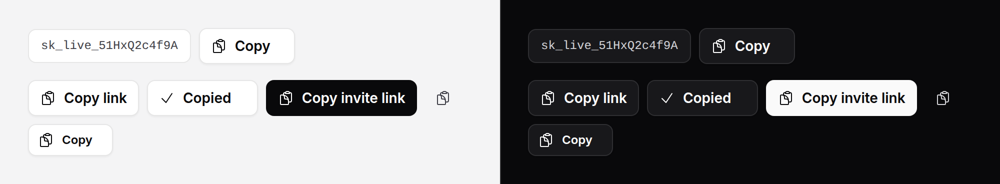

# Copy button

Copies a value to the clipboard and says so in place, for a moment: an API
key, a webhook URL, an invite link.



> **Needs Alpine** and the package's script. See [getting started](../getting-started.md#3-add-the-script).

## Use it

```blade
<x-ds::copy-button :value="$token->plainTextToken" />
```

Or copy from something already on the page, by id or CSS selector:

```blade
<code id="webhook-url">{{ $webhook->url }}</code>
<x-ds::copy-button target="webhook-url" label="Copy URL" />
```

`target` is read at the moment of the press. A field gives its value as it is
then, so a URL someone has just edited copies what they typed. Any other
element gives its text, with the whitespace around it trimmed, so the
indentation of your Blade does not end up in someone's clipboard.

## Props

| Prop | Type | Default | What it does |
|---|---|---|---|
| `value` | string | — | The text to copy. |
| `target` | string | — | An element id or a CSS selector to copy from instead. Give `value` or `target`, never both: either alone, or neither, throws when the view renders. |
| `label` | string | `"Copy"` | The button's words, and its accessible name when `iconOnly`. |
| `copiedLabel` | string | `"Copied"` | Shown in the label's place, and announced, for 1.5 s after a copy. |
| `iconOnly` | bool | `false` | The clipboard icon alone, square. |
| `variant` | string | `secondary` | `primary`, `secondary`, `ghost`, `danger`, as [button](button.md). |
| `size` | string | `md` | `sm`, `md`, `lg`, as [button](button.md). |

Anything else you pass (`id`, `class`, `@copy-failed`, `data-*`) goes on the
button.

## What it does

- **On a copy** the clipboard icon becomes a check and the label becomes
  `copiedLabel`, for 1.5 s. A second press restarts the 1.5 s.
- **The width does not move.** Both labels are laid out in the same place
  from the first paint, so the button is as wide as the longer one and the row
  around it never shifts. They crossfade, with motion allowed. For a
  confirmation of anything other than a copy, see [swap button](swap-button.md),
  which works the same way.
- **A screen reader hears it**: `copiedLabel` is said through a polite live
  region beside the button.
- **On a plain-`http` page**, where browsers withhold the clipboard API, it
  falls back to the older copy command.

## When the copy fails

A browser can refuse the clipboard (a permissions policy, an embedded frame),
and a `target` can be missing from the page. Then nothing on the button
changes, because "Copied" would be a lie, and the button dispatches a
`copy-failed` event, which bubbles, for you to turn into a message:

```blade
{{-- `notify` is whatever your layout's toast list listens for --}}
<x-ds::copy-button
    :value="$key"
    @copy-failed="$dispatch('notify', { tone: 'danger', title: 'Could not copy. Select the key and copy it by hand.' })"
/>
```

Or once for the whole page, with `x-on:copy-failed.window` beside your
[toast region](toast.md).

## Accessibility

- A real `button`, `type="button"`, so it never submits the form around it.
- Its name is its label: "Copy", then "Copied" while the label shows that.
  Icon-only, the name is `label` throughout, and the live region carries the
  news.
- The announcement lives outside the button. Text inside it would join the
  button's name, and a change to the name of a focused button is not reliably
  read out.

## Don't

- **Don't put a secret in `value` that the page should not hold.** It is in
  the HTML. Copy from a field the reader asked to reveal, or show it once.
- **Don't make it the only way to get the text.** Keep the value on screen and
  selectable; a refused clipboard leaves nothing else.
- **Don't write your own `x-on:click` on it.** The copy is wired there; use
  `@click` beside it if you need both.

More in [specs/copy-button.md](../../specs/copy-button.md).
