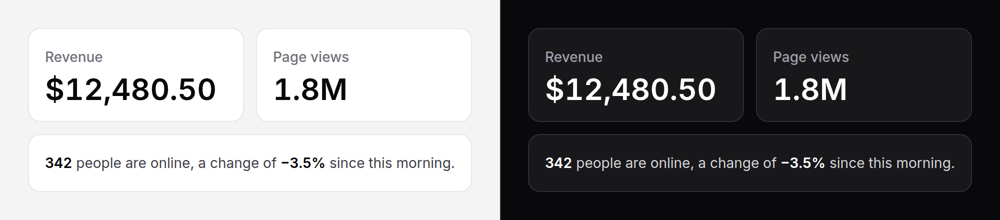

# Counter

A number that rolls its digits to a new value, like a meter, when it changes.
At rest it is plain formatted text; the roll is an enhancement on top.



> **Needs Alpine** and the package's script for the roll, and for a value
> bound to Alpine state. Without them a counter is the formatted number, and a
> server re-render still changes it. See
> [getting started](../getting-started.md#3-add-the-script).

## Use it

```blade
<x-ds::counter :value="$orders" />
<x-ds::counter :value="12480.5" :format="['prefix' => '$', 'decimals' => 2]" size="xl" />
<x-ds::counter :value="1840000" :format="['compact' => true]" />   {{-- 1.8M --}}
```

### From Alpine state

Bind `value` with Alpine's own syntax (`::value` in Blade, which writes
`:value`, or `x-bind:value`). The counter follows the expression and rolls each
time it changes:

```blade
<div x-data="{ count: 40 }">
    <x-ds::counter ::value="count" />
    <x-ds::button x-on:click="count += 7">Add seven</x-ds::button>
</div>
```

The server still renders `value` (the `0` default, or one you pass as well) so
the page reads right before Alpine starts.

### From Livewire

Nothing to wire: pass the property, and a re-render that changes it rolls the
digits.

```blade
<x-ds::counter :value="$this->unread" />
```

### On entering the view

`animateIn` rolls up from zero the first time half the counter is in view, once.

```blade
<x-ds::counter :value="$customers" :animateIn="true" size="xl" />
```

## Props

| Prop | Type | Default | What it does |
|---|---|---|---|
| `value` | number | `0` | The number. Rendered, formatted, from PHP. Bind it with `::value` to follow Alpine state. |
| `format` | array | `[]` | How it reads; see below. |
| `size` | `sm` `md` `lg` `xl` | the surrounding text's | The meta, body, title or display size. |
| `duration` | `hint` `popover` `dialog` `slide` | `slide` | The motion token the roll is timed by. |
| `animateIn` | bool | `false` | Roll up from zero the first time it scrolls into view. |

### Format

| Key | Default | What it does |
|---|---|---|
| `decimals` | up to 2 (1 when compact), trailing zeros dropped | A number gives exactly that many places: `2` reads `12,480.50`. |
| `grouping` | `true` | Thousands separators. |
| `prefix` | — | Before the number: `$`. A minus goes before it: `−$1,200`. |
| `suffix` | — | After the number: `%`, ` ms`. |
| `compact` | `false` | Thousands as K, millions as M, then B and T: `1.8M`. |
| `locale` | the app's | Which separators: `de` reads `1.234,5`. |

The same keys format [sparkline](sparkline.md) and [gauge](gauge.md) values.
Negative numbers use a real minus sign (U+2212), which is as wide as a digit.

## Accessibility

- A screen reader reads one plain number: a visually hidden span carries it,
  and the rolling digits are `aria-hidden`. Mid-roll it already holds the new
  value.
- It is not a live region. A number that changes on its own is not announced;
  if the change matters, say so in a [toast](toast.md) or a live region of your
  own.
- Not focusable, no keyboard interaction.
- Under `prefers-reduced-motion: reduce` the new number simply replaces the
  old one.

## Don't

- **Don't use it for a figure that never changes.** It is plain text then;
  write the number.
- **Don't roll something people need to read exactly while it moves**, such as
  a price in a checkout. The roll is for figures that are glanced at.
- **Don't bind `value` with `x-text`.** Bind it with `::value`, so the counter
  formats it and keeps the hidden text right.
- **Don't nest it in another live-updating number.** One element owns the text.

More in [specs/counter.md](../../specs/counter.md).
