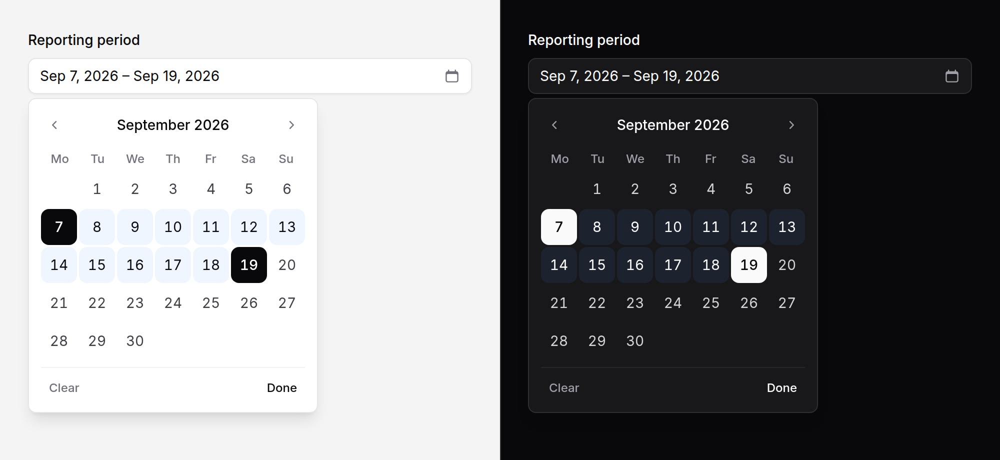

# Date picker

A calendar popover for one date or a range.



> **Needs Alpine** and the package's script. See [getting started](../getting-started.md#3-add-the-script).
> Without them it is the browser's own date field (two for a range), posting the same names.
> New in 2.0: the calendar is the [calendar](calendar.md)'s grid; see [upgrading from 1.x](../getting-started.md#from-1x-to-20).

## The native field may be what you want

`<x-ds::input type="date" />` gives the platform's own date field. **On anything
phone-first that is the better control** — the OS picker is a wheel the reader
already knows, it's localised, and it costs nothing.

This component exists because the native popup can't be styled.

## Use it

```blade
<x-ds::date-picker name="due" label="Due date" :value="old('due', $task->due_at)" />
{{-- posts due=2026-09-30 --}}
```

A range posts **two fields**:

```blade
<x-ds::date-picker name="period" label="Reporting period" :range="true"
                   :value="[$from, $to]" :min="now()->subYear()" :max="now()" />
{{-- posts period_start=2026-07-01 and period_end=2026-09-30 --}}
```

Two dates are two values — squeezing them into one string means every project
writing the same parser and getting the separator wrong.

## Props

| Prop | Type | Default | What it does |
|---|---|---|---|
| `name` | string | *required* | Field name. With `range`, posts `{name}_start` / `{name}_end`. |
| `value` | date\|array | — | `Y-m-d`, a `DateTimeInterface`, or an array of two for a range. |
| `range` | bool | `false` | Pick a start and an end. |
| `min` / `max` | date | — | Earliest / latest selectable day. |
| `label` | string | — | |
| `placeholder` | string | `Choose a date` | |
| `weekStartsOn` | `0` \| `1` | `1` | Sunday or Monday. |
| `help` | string | — | |
| `error` | string | — | |
| `disabled` | bool | `false` | |
| `months` | `1` \| `2` | `1` | Two months side by side in the popover; one on a phone. |
| `presets` | bool\|array | `false` | With `range`: `true` for Today, Yesterday, Last 7 days, Last 30 days, This month, Last month and This year, or `label => [from, to]` worked out by you. |
| `minDays` / `maxDays` | int | — | With `range`: the fewest / most days a range may span, counting both ends. |
| `confirm` | bool | `false` | Apply and Cancel: picks are a draft until applied, and nothing closes the popover by itself. |
| `today` | date | `now()` | The day marked as today, and what the presets count from, in the app's timezone. Never the browser's clock. |

`wire:model` and `x-model` go on the component and bind `Y-m-d` (`''` when
empty), or `[from, to]` with `range`.

`value` accepts a Carbon instance directly, so `$task->due_at` works with no
formatting on your side.

## Reading it back

The posted value is `Y-m-d`, which is what a date column and `Carbon::parse` both
want:

```php
$request->validate([
    'period_start' => ['required', 'date'],
    'period_end'   => ['required', 'date', 'after_or_equal:period_start'],
]);

$from = Carbon::parse($request->period_start);
```

## Presets, two months and a confirm step

```blade
<x-ds::date-picker name="period" label="Reporting period" :range="true"
                   :months="2" :presets="true" :value="[$from, $to]" />

<x-ds::date-picker name="quarter" label="Quarter" :range="true" :presets="[
    'This quarter' => [now()->startOfQuarter(), now()],
    'Last quarter' => [now()->subQuarter()->startOfQuarter(), now()->subQuarter()->endOfQuarter()],
]" />

<x-ds::date-picker name="stay" label="Stay" :range="true" :minDays="2" :maxDays="14" :confirm="true" />
```

The presets sit beside the months (above them on a phone), and the one equal
to the chosen range is marked. Choosing one fills the range and closes the
popover, unless `confirm` is set. The built-in set is worked out in PHP for
the first paint and again by the script from the same `today`, so the two
agree; a `label => [from, to]` list is yours, worked out however you like.

With `minDays` or `maxDays`, once a start is chosen the ends that would break
them are disabled.

## Keyboard

Arrows move a day or a week, **PageUp/PageDown a month** and with Shift a
year, Home/End the start and end of the week, as the ARIA date grid has them.
Moving past the edge of the month follows the grid: it changes month and keeps
focus on the day it landed on. The grid is one Tab stop.

A calendar that only answers to Tab makes a keyboard reader press it thirty times
to reach the end of the month.

## Range behaviour

First click sets the start, second sets the end. **A second click *before* the
start swaps the ends** rather than producing a backwards range you then have
to undo: the earlier day becomes the start and the first pick the end.

While a range is half-made, the day under the pointer or the focus previews it.

## Locale

Day and month names come from Carbon, so they follow `config('app.locale')`. The
summary in the trigger is formatted in the browser, so it follows the *reader's*
locale.

`weekStartsOn` is a prop because which day a week starts on is regional, and no
default is right everywhere.

## Don't

- **Don't use it on a phone-first screen.** See the top of this page.
- **Don't use it for a date of birth.** A hundred-year calendar is thirteen hundred
  presses of "previous month" — that wants three selects or a text field.
- **Don't add a time to it.** A date and a time are two questions.
- **Don't let the browser decide what today is.** Pass `today` for a user's
  own timezone; the default is the server's.

More in [specs/date-picker.md](../../specs/date-picker.md), including why every
value here is a string rather than a `Date`.
