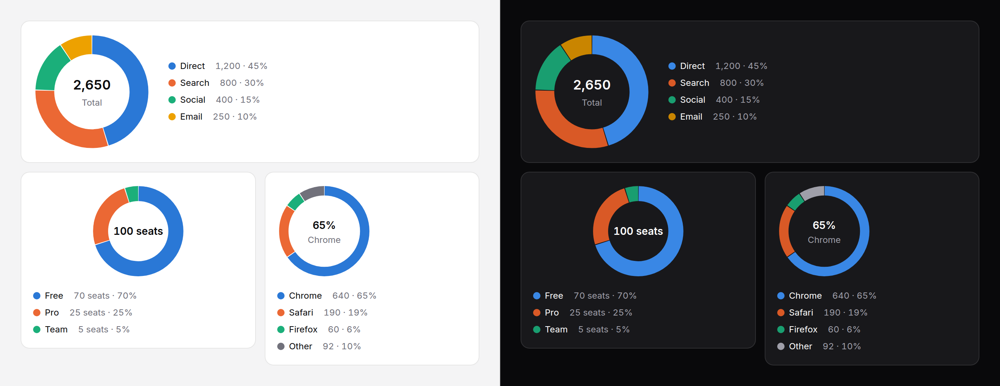

# Donut chart

The parts of one whole, as a ring, with the total in the middle and each
part's value and share in the legend. For a few parts where the share of
the whole is the point.



> **Needs Alpine** and the package's script for the readout and keyboard
> access to each segment. Without them the chart is a correct static image
> with a generated text alternative. See
> [getting started](../getting-started.md#3-add-the-script).

## When not to use it

A donut answers one question: **roughly what share of the whole is each
part?** For almost anything else, another chart is better.

- **Comparing parts with each other.** Angles are read far less accurately
  than lengths; two parts a few percent apart look the same. Use a
  [bar chart](bar-chart.md), sorted.
- **A change over time.** Two donuts side by side cannot be compared. Use a
  [line chart](line-chart.md), or a stacked bar chart.
- **More than five or six parts.** The small ones become slivers. `maxSegments`
  folds the tail into "Other", but if the tail is what matters, use bars.
- **Parts that are not a whole**: survey answers where several could be
  chosen, values that can be zero or negative. It throws on those.
- **One number against a target.** That is a [gauge](gauge.md) or a
  [progress bar](progress.md).

## Use it

```blade
<x-ds::donut-chart label="Traffic by source" :data="['Direct' => 1200, 'Search' => 800, 'Social' => 400, 'Email' => 250]" />

<x-ds::donut-chart label="Seats by plan" size="sm" legend="bottom" :data="$plans" :format="['suffix' => ' seats']" />

{{-- Your own content in the middle --}}
<x-ds::donut-chart label="Browsers" :data="$browsers" :maxSegments="4">
    <x-slot:centre>
        <span class="text-title font-semibold text-fg">65%</span>
        <span class="text-meta text-fg-muted">Chrome</span>
    </x-slot:centre>
</x-ds::donut-chart>
```

## Props

| Prop | Type | Default | What it does |
|---|---|---|---|
| `data` | array | `[]` | `['Direct' => 1200, …]`. Every value must be a number above zero; anything else throws, naming the part. |
| `label` | string | — | What the whole is. Starts the summary, captions the table. |
| `size` | `sm` `md` `lg` | `md` | 128, 160 or 208px across. |
| `thickness` | `sm` `md` `lg` | `md` | The ring's width. |
| `legend` | `right` `bottom` `none` | `right` | The legend, with each part's value and share. `right` wraps underneath when there is no room. |
| `maxSegments` | int, 2 to 8 | `6` | The most segments drawn. Past it, the smallest fold into one neutral "Other". |
| `otherLabel` | string | `Other` | What the folded segment is called. |
| `showTotal` | bool | `true` | The total in the middle. The `centre` slot replaces it. |
| `totalLabel` | string | `Total` | The word under the total (not shown at `sm`). |
| `format` | array | `[]` | How numbers read; [counter's keys](counter.md#format). |
| `summary` | string | generated | The text alternative, in place of the generated one. |
| `table` | bool | `false` | Also give part, value and share as a visually hidden table. |
| `interactive` | bool | `true` | With the script: the readout and keyboard access. |
| `empty` | string | `No data to show` | The empty state's title. |

| Slot | What it does |
|---|---|
| `centre` | Anything for the hole, in place of the total. It is inset to the ring's inner edge and wraps there. Hidden from nothing: say in it only what the summary or the legend also says, or it is read twice. |

The percentages always add up to exactly 100: they are rounded by largest
remainder, not each on its own.

## Accessibility

- Without the script the chart is `role="img"`. With a legend, named by the
  gist: "Traffic by source: 4 parts, total 2,650; the largest is Direct at
  45%." The legend lists every part as text. With `legend="none"`, the name
  lists every part.
- With it, one Tab stop: any arrow moves segment to segment, Home and End to
  the ends, Escape puts the readout away. Each segment is named "Search: 800
  (30%)". The focus ring goes round the whole donut and the focused segment
  widens.
- The legend is not a toggle here: hiding a part would change the whole.
- `legend="none"` leaves colour as the only link between a segment and its
  name. Use it only when the parts are named beside the chart already.

## Don't

- **Don't pass zeros.** Filter them out; an empty part has no arc.
- **Don't put a percentage in the centre that the legend contradicts.** Take
  it from the same data.
- **Don't draw several donuts to compare them.** Use one bar chart.

More in [specs/donut-chart.md](../../specs/donut-chart.md).
