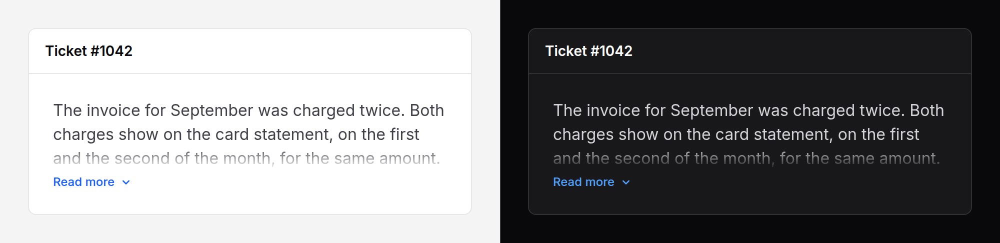

# Expandable text

Text held to a few lines with a fade, and a **Read more** that lets the rest
out. The button shows only when the text is longer than that.



> **Needs Alpine** and the package's script. See [getting started](../getting-started.md#3-add-the-script).
> Without them the text is shown in full and no button appears.

## Use it

```blade
<x-ds::expandable-text>
    {{ $ticket->body }}
</x-ds::expandable-text>

<x-ds::expandable-text :lines="5" moreLabel="Show the whole review" lessLabel="Show less">
    {{ $review->text }}
</x-ds::expandable-text>
```

It measures the text, and measures again when its box changes width or its
text changes, so a card that widens loses its button when the text fits.

## Props

| Prop | Type | Default | What it does |
|---|---|---|---|
| `lines` | int | `3` | How many lines show while it is held. |
| `moreLabel` | string | `Read more` | The button's words while held. |
| `lessLabel` | string | `Show less` | Its words while open. |

## Accessibility

- A real button with `aria-expanded` and `aria-controls`. Pressing it moves no
  focus.
- A screen reader reads all of the text either way: the clamp is visual.
- The height animates only when the reader has not asked for reduced motion.

## Don't

- **Don't clamp what the reader must read to act**: terms, warnings, errors.
- **Don't put links in the part that hides.** They stay in the Tab order.
- **Don't clamp to one line.** Truncate, or link to the full text.

More in [specs/expandable-text.md](../../specs/expandable-text.md).
