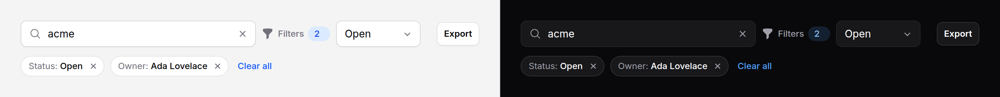

# Filter bar

The row above a list that narrows it: a search, a few controls, the filters
applied as chips, and a way to clear them. Covers `filter-bar` and
`filter-chip`.



> Plain Blade. `collapsible` needs Alpine and the package's script
> (see [getting started](../getting-started.md#3-add-the-script)), and so does
> the search field's `clearable` ✕.

## Use it with a GET form

The query string is the state. Every control posts its own name; each chip
links to the URL without its filter.

```blade
<form method="GET">
    <x-ds::filter-bar :active="count(array_filter($filters))" :resetHref="url()->current()">
        <x-slot:search>
            <x-ds::input type="search" name="q" aria-label="Search invoices"
                icon="magnifying-glass" :clearable="true" :value="request('q')" />
        </x-slot:search>

        <x-ds::input as="select" name="status" aria-label="Status">
            <option value="">Any status</option>
            <option value="open" @selected(request('status') === 'open')>Open</option>
            <option value="paid" @selected(request('status') === 'paid')>Paid</option>
        </x-ds::input>
        <x-ds::button type="submit" variant="secondary">Apply</x-ds::button>

        <x-slot:applied>
            @if (request('status'))
                <x-ds::filter-chip label="Status" :value="ucfirst(request('status'))"
                    :removeHref="request()->fullUrlWithoutQuery('status')" />
            @endif
        </x-slot:applied>

        <x-slot:actions>
            <x-ds::button href="{{ route('invoices.export', request()->query()) }}" variant="ghost">Export</x-ds::button>
        </x-slot:actions>
    </x-ds::filter-bar>
</form>
```

## Use it with Livewire

The properties are the state. Chips dispatch `remove`, Clear all dispatches
`reset`.

```blade
{{-- public string $q = ''; public string $status = ''; --}}
<x-ds::filter-bar :active="(int) filled($status)" :reset="true" x-on:reset="$wire.clearFilters()">
    <x-slot:search>
        <x-ds::input type="search" aria-label="Search invoices" icon="magnifying-glass"
            :clearable="true" wire:model.live.debounce.300ms="q" />
    </x-slot:search>

    <x-ds::input as="select" aria-label="Status" wire:model.live="status">
        <option value="">Any status</option>
        <option value="open">Open</option>
        <option value="paid">Paid</option>
    </x-ds::input>

    <x-slot:applied>
        @if ($status)
            <x-ds::filter-chip label="Status" :value="ucfirst($status)" x-on:remove="$wire.set('status', '')" />
        @endif
    </x-slot:applied>
</x-ds::filter-bar>
```

```php
public function clearFilters(): void
{
    $this->reset('q', 'status');
}
```

## Fold the controls on a phone

`collapsible` puts the controls behind a **Filters (n)** button below the `md`
breakpoint, opening them in a popover. At `md` and up they are a plain row. The
search stays in the row either way.

```blade
<x-ds::filter-bar :collapsible="true" :active="2">…</x-ds::filter-bar>
```

## `filter-bar` props

| Prop | Type | Default | What it does |
|---|---|---|---|
| `label` | string | `Filters` | The search landmark's name, and the summary's and the button's words. |
| `active` | int | — | How many filters are applied: the count shown, and whether Clear all is drawn. |
| `resetHref` | string | — | Clear all as a link (the URL with no filters). |
| `reset` | bool | `false` | Clear all as a button that dispatches `reset`. |
| `resetLabel` | string | `Clear all` | Its words. |
| `appliedLabel` | string | `Applied filters` | The chips' group name. |
| `collapsible` | bool | `false` | Fold the controls behind a button below `md`. |

Slots: the default slot (the controls), `search`, `applied` (the chips) and
`actions` (at the end of the row).

## `filter-chip` props

| Prop | Type | Default | What it does |
|---|---|---|---|
| `label` | string | — | The field ("Status"). |
| `value` | string | *required* | The setting ("Open"). |
| `removeHref` | string | — | Remove as a link. Without it, a button that dispatches `remove` with `{ label, value }`. |
| `removeLabel` | string | `Remove filter` | Starts the remove control's name: "Remove filter Status: Open". |

## A clearable search

`clearable` on `ds::input` adds a ✕ while the field has a value. It empties the
field, puts focus back in it, and fires `input` and `change`, so `wire:model`
and `x-model` see it. Text, search, email, url and tel fields; see
[input](input.md).

## Accessibility

- The bar is a `search` landmark; the chips are a named group.
- The count is read as "2 applied".
- Each remove control says what it removes.

## Don't

- **Don't put more than four controls in the row.** Use a drawer with a form.
- **Don't hide the search behind the Filters button.** It stays in the row.
- **Don't show chips for defaults.** A chip says what the reader changed.
- **Don't filter on every keystroke without a debounce.**

More in [specs/filter-bar.md](../../specs/filter-bar.md).
