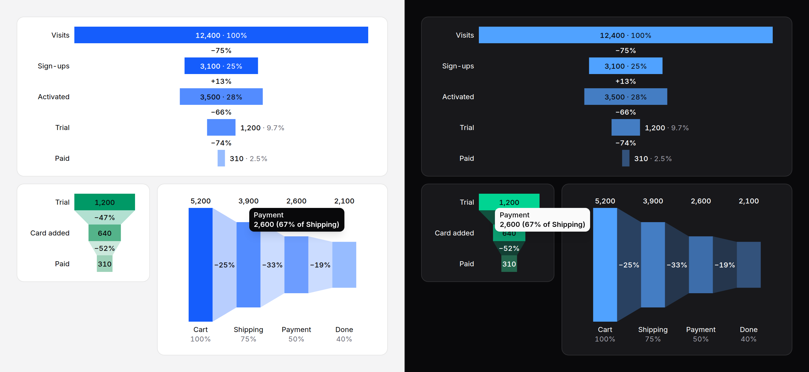

# Funnel chart

How many reached each step of a sequence (visits, sign-ups, trials, paid),
a bar per stage with the drop from one stage to the next written between
them. Static SVG with a generated text summary.



> **Needs Alpine** and the package's script for the readout and keyboard
> access to each stage. Without them the funnel is a correct static image
> with a generated text alternative. See
> [getting started](../getting-started.md#3-add-the-script).

## When to use it

For a sequence where each stage is a subset of the one before: a signup
flow, a checkout, a hiring pipeline. The question it answers is "where do
we lose them?". For parts that add up to a whole, use a
[bar chart](bar-chart.md), a [donut](donut-chart.md) or a
[treemap](treemap.md); for one stage over time, a [line chart](line-chart.md).

## Use it

```blade
{{-- Stages top to bottom, the drop between each two --}}
<x-ds::funnel-chart label="Signups this month"
    :data="['Visits' => 12400, 'Sign-ups' => 3100, 'Trial' => 1200, 'Paid' => 310]" />

{{-- Left to right, joined, with each stage's share of the first as well --}}
<x-ds::funnel-chart label="Checkout" orientation="horizontal" shape="funnel" showRate="both"
    :data="['Cart' => 5200, 'Shipping' => 3900, 'Payment' => 2600, 'Done' => 2100]" />

{{-- One stage called out in its own colour --}}
<x-ds::funnel-chart label="Hiring" tone="neutral" :data="[
    ['label' => 'Applied', 'value' => 840],
    ['label' => 'Screened', 'value' => 210],
    ['label' => 'Interviewed', 'value' => 48, 'tone' => 'warning'],
    ['label' => 'Hired', 'value' => 6],
]" />
```

## Props

| Prop | Type | Default | What it does |
|---|---|---|---|
| `data` | array | — | The stages in order: `['Visits' => 12400, …]`, or rows with `label`, `value` and an optional `tone` or `series`. Zero or more each; a negative or non-number throws. |
| `label` | string | — | What the funnel is; the start of the summary and the table's caption. |
| `orientation` | `vertical` `horizontal` | `vertical` | Stages top to bottom, or left to right. |
| `shape` | `bars` `funnel` | `bars` | Separate centred bars, or bars joined stage to stage by a faint trapezoid. |
| `showRate` | `step` `total` `both` `none` | `step` | On screen: the change from the stage before ("−75%"), between stages; each stage's share of the first, after its value; both; or neither. Every rate is in each stage's accessible name and in the table either way; the readout gives the step. |
| `height` | `sm` `md` `lg` | `md` | Vertical: each stage's band, 28, 36 or 44px. Horizontal: the plot, 128, 192 or 256px. |
| `tone` | `neutral` `accent` `success` `warning` `danger` | `accent` | The hue the stages fade through. A row's own `tone` or `series` draws that stage at full strength. |
| `format` | array | `[]` | How values read; [counter's keys](counter.md#format). Rates are always percentages. |
| `summary` | string | generated | The text alternative, in place of the generated one. |
| `table` | bool | `false` | Also give stage, value and both rates as a visually hidden table. |
| `interactive` | bool | `true` | With the script: the readout and keyboard access. |
| `empty` | string | `No data to show` | The empty state's title, when every stage is 0. |

Bars are scaled to the **largest** stage, not the first, so a stage that is
larger than the one before it is drawn larger, and its change reads "+13%".
A value is written inside its bar while it fits there and beside it when it
does not; that switch follows the chart's own width, not the screen's.

## Accessibility

- Without the script the funnel is `role="img"`: "Signups this month: 4
  stages, from Visits 12,400 to Paid 310 (2.5% of the first); the largest
  drop is Visits to Sign-ups (−75%)."
- With it, one Tab stop; the arrows move stage to stage (Down and Up when
  vertical, Right and Left when horizontal), Home and End to the ends,
  Escape puts the readout away. Each stage is named with its value and both
  rates: "Trial: 1,200, 39% of Sign-ups, 9.7% of Visits".
- Every change is written as signed text, so a drop never rests on colour
  or bar length.

## Don't

- **Don't sort the stages by size.** The order is the sequence; a stage
  that grows is news.
- **Don't give each stage a colour.** The fade says "the same people,
  fewer"; keep a `tone` for the one stage to look at.
- **Don't use it for parts of a whole.** That is a bar chart or a treemap.

More in [specs/funnel-chart.md](../../specs/funnel-chart.md).
