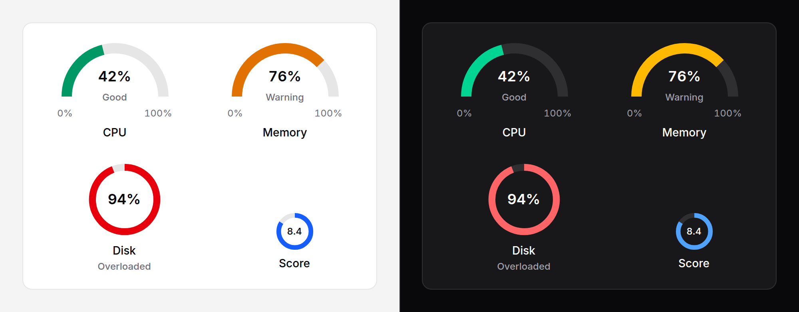

# Gauge

One reading against a known range, as an arc: CPU at 42%, a score of 8.4 out
of 10. Thresholds colour it, and say in a word what the colour means.



## Use it

```blade
<x-ds::gauge label="CPU" :value="$cpu" :format="['suffix' => '%']" />

<x-ds::gauge label="Memory" :value="$memory" :format="['suffix' => '%']" :thresholds="[
    ['at' => 0, 'tone' => 'success'],
    ['at' => 70, 'tone' => 'warning'],
    ['at' => 90, 'tone' => 'danger', 'label' => 'Overloaded'],
]" />

<x-ds::gauge label="Score" :value="8.4" :max="10" :format="['decimals' => 1]" variant="ring" tone="accent" />
```

## Props

| Prop | Type | Default | What it does |
|---|---|---|---|
| `value` | number or `null` | `null` | The reading. `null` reads "No reading". Past either end the arc stops and the value still prints. |
| `min` | number | `0` | The bottom of the range. |
| `max` | number | `100` | The top of the range. |
| `label` | string | — | What is being measured. Always the accessible name. Required, unless you pass `aria-label` or `aria-labelledby`. |
| `hideLabel` | bool | `false` | Keeps the name for screen readers and takes it off the screen. |
| `variant` | `semi` `ring` | `semi` | A half circle with the range printed under it, or a full ring. |
| `thresholds` | array | — | Bands of the range: each `at`, `tone`, and an optional `label`. Wins over `tone`. |
| `tone` | `neutral` `accent` `success` `warning` `danger` | `neutral` | The arc's colour when there are no thresholds. |
| `size` | `sm` `md` `lg` | `md` | |
| `showValue` | bool | `true` | The value in the middle. |
| `format` | array | `[]` | How the value and range read; the keys are [counter's](counter.md#format). |

### Thresholds

From each band's `at` upward the arc takes its tone, and its `label` is shown
and read with the value. Without a `label` the tone gives the word: `success`
"Good", `warning` "Warning", `danger` "Critical"; `neutral` and `accent` give
none. Bands are sorted for you. A value below the lowest `at` is neutral.

## When to use which

| | Use it for | Example |
|---|---|---|
| [Progress](progress.md) | A task moving towards done | Uploading, 64% |
| [Usage meter](usage-meter.md) | An allowance being used up, in its units | 42 of 50 credits |
| **Gauge** | A reading that goes up and down within a range | CPU at 42% |

A gauge is the one to reach for when the value is a *level*, not a step
towards finishing and not an amount spent: it can fall as well as rise, and
the question is "is this healthy?". In a long list, prefer a usage meter or a
number: a column of arcs is hard to compare.

## Accessibility

- `role="meter"`, named by `label`, with `aria-valuemin`, `aria-valuemax` and
  `aria-valuenow` (clamped into the range, as a meter's value must be).
- `aria-valuetext` is what is read: the printed value and the band's word,
  "76%, Warning"; past the range, "120%, above the maximum of 100%, Critical".
- The word is on screen too, under the value or under the label, so colour is
  never the only thing that says it.
- Not focusable, no keyboard interaction. It does not announce changes.

## Don't

- **Don't use it for a task.** That is a [progress](progress.md) bar.
- **Don't use it for an allowance.** "9 of 10 seats" is a
  [usage meter](usage-meter.md), which says the units.
- **Don't give bands a tone without a word you'd stand behind.** "Critical" at
  60% CPU trains people to ignore it.
- **Don't use more than about four bands.** Past that the colours stop meaning
  anything.

More in [specs/gauge.md](../../specs/gauge.md).
