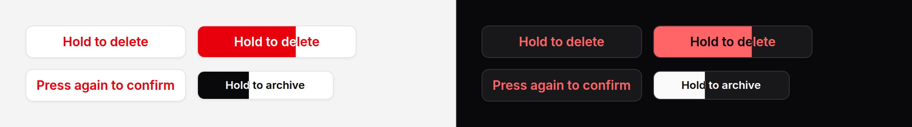

# Hold button

A button confirmed by holding it down: it fills while held, and acts when
full. For an action people take often enough that a second question would
annoy them, and that should still not happen from a stray click.



> **Needs Alpine** and the package's script. See [getting started](../getting-started.md#3-add-the-script).

## Use it

```blade
<form method="POST" action="{{ route('drafts.destroy', $draft) }}">
    @csrf
    @method('DELETE')
    <x-ds::hold-button label="Hold to delete" type="submit" />
</form>
```

Or with events, for Livewire or your own Alpine:

```blade
<x-ds::hold-button label="Hold to archive" tone="neutral" @confirm="$wire.archive({{ $thread->id }})" />
```

The instruction is the button's own words, and it is a prop rather than
something you remember to write beside it: whoever sees the button is told how
to use it.

Not sure this is the right guard? See
[which confirmation do I use?](confirm-button.md#which-confirmation-do-i-use)

## Props

| Prop | Type | Default | What it does |
|---|---|---|---|
| `label` | string | `"Hold to confirm"` | The instruction, which is also the button's words and accessible name: "Hold to delete". |
| `armedLabel` | string | `"Press again to confirm"` | Shown in its place, and announced, after a press that did not hold (see below). |
| `duration` | int | `1500` | Milliseconds of holding that confirm. |
| `tone` | string | `danger` | `danger` or `neutral`: the outline at rest, and the colour it fills with. |
| `size` | string | `md` | `sm`, `md`, `lg`, as [button](button.md). |
| `type` | string | `button` | `submit` sends the form around it once confirmed, with this button as the submitter (its `name` and `value` go too). |

Everything else (`id`, `name`, `value`, `@confirm`, `data-*`) goes on the
button.

## Events

| Event | When |
|---|---|
| `confirm` | Confirmed: held full, or pressed twice. From the button, bubbling. |

The button is clicked **once**, after `confirm`: a `@click` or `wire:click` on
it runs then and at no other time. Every other click is stopped before it
reaches them. Prefer `@confirm`: see "Without the script".

## How it is confirmed

- **Holding.** A mouse button, a finger or a pen held on it, or **Space or
  Enter held** while it has focus, fills it from the inline start over
  `duration`. Letting go early, or sliding off the button, rewinds it, three
  times as fast. Full is confirmed.
- **Pressing twice.** Holding is not something everyone can do, and a screen
  reader in browse mode, voice control and switch access never hold anything:
  they send one click. So **a keyboard press let go before the fill, or a
  click no held press began, arms the button**. Its words become "Press again
  to confirm", a polite live region says so, and the next such press confirms.
  Focus leaving, or Escape, disarms it.
- **A mouse is never two-step.** Two quick clicks of a mouse rewind and do
  nothing, or the hold would protect against nothing.

With `type="submit"`, a full button stays full while the page goes. If the
form would refuse the submit (a required field left empty), nothing is
confirmed and the browser shows why.

## Accessibility

- A real `button`, always rendered `type="button"`; it becomes a submitter only
  for the one click that confirms.
- The instruction is its name. The armed words replace it in place, and are
  announced through a live region outside the button, because a change to a
  focused button's own name is not reliably read.
- The keyboard can do everything a pointer can: hold Space or Enter, or press
  twice.
- **Reduced motion:** the fill moves in four steps rather than sweeping, and
  rewinds at once.
- On a touch screen, a held finger does not scroll the page, select the words
  or open the browser's long-press menu.

## Without the script

A press **submits nothing**: the button is `type="button"` and only the script
makes it a submitter. That is why `@confirm` and `type="submit"` are the safe
ways to hang the action on it. A `@click` or `wire:click` you put on the button
yourself is a different matter: without the script, Alpine or Livewire still
run it on a single click.

## Don't

- **Don't use it for something that cannot be undone and matters.** A hold is
  the lightest guard there is. Use a [confirm popover](confirm-popover.md) with
  type-to-confirm, or a [modal](modal.md).
- **Don't shorten `duration` much below a second.** Under that, a slow click is
  a hold.
- **Don't write the instruction beside it** as well. It is already on the
  button.
- **Don't put `wire:click` on it** where a missing script would matter. Listen
  for `confirm`.

More in [specs/hold-button.md](../../specs/hold-button.md).
