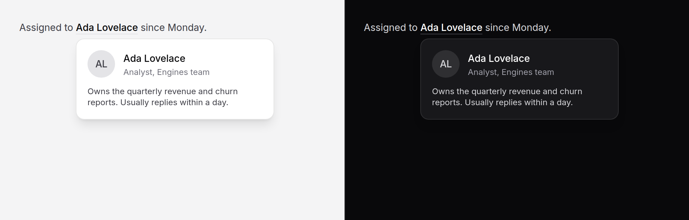

# Hover card

A preview of a person, a record or a link, shown while the pointer rests on
it or keyboard focus reaches it: who someone is before you open their page.
Supplementary by design. Everything in it must also be on the page the
trigger links to.



> **Needs Alpine** and the package's script. See [getting started](../getting-started.md#3-add-the-script).

## Use it

```blade
<p>
    Assigned to
    <x-ds::hover-card>
        <x-slot:trigger>
            <a href="{{ route('people.show', $owner) }}">{{ $owner->name }}</a>
        </x-slot:trigger>

        <span class="flex items-center gap-3">
            <x-ds::avatar :name="$owner->name" :src="$owner->avatar_url" />
            <span>
                <span class="block font-medium text-fg">{{ $owner->name }}</span>
                <span class="block text-meta text-fg-muted">{{ $owner->title }}</span>
            </span>
        </span>
        <span class="mt-3 block text-meta">{{ $owner->bio }}</span>
    </x-ds::hover-card>
    since {{ $assignedAt->format('l') }}.
</p>
```

The trigger is your own link, untouched: a press on it, or a tap on a phone,
goes where it always went. The card only adds a look ahead.

The whole component is `span`s, so it can sit inside a paragraph. Keep the
card's own content to `span`s too when it does: a `div` inside a `p` ends the
paragraph before it.

## Props

| Prop | Type | Default | What it does |
|---|---|---|---|
| `placement` | string | `bottom-start` | The preferred side and alignment, as on [popover](popover.md): `top`, `bottom`, `left` or `right`, then `-start`, `-end`, or nothing for centred. It flips and shifts to stay on screen. |
| `width` | string | `md` | `sm` (14rem), `md` (18rem) or `lg` (24rem), never wider than the window. |

Slots: `trigger` (your link) and the default slot (the card). `id` names the
card; any other attribute goes on the wrapper.

## What it does

- **Opens** when a mouse or pen rests on the trigger for half a second, or
  keyboard focus reaches it and stays for the same half second. A pointer
  passing over on its way somewhere else opens nothing.
- **Stays open** while the pointer is on the trigger or the card, so it can
  travel across the gap into the card and use a link there.
- **Closes** a third of a second after the pointer leaves both, at once when
  focus moves elsewhere, and on Escape, wherever focus is.
- **Never opens on touch.** A tap is the trigger's own link.
- **Stays on screen**, flipping above the trigger near the bottom of the
  window, like the popover; the two share their surface and placement.

## Accessibility

- **The trigger keeps its own semantics.** Nothing is added to it: no
  `aria-expanded`, because activating it does not expand anything; no
  `aria-describedby`, because the card can hold links and a description is
  read as flat text.
- **The card has no role.** It is not a `tooltip`, which may not contain
  anything interactive, and not a `dialog`, because focus never moves into it
  on its own.
- **It is reachable, never required.** The card follows the trigger in the
  page, so while it is open Tab moves from the trigger into its links and on
  out, which closes it. Nothing is trapped. A screen reader meets the card's
  content when it is open, and nothing when it is not.
- **Anything essential must also be on the linked page.** The card does not
  exist on a phone, before the delay, or for a reader who never rests on the
  trigger.
- Escape dismisses a card shown by hover without moving the pointer, as WCAG
  1.4.13 asks of content that appears on hover.

## Don't

- **Don't put anything only the card has.** An action that matters (Follow,
  Message) belongs on the person's page too.
- **Don't use it for a short label.** That is a [tooltip](tooltip.md).
- **Don't use it for something you open on purpose.** A panel the reader asks
  for with a press is a [popover](popover.md).
- **Don't wrap a button that does something on press.** The card is a preview
  of where a link goes.

More in [specs/hover-card.md](../../specs/hover-card.md).
