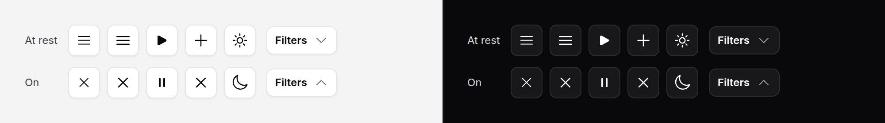

# Icon swap

Two icons that turn into each other: menu and close, play and pause, plus and
close, a chevron that turns, sun and moon. Decorative; the button around it
holds the name and the state.



No script. The swap reads the state of the element around it from CSS.

## Use it

Put it in a button that says its state, and it follows that state:

```blade
<x-ds::button iconOnly aria-label="Menu" x-bind:aria-expanded="nav ? 'true' : 'false'" @click="nav = ! nav">
    <x-ds::icon-swap preset="menu" />
</x-ds::button>
```

It turns when an ancestor has any of `aria-expanded="true"`,
`aria-pressed="true"`, `aria-checked="true"`, or `data-state` of `open`, `on`,
`checked` or `active`. So most uses need no wiring at all:

```blade
{{-- A dropdown trigger: the dropdown sets aria-expanded on it --}}
<x-ds::dropdown>
    <x-slot:trigger>
        <x-ds::button>Actions <x-ds::icon-swap from="chevron-down" preset="rotate" size="4" /></x-ds::button>
    </x-slot:trigger>
    …
</x-ds::dropdown>

{{-- A drawer button: aria-expanded is yours to bind --}}
<x-ds::button iconOnly aria-label="Filters" x-bind:aria-expanded="filters" @click="filters = true">
    <x-ds::icon-swap from="funnel" to="x-mark" />
</x-ds::button>

{{-- A play toggle --}}
<x-ds::button iconOnly aria-label="Play" x-bind:aria-pressed="playing" @click="playing = ! playing">
    <x-ds::icon-swap from="play" to="pause" variant="solid" preset="rotate" />
</x-ds::button>
```

[Theme switcher](theme-switcher.md) cycles three icons by itself and needs none
of this; to show its sun and moon somewhere of your own, bind the state:

```blade
<x-ds::icon-swap from="sun" to="moon" preset="flip" x-bind:data-state="dark ? 'on' : 'off'" />
```

Or set it from the server, with no button at all: `:active="true"`.

## Props

| Prop | Type | Default | What it does |
|---|---|---|---|
| `from` | string | — | The icon at rest, by [icon](icon.md) name. Not used by `menu`. |
| `to` | string | — | The icon it turns into. Optional with `rotate`: a lone icon turns 180°, a chevron's flip. |
| `active` | bool | `false` | Show `to` regardless of the button, for a state the server knows. |
| `preset` | string | `crossfade` | `crossfade` (fade and scale), `rotate` (fade and turn a quarter), `flip` (turn on its vertical axis), or `menu` (three bars that fold into a cross). |
| `size` | string | `5` | `4`, `5`, `6`: 16, 20, 24px, as [icon](icon.md). |
| `variant` | string | `outline` | As [icon](icon.md). |

## What it does

- **Two icons stacked**, one fading and turning out as the other comes in.
  There is no path morphing: it is honest about being two pictures.
- **`menu` is drawn from spans**, at the weight and spacing of `bars-3`, and
  ends at the size of `x-mark`.
- **With reduced motion** it switches at once.

## Accessibility

- It is `aria-hidden`. The button carries the name ("Menu") and the state
  (`aria-expanded`); the icon only pictures it.
- Keep the name the same in both states. A menu button is "Menu", expanded or
  not; "Close menu" would make a screen reader say two things.

## Don't

- **Don't put it in a button with no state.** It reads the state; without one
  it never turns.
- **Don't nest it inside another stateful element by accident.** It reads ANY
  ancestor, so an icon swap inside an open disclosure's panel turns too. Put it
  in the control itself.
- **Don't use it as the only sign of the state.** The icon is decorative.

More in [specs/icon-swap.md](../../specs/icon-swap.md).
