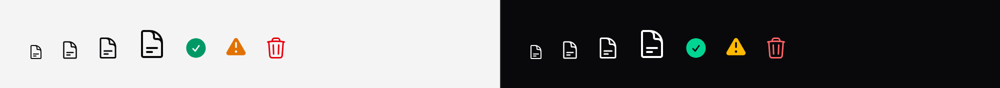

# Icon

A Heroicon, sized and coloured by the system.



## Use it

```blade
<x-ds::icon name="check-circle" />
<x-ds::icon name="trash" size="5" class="text-danger" />
```

Icons inherit `currentColor`, so they take the colour of the text around them.
Set a colour with a class when you need a different one.

## Props

| Prop | Type | Default | What it does |
|---|---|---|---|
| `name` | string | *required* | Any [Heroicons v2](https://heroicons.com) name. |
| `variant` | `outline` `solid` `mini` `micro` | `outline` | 24px outline, 24px solid, 20px, 16px. |
| `size` | Tailwind size step | `4` (16px) | `4` = 16px, `5` = 20px, `6` = 24px. |
| `label` | string | — | Makes the icon meaningful rather than decorative. |
| `fallback` | string | — | An icon to render when `name` does not exist, instead of throwing. Only for names that come from data or config. |

## Size: the one thing to know

`size` builds the class `size-{$size}` at runtime, and Tailwind reads source
**text** — so `size="4.5"` in your Blade is not the string `size-4.5`.

The package pre-generates a range so this works anyway: **1.5, 3, 3.5, 4, 4.5,
5, 5.5, 6, 7, 8, 9, 10, 11, 12, 14, 16**.

Pass something outside that range and the icon gets **no rule at all**, which
means it expands to fill its container. If an icon renders enormous, this is
why. Either use a size from the list, or write the class yourself so your own
Tailwind scan picks it up:

```blade
<x-ds::icon name="check" class="size-[18px]" />
```

## Accessibility

**Icons are hidden from screen readers by default**, because most sit beside a
label that already says the same thing — "trash Delete" is worse than "Delete".

Pass `label` **only** when the icon is the only thing carrying the meaning:

```blade
{{-- decorative: the word "Delete" is right there --}}
<x-ds::button><x-ds::icon name="trash" size="4" /> Delete</x-ds::button>

{{-- meaningful: nothing else says what this does --}}
<x-ds::icon name="check-circle" label="Verified" class="text-success" />
```

For an icon-only button, put the name on the **button**, not the icon.

## Old icon names still work

Heroicons v2 renamed a lot of icons. Common v1 names (`x`, `search`, `mail`,
`cog`, `menu`, `logout`, …) are aliased to their v2 spellings, so they still
resolve.

Publish the config to see or extend the map:

```bash
php artisan vendor:publish --tag=blade-ui-config
```

New code should use v2 names.

## A name that does not exist

A name that is neither a Heroicons v2 name nor an alias **throws**: `Unable to
locate a class or view for component [heroicon-o-grid]`. In a template that is
what you want. The name is yours, it is wrong, and the page should say so the
first time you open it.

When the name comes from **data or config**, a menu built from
`config/admin.php`, a status icon stored in a table, one bad entry would take
down every page that renders it, including the page where you would fix it.
Pass `fallback` there:

```blade
@foreach (config('admin.nav') as $item)
    <x-ds::icon :name="$item['icon']" fallback="question-mark-circle" />
@endforeach
```

An unknown name then renders the fallback icon, in the same variant, and logs
one warning per request per name:

```text
blade-ui: icon "grid" not found, rendered "question-mark-circle"
```

Aliases are resolved before the check, so `search` renders the magnifying glass,
not the fallback.

To check a name yourself, in a health check or a form that saves one, ask the
same resolution the component uses:

```php
use Shipbytes\BladeUi\Support\Icons;

Icons::exists('grid');                  // false
Icons::exists('search');                // true, through the alias
Icons::exists('check-circle', 'solid'); // true
```

## Don't

- **Don't label a decorative icon.** Every redundant label is one more thing read
  aloud before the reader reaches what they wanted.
- **Don't pass `fallback` to an icon whose name you typed.** It turns your typo
  into a question mark and a log line instead of an error on first load.
- **Don't set a colour on a wrapper and expect the SVG to take it.** The icons
  carry `fill="currentColor"` as a presentation attribute, which beats
  inheritance. Put the class on the icon.

More in [specs/icon.md](../../specs/icon.md).
