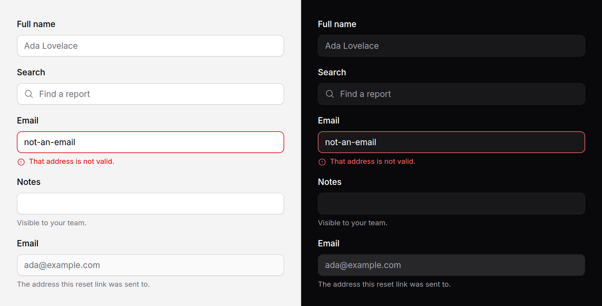
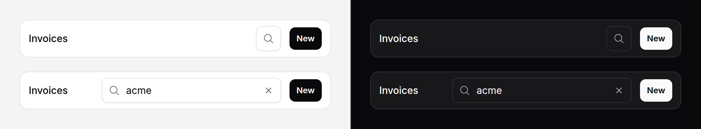

# Input

A text field, a textarea, or a native select. One component, three shapes.



> `reveal` and `clearable` are the two props here that need [Alpine](../getting-started.md#alpine)
> and the package's [script](../getting-started.md#3-add-the-script); `expanding`
> works without them and uses them for Escape and its `shortcut`. Everything
> else on this page works in a plain Blade view with no JavaScript at all.

## Use it

```blade
<x-ds::input name="email" label="Email address" type="email" />
<x-ds::input as="textarea" name="notes" label="Notes" :rows="4" />
<x-ds::input as="select" name="plan" label="Plan">
    <option value="free">Free</option>
    <option value="pro">Pro</option>
</x-ds::input>
```

## Props

| Prop | Type | Default | What it does |
|---|---|---|---|
| `as` | `input` `textarea` `select` | `input` | Which control to render. |
| `type` | string | `text` | Any HTML input type. Ignored for the other two. |
| `label` | string | — | Rendered as a real `<label for>`. |
| `help` | string | — | Guidance under the field. |
| `error` | string | — | Validation message. Styles the control and sets `aria-invalid`. |
| `icon` | string | — | Heroicon inside the control, before the value. |
| `rows` | int | `3` | Textarea only. |
| `reveal` | bool | `false` | `type="password"` only: a button in the field that shows the password and hides it again. Needs Alpine and the script. |
| `clearable` | bool | `false` | Text, search, email, url and tel: a ✕ in the field, while it has a value, that empties it. Needs Alpine and the script. |
| `expanding` | bool | `false` | A search that is an icon button until it is used, then grows into the field. See [below](#a-search-that-expands). |
| `mode` | `push` \| `overlay` | `push` | With `expanding`: the field pushes what follows along, or grows over what is before it. |
| `shortcut` | string | — | With `expanding`: a key that opens it from anywhere, `/` or `mod+k`. Needs Alpine and the script. |
| `disabled` | bool | `false` | |
| `readonly` | attribute | — | Not a prop: pass it like any HTML attribute. The field looks fixed (subtle fill, muted text, no hover) but stays focusable and is submitted. Ignored for `as="select"`, as the browser ignores it there. |

`name`, `value`, `placeholder`, `required`, `wire:model` and anything else pass
straight through to the control.

## `help` is replaced by `error`, never stacked

Two lines of guidance under one field is one too many. Pass both and the error
wins while it is there.

```blade
<x-ds::input
    name="email"
    label="Email address"
    help="We only use this for receipts."
    :error="$errors->first('email')"
/>
```

With Laravel validation that is the whole integration — `$errors->first()`
returns `null` when the field is clean, so `help` shows until it doesn't.

## An `id` is generated if you don't give one

The label needs a `for` and the help text needs an `aria-describedby`, so the
component generates an id per field. Pass your own `id` when something outside
needs to point at the control.

**Under `wire:model` the generated id is the same on every render**, a hash of
the binding, name, value and label. Livewire's morph matches elements by id, and
until v1.2.2 a fresh random id on each render made it *replace* a bound field
rather than update it: the field lost focus, and a live search kept the first
burst of typing and dropped the rest. A field with no binding still gets a
random id, so two look-alike fields on one plain page do not collide. The same
holds for checkbox, radio, switch, select, combobox, date-picker and
file-upload.

Two bound fields that agree on binding, name, value and label are the same field
twice. Give one an `id`.

## Readonly is not disabled

A value the user should see, copy and send but not change, such as the email a
password-reset link was sent to, is `readonly`:

```blade
<x-ds::input name="email" label="Email" type="email" :value="$email" readonly />
```

It looks fixed, with the subtle fill and muted text, and no hover border, so it
does not invite typing. Unlike `disabled` it stays in the tab order, its text can
be selected, and it is **submitted with the form**. A disabled field is left out
of the request entirely, which is how a reset form ends up posting no email.

## Show the password

```blade
<x-ds::input type="password" name="password" label="Password" autocomplete="current-password" :reveal="true" />
```

`reveal` adds an eye button at the end of a password field. It is a toggle,
named "Show password" with `aria-pressed` saying whether the password is
showing; it never submits the form, keeps the caret where it was, and hides the
password again when the form submits. Ignored on every other type. Without the
attribute, the field's markup is exactly what it was before the prop existed.

For a new password, pair it with the
[password strength](password-strength.md) meter.

## A field you can clear

```blade
<x-ds::input type="search" name="q" label="Search" icon="magnifying-glass" :clearable="true" />
```

`clearable` adds a ✕ at the end of the field while it holds something. A press
empties it, puts focus back in it, and fires `input` and `change`, so
`wire:model`, `x-model` and your own listeners all hear it. The button is named
"Clear" and the label ("Clear Search"). The browser's own ✕ on a search field
is removed, so there is one. Escape does not clear: in a popover or a modal it
closes them. Ignored on passwords, disabled and read-only fields; without the
attribute the markup is exactly what it was.

Use it on a search or a filter, not on an ordinary form field.

## A search that expands



```blade
<form role="search" action="{{ route('search') }}" class="flex items-center gap-2">
    <x-ds::input name="q" label="Search" :expanding="true" :clearable="true" shortcut="/" />
</form>

{{-- In a header, growing over the title rather than moving it --}}
<x-ds::input name="q" label="Search docs" :expanding="true" mode="overlay" />
```

Collapsed it is a square the size of an icon button, named by `label` (or
"Search"). A press, a Tab into it or the `shortcut` opens it to 16rem; it stays
open while it has focus or holds text, and closes when it loses focus empty.
The width is CSS, `:focus` and `:placeholder-shown`, so it opens and closes
with no script, and animates only for readers who have not asked for less
motion. `push` widens it in its row; `overlay` keeps its square in the row and
grows over what comes before it, so nothing else on the page moves.

With Alpine and the script, **Escape** clears the text, and a second Escape
closes it with focus on its button; `shortcut` opens it from anywhere outside
another field. Unlike a plain `clearable` field, it takes Escape: it is the way
out of a control that has no other edge to leave by. `help` and `error` are not
drawn in this form; put the search in a `form role="search"` and it submits
with Enter, as any search field does. Without the prop the markup is exactly
what it was.

## The select here is the native one

`as="select"` renders a real `<select>` — the OS control, with the OS popup.
**On anything phone-first that is the right choice**: it gets typeahead and the
platform's own scrolling for free.

Use [`x-ds::select`](select.md) when the unstyleable native popup is the problem.

## Accessibility

- `label` is a real `<label for>`, so clicking it focuses the field.
- `error` sets `aria-invalid="true"` and wires `aria-describedby`.
- The focus ring is drawn **inward**, so the box never changes size on focus and
  nothing below it shifts.
- Expanding: the field is the one Tab stop; the icon button under it is out
  of the tab order, named for a screen reader's browse mode, and is where
  Escape returns focus.
- Omit `label` only when a visible label elsewhere already names the field — and
  then give the control an `aria-label` yourself.

## Don't

- **Don't use a placeholder as the label.** It disappears the moment someone
  types, and it is invisible to autofill.
- **Don't put the error in an [alert](alert.md) above the form.** The reader then
  has to work out which field it meant.
- **Don't disable a field to mean "not applicable".** Hide it, or explain in
  `help` — a greyed-out field is a question with no answer.

More in [specs/input.md](../../specs/input.md).
