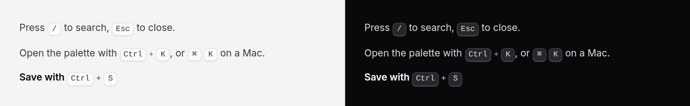

# Kbd

A key on the keyboard, inline in text.



> Plain Blade, pure CSS. With `shortcut`, Alpine and the package's script
> redraw it for a Mac; without them it shows the words form.

## Use it

```blade
<p>Press <x-ds::kbd>/</x-ds::kbd> to search.</p>
<p>Open the palette with <x-ds::kbd :keys="['Ctrl', 'K']" />.</p>
<p>On a Mac: <x-ds::kbd :keys="['⌘', 'K']" separator="" />.</p>
```

It takes the size of the text it sits in, so there is no size prop.

A shortcut you store as a string, as [shortcut input](shortcut-input.md)
records it, goes in `shortcut`:

```blade
<p>Search with <x-ds::kbd shortcut="mod+k" />.</p>
```

The server draws Ctrl + K. Once Alpine and the script run on a Mac it is ⌘K,
with no separator, as macOS writes it. Either way it is read as words, "Control+K"
or "Command+K", because screen readers say the symbols inconsistently. Change
its `data-ds-shortcut` attribute and it redraws.

## Props

| Prop | Type | Default | What it does |
|---|---|---|---|
| `keys` | array | — | A combination, one key each, nested as HTML has it. Without it, the slot is the one key. |
| `separator` | string | `+` | Between the keys. `""` for none. |
| `shortcut` | string | — | A stored shortcut, `mod+shift+k`, drawn for the platform and read as words. Takes the place of `keys` and the slot. |

## Don't

- **Don't use it for a button's name.** "Press **Save**" is bold, not a key.
- **Don't write a symbol alone.** "⌘" can be read out as "place of interest
  sign"; say "Cmd" in the prose too.

More in [specs/kbd.md](../../specs/kbd.md).
