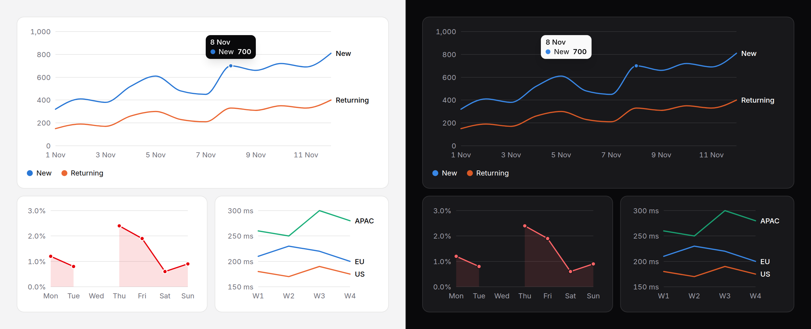

# Line chart

Values in order, usually over time: one line or up to eight, straight or
smooth, with an optional filled area. Missing values are gaps, never bridged.
A complete, accessible SVG from the server; hover and keyboard reading on top.



> **Needs Alpine** and the package's script for the readout, keyboard access
> to each point and the legend toggles. Without them the chart is a correct
> static image with a generated text alternative. See
> [getting started](../getting-started.md#3-add-the-script).

## Use it

```blade
<x-ds::line-chart label="Visits this week" :data="['Mon' => 320, 'Tue' => 410, 'Wed' => 380]" />

{{-- Several series, smooth, named at their ends --}}
<x-ds::line-chart label="Visits, new and returning" :data="$days" :series="['New', 'Returning']" curve="smooth" />

{{-- One series whose colour means something, filled, with a gap --}}
<x-ds::line-chart label="Error rate" :data="['Mon' => 1.2, 'Tue' => null, 'Wed' => 2.4]"
    :area="true" tone="danger" :points="true" :format="['suffix' => '%', 'decimals' => 1]" />
```

## Props

| Prop | Type | Default | What it does |
|---|---|---|---|
| `data` | array | `[]` | In order along the x axis. `['Mon' => 12, …]` for one series; `['Mon' => ['New' => 12, 'Returning' => 3], …]` or `['Mon' => [12, 3], …]` for several. `null` is a gap. |
| `series` | array or string | — | The series' names, in order; they take series-1, series-2… Eight at most. |
| `label` | string | — | What the chart shows. Starts the summary, captions the table. |
| `height` | `sm` `md` `lg` | `md` | The plot's height: 128, 192 or 256px. |
| `format` | array | `[]` | How numbers read; [counter's keys](counter.md#format). |
| `yTicks` | int or array | about 5 | Roughly how many value ticks, or the values themselves. |
| `area` | bool | `false` | Fill under each line, down to zero. The axis then always includes zero. |
| `curve` | `linear` `smooth` | `linear` | `smooth` is a monotone curve: it never shows a peak or a dip the data does not have. |
| `points` | bool | `false` | A dot on every value. A value with gaps on both sides always gets one. |
| `xLabels` | `auto` `none` or a number | `auto` | `auto` drops labels in halves when crowded; `3` keeps every third. |
| `legend` | `auto` `end` `bottom` | `auto` | `auto`: a legend from two series, and each line named at its end too at four or fewer. `end`: the end names **instead** of the legend (four or fewer). `bottom`: the legend only. |
| `tone` | `neutral` `accent` `success` `warning` `danger` | — | For one series whose colour means something. |
| `summary` | string | generated | The text alternative, in place of the generated one. |
| `table` | bool | `false` | Also give every value as a visually hidden table. |
| `interactive` | bool | `true` | With the script: the readout, keyboard access, legend toggles. |
| `empty` | string | `No data to show` | The empty state's title. |

## At any width

The lines stretch to the container and keep their 2px; the points stay round
and the text stays 12px, however wide or narrow it is. On a narrow chart
the x labels drop out in halves, the first always kept, and two lines that
end close together have their end names pushed apart.

## The data it handles

- **Empty**, or nothing numeric: the [empty state](empty-state.md).
- **One value**: a point in the middle.
- **All equal**: a flat line through the middle of a small band.
- **Gaps** (`null`): the line and the area stop and start again. A value with
  a gap either side is drawn as its point.

## Accessibility

- Without the script the chart is `role="img"`, named by a summary per series:
  "Visits: up from 320 to 810 (low 320, high 810)." Pass `summary` when you
  can say it better ("Doubled after the launch").
- With it, one Tab stop per chart: ArrowLeft and ArrowRight move along a line,
  ArrowDown and ArrowUp to the same point on the next or previous line, Home
  and End to the ends, Escape puts the readout away. Each point is named
  "8 Nov, New: 700". The pointer reads the nearest point, so a reader need
  not hit a 7px dot.
- Legend entries become toggle buttons; hiding a line re-scales nothing.
- Colour is never the only tie between a line and its name: the legend, the
  end labels, or both, always say it.

## Don't

- **Don't put two units on one chart.** There is one value axis on purpose;
  draw two charts and line them up.
- **Don't use it for categories with no order.** That is a [bar chart](bar-chart.md).
- **Don't use `area` with several overlapping series** unless the overlap is
  the point. Each area hides part of the one behind it.
- **Don't drop the end names and the legend both.** `legend="end"` keeps the
  names; there is no option for neither.

More in [specs/line-chart.md](../../specs/line-chart.md).
