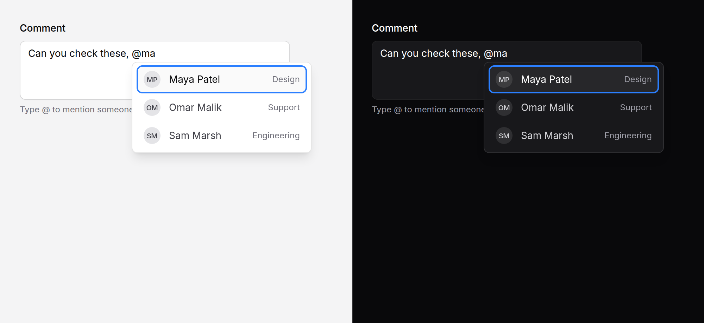

# Mention input

A text field that suggests people or things after `@` (or any trigger you
choose), writes the chosen one into the text, and posts their ids beside it.



> **Needs Alpine** and the package's script. See [getting started](../getting-started.md#3-add-the-script).
> Without them it is an ordinary textarea.

## Use it

```blade
<x-ds::mention-input
    name="body"
    label="Comment"
    :items="$members->map(fn ($m) => ['id' => $m->id, 'label' => $m->name, 'meta' => $m->team, 'src' => $m->avatar_url])"
/>

{{-- People after @, issues after #, written as tokens the server can parse --}}
<x-ds::mention-input
    name="body"
    label="Update"
    :triggers="['@' => $people, '#' => $issues]"
    insert="@[label](id)"
    :atomic="true"
/>

{{-- One line --}}
<x-ds::mention-input name="title" label="Title" :items="$people" :multiline="false" />
```

## What it posts

| Field | Example |
|---|---|
| `body` | `Thanks @Maya Patel, can you look at #Fix login redirect?` |
| `body_mentions[]` | `7`, `101`: the id of each row chosen, once each |

A mention whose text is later edited ("@Maya Patxel") stops posting its id, and
Undo brings it back. With `insert="@[label](id)"` the text holds
`@[Maya Patel](7)`, which you can parse on the server instead:
`preg_match_all('/[@#]\[([^\]]+)\]\((\d+)\)/', $body, $m)`. `wire:model` and
`x-model` bind the text.

## Props

| Prop | Type | Default | What it does |
|---|---|---|---|
| `name` | string | — | The field the text posts under. |
| `label` | string | — | The field's label. |
| `value` | string | — | The text. Mentions already in it post their ids. |
| `items` | array | `[]` | The rows: `id`, `label`, and optionally `meta` (a second line to match too), `src` or `initials` (an avatar). Arrays or objects. |
| `triggers` | string \| array | `"@"` | The character that opens the list, or a map of character ⇒ rows: `['@' => $people, '#' => $issues]`. |
| `insert` | string | `"@label"` | What a row writes. `@` is the trigger, `label` and `id` the row's: `"@[label](id)"` writes `@[Maya Patel](7)`. A space follows. |
| `minChars` | int | `0` | Characters to type after the trigger before the list opens. |
| `max` | int | `8` | Rows shown at once. |
| `multiline` | bool | `true` | `false` for a one-line text field. |
| `rows` | int | `3` | The textarea's height. |
| `atomic` | bool | `false` | Backspace just after a mention deletes all of it. |
| `loading` | bool | `false` | The list says "Loading…" while you fetch. |
| `mentionsName` | string | `{name}_mentions[]` | Where the ids post. |
| `placeholder` | string | — | |
| `listLabel` | string | `"Suggestions"` | The list's name for screen readers. |
| `emptyText` | string | `"No matches"` | |
| `loadingText` | string | `"Loading…"` | |
| `help` | string | — | Guidance under the field. |
| `error` | string | — | Replaces `help`, marks the field invalid. |
| `disabled` | bool | `false` | |

Anything else (`id`, `required`, `maxlength`) goes on the field; `class` on the
root.

## What it does

- **Typing `@`** at the start of a word opens the list under it; the letters
  after it filter the list ("ma" finds Maya Patel and Omar Malik, the first
  first). `ada@example.com` does not open it.
- **Up and Down** pick a row, **Enter** or **Tab** writes it in, **Escape**
  closes the list (and only the list, inside a modal). A click works too.
- **It closes by itself** when you type a space and nothing matches, move the
  caret away, or leave the field.
- **Moving back** into a word you already typed does not reopen it.

## Long lists

Don't send every user. Listen for `search`, which fires 200 ms after typing
stops with `{ trigger, query }`, and render the rows that match:

```blade
<x-ds::mention-input
    name="body"
    label="Comment"
    :items="$matches"
    :loading="$searching"
    wire:model="body"
    x-on:search="$wire.findPeople($event.detail.query)"
/>
```

## Accessibility

- With the script the field is a combobox: a screen reader says the list is
  open, and reads each row as the arrows reach it, while focus stays in the
  text.
- "No matches" and "Loading…" are announced.
- The list sits under the `@` you typed, wherever it is in the text.

## Don't

- **Don't trust the ids.** Check on the server that each is someone the author
  may mention.
- **Don't expect highlighted names in the field.** It is plain text; style the
  mentions when you display the saved text.
- **Don't use it for picking one person.** That is a
  [combobox](combobox.md).

More in [specs/mention-input.md](../../specs/mention-input.md).
