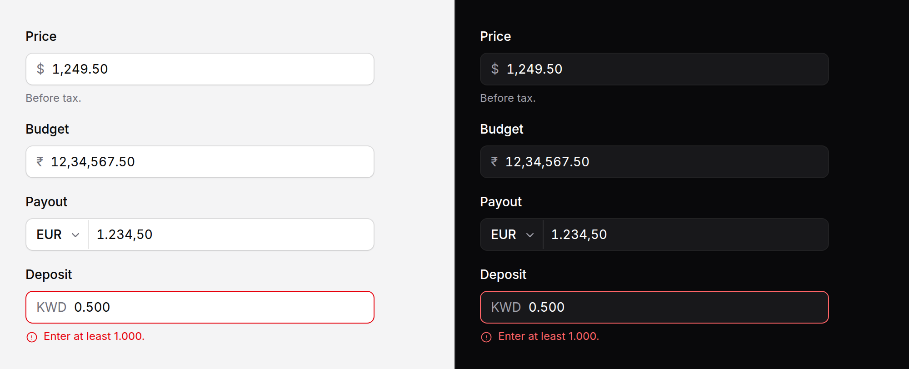

# Money input

An amount of money, grouped as the reader's locale groups it while they type,
and posted as a plain decimal string your server can read without guessing.



> **Needs Alpine** and the package's script for the grouping as you type.
> Without them it is a plain text field, named `name`, posting what was typed.
> See [getting started](../getting-started.md#3-add-the-script).

## Use it

```blade
<x-ds::money-input name="price" label="Price" currency="USD" :value="$product->price" />

{{-- Indian grouping: 12,34,567.50 --}}
<x-ds::money-input name="budget" label="Budget" currency="INR" locale="en-IN" />

{{-- The currency chosen beside it, posted as price_currency --}}
<x-ds::money-input name="price" label="Price" :currencies="['USD', 'EUR', 'GBP', 'JPY']" currency="EUR" />

{{-- Integer minor units in and out: 1999 is $19.99 --}}
<x-ds::money-input name="amount_cents" label="Amount" :value="$order->amount_cents" :minor="true" min="0.50" max="10000" />
```

It posts `"1234.50"`: digits, a `.` and the currency's places, never grouped,
never a float. With `minor`, `"123450"`.

```blade
<x-ds::money-input name="price" label="Price" wire:model.blur="price" />
<x-ds::money-input name="tip" label="Tip" x-model="tip" />
```

`wire:model` and `x-model` bind that same string.

## Props

| Prop | Type | Default | What it does |
|---|---|---|---|
| `name` | string | — | The field the amount posts under. |
| `label` | string | — | The field's label. |
| `value` | string\|int\|float | — | The amount. A string is read as written (`"1234.5"`); with `minor`, an integer of minor units. |
| `currency` | string | `USD` | ISO 4217 code. Sets the places: 2, or 0 for JPY, KRW, VND and others, 3 for BHD, KWD, OMR, TND and others. |
| `locale` | string | the app's | Grouping and the decimal separator: `de` writes 1.234,50, `en-IN` writes 12,34,567.50. |
| `decimals` | int | from the currency | Places, overriding the table. |
| `symbol` | `symbol` \| `code` \| `none` | `symbol` | What is drawn beside the amount, where the locale puts it ($ before, € after in de). |
| `currencies` | array | — | Codes, or code ⇒ label, for a currency select at the start of the field. |
| `currencyName` | string | `{name}_currency` | With `currencies`: the field the chosen code posts under. |
| `min` `max` `step` | string | — | Bounds and a step, in whole units even with `minor`. Checked on leaving the field; the form will not submit past them. |
| `allowNegative` | bool | `false` | Take a minus at the start. |
| `minor` | bool | `false` | `value` and the posted amount are integer minor units. |
| `help` | string | — | Guidance under the field. |
| `error` | string | — | Replaces `help`, marks the field invalid. |
| `size` | `md` \| `sm` | `md` | `sm` is 32px, for a table row. |
| `disabled` | bool | `false` | |

Anything else (`id`, `required`, `placeholder`) goes on the text field; `class`
on the root.

## What it does

- **Typing** groups the digits as they arrive, keeping the caret where it was.
  Either `.` or `,` types the locale's decimal separator, so a German reader can
  use the keypad's `.`. Backspace beside a group separator deletes the digit
  past it.
- **Pasting** `$1,234.56`, `1.234,56 €` or `1 234,56` keeps the amount: symbols
  go, and the reader works out which mark is the decimal point.
- **Leaving the field** pads it to the currency's places, and checks `min`,
  `max` and `step` with the browser's own validity, so the form will not submit
  an amount out of range.
- **Changing the currency** rounds the amount to the new currency's places.
- **Without the script** it is a text field with `inputmode="decimal"` and a
  `pattern`, posting what was typed, grouping and all. Your server validates
  that form anyway; the difference is that the amount may arrive as `1,234.50`.

The first paint comes from `Support\Money::format()`, which uses PHP's intl
extension when it is loaded. Without intl it writes en style (`1,234.50`, a
common symbol or the code before it); the script then redraws the field for the
locale.

```php
use Shipbytes\BladeUi\Support\Money;

Money::format('1234567.5', 'INR', 'en-IN', symbol: 'symbol'); // "₹12,34,567.50"
Money::decimals('JPY');                                      // 0
```

## Accessibility

- A text field with `inputmode="decimal"`, so a phone shows the number pad
  with a separator, named by its label.
- The symbol is drawn for the eye; the currency code is the field's
  description, so "Price, USD" is what is read.
- An amount out of range sets `aria-invalid` and the browser's validation
  message.

## Don't

- **Don't read the posted amount as a float.** Use integer minor units,
  `bcmath` or a money library. That is what the string is for.
- **Don't skip server validation.** The field shapes typing; it is not a
  check.
- **Don't use it for quantities.** A count is a [number field](number-field.md).

More in [specs/money-input.md](../../specs/money-input.md).
