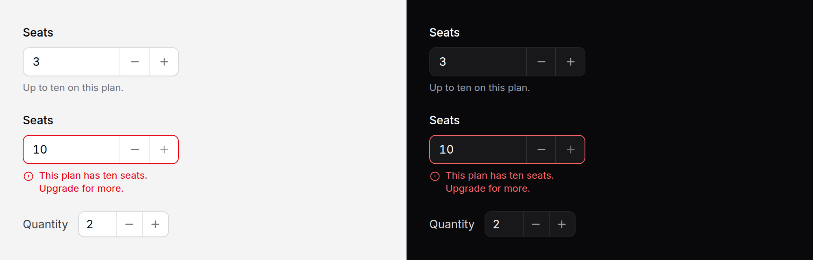

# Number field

A number with a lower and an upper bound, and buttons to step it.



> **Needs Alpine** and the package's script. See [getting started](../getting-started.md#3-add-the-script).

## Use it

```blade
<x-ds::number-field name="seats" label="Seats" :value="old('seats', 3)" :min="1" :max="10" />
```

Underneath is a real `<input type="number">` with your `min`, `max` and
`step`, so typing, the arrow keys, the browser's own range check and what the
form posts are all the browser's. The buttons are the only addition.

## Props

| Prop | Type | Default | What it does |
|---|---|---|---|
| `name` | string | *required* | Submitted field name. |
| `label` | string | — | Field label. |
| `help` | string | — | Guidance under the field. |
| `error` | string | — | Validation message. Replaces `help`. |
| `value` | number | — | The current value. |
| `min` | number | — | Lower bound. The decrease button disables here. |
| `max` | number | — | Upper bound. The increase button disables here. |
| `step` | number \| `any` | `1` | The size of one press, or of one arrow key. |
| `disabled` | bool | `false` | |
| `size` | `md` `sm` | `md` | `md` is the input's own size: 44px below `sm`, 36px above. `sm` is 32px everywhere, for a table row. |

`wire:model`, `x-model`, `required`, `placeholder` and anything else pass
straight through to the input. A `class` goes on the wrapper.

## The buttons

- **A press** steps once, by `step`, and stops at the bound. Stepping uses the
  browser's own `stepUp()` and `stepDown()`, so a value off the step (2.5 with
  a step of 1) snaps to the next one the way the arrow keys do.
- **Holding** a button repeats after a short delay, and stops when it is
  released, when the pointer leaves it, or at the bound.
- **A button at its bound is disabled.** The server renders that state from
  `value`, `min` and `max`, so it is right before any script runs; after that it
  follows the value as it is typed.
- **They never submit the form** and never take focus, so a caret in the field
  stays where it was.

**They are out of the tab order** (`tabindex="-1"`). A keyboard already has
the arrow keys, and two more Tab stops per field would double the presses it
takes to get through a form. A screen reader still reaches them, as "Decrease
Seats" and "Increase Seats".

## With Livewire and Alpine

Each step dispatches `input` on the field, and the press dispatches `change`
once when it ends, the way a native spinner does. So `wire:model.live` follows
every step, and `wire:model.change` sends one request per press rather than one
for every repeat of a held button.

```blade
<x-ds::number-field name="seats" label="Seats" wire:model.change="seats" :min="1" :max="$plan->seats" />
```

## The keyboard a phone raises

From the bounds and the step: the digit pad for whole numbers from zero up,
the pad with a decimal point for a fractional step, and the browser's own
number keyboard when `min` allows a negative, because the iOS digit pads have
no minus key.

## Accessibility

- The input is labelled by `label`, and is a native number field, so its role,
  value and range are the browser's.
- `error` sets `aria-invalid` and describes the field with the message.
- The buttons name the field they change and point at it with
  `aria-controls`.

## Don't

- **Don't use it for numbers that are not quantities.** A phone number, a card
  number or a postcode is text that happens to be digits: an arrow key that
  adds one to a postcode is a bug.
- **Don't use it for a wide range.** Choosing 1 to 1,000 by pressing is slower
  than typing; a plain [input](input.md) with `type="number"` is enough.
- **Don't rely on `min` and `max` alone.** Typing can still go past them, as
  in any number field. Validate on the server.

More in [specs/number-field.md](../../specs/number-field.md).
