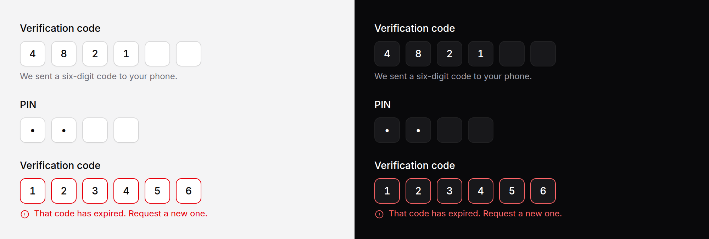

# OTP input

A one-time code or a PIN, typed into one box per character and posted as one
field.



> **Needs Alpine** and the package's script. See [getting started](../getting-started.md#3-add-the-script).

## Use it

```blade
<x-ds::otp-input name="code" label="Verification code" help="We sent a six-digit code to your phone." />
```

The form posts `code=482193`. The boxes have no `name`; one hidden input
carries the joined code, so your controller reads one field, exactly as it
would from a plain text input.

## Props

| Prop | Type | Default | What it does |
|---|---|---|---|
| `name` | string | *required* | The one field the code posts as. |
| `length` | int | `6` | How many characters, one box each. |
| `label` | string | — | Names the group of boxes. Pressing it focuses the first box. |
| `help` | string | — | Guidance under the boxes. |
| `error` | string | — | Validation message. Marks every box invalid. Replaces `help`. |
| `masked` | bool | `false` | PIN mode: the boxes show dots. |
| `numeric` | bool | `true` | Digits only. `false` takes letters as well. |
| `autofocus` | bool | `false` | Focus the first empty box when the page loads. |
| `disabled` | bool | `false` | Disables the boxes and the field that posts. |
| `value` | string | — | The code so far, rendered into the boxes by the server. |

`wire:model` and `x-model` go on the wrapper and bind both ways (see below).
Anything else you pass (`@complete`, `required`, `data-*`) goes on the hidden
input that posts. A `class` goes on the wrapper.

## What it does

- **Typing** fills a box and moves to the next.
- **A character the field does not take** (a letter in a numeric code) is
  ignored, and focus stays where it was.
- **Typing into a filled box** replaces its character.
- **Backspace** on a filled box clears it; on an empty box it moves back and
  clears the one before.
- **Left and Right** move between boxes; **Home** and **End** jump to the ends.
- **Paste** anywhere spreads the code across the boxes. A code as long as the
  field fills from the first box wherever it was pasted; a shorter one fills
  from the box it landed in. Spaces and dashes are dropped, so `123 456` and
  `123-456` both paste as `123456`.
- **The browser's one-time-code autofill** (the code from a text message,
  offered above the keyboard) fills every box at once. Only the first box asks
  for it, with `autocomplete="one-time-code"`.

## Submitting when the code is complete

When every box is filled, the field dispatches a `complete` event, which
bubbles, with the code in `event.detail.value`. It fires again if the code
changes and is still complete, so a corrected code is sent again.

**In a plain form**, submit it:

```blade
<form method="POST" action="{{ route('verify') }}">
    @csrf
    <x-ds::otp-input name="code" label="Verification code" @complete="$el.form.requestSubmit()" />
    <x-ds::button type="submit">Verify</x-ds::button>
</form>
```

`$el` there is the hidden input, which knows its form. Keep the button: someone
who pastes a code and then corrects one digit, or whose browser blocks the
script, still needs a way to send it.

**With Livewire**, bind the field and call your action:

```blade
<x-ds::otp-input
    name="code"
    label="Verification code"
    wire:model="code"
    :value="$code"
    @complete="$wire.verify()"
    :error="$errors->first('code')"
/>
```

`wire:model` binds both ways: the code reaches `$code` as it is typed, and
setting `$code` on the server (clearing it after a failed attempt, say) clears
the boxes. Pass `:value="$code"` as well, so the boxes are right on first paint,
before Alpine starts, and in a page whose script never runs.

**With Alpine**, `x-model` on the tag does the same:

```blade
<div x-data="{ code: '' }">
    <x-ds::otp-input name="code" label="Verification code" x-model="code" />
    <x-ds::button variant="ghost" @click="code = ''">Clear</x-ds::button>
</div>
```

A code you set is written into the boxes as it is, minus anything the field
cannot hold (a letter in a numeric code, characters past the last box), and
your property is handed back what is actually there. It does not dispatch
`complete`: the reader did not finish typing anything. When Alpine starts, the
bound property wins over `value`, as `x-model` on an ordinary field does.

## Validate on the server

The boxes refuse characters the field does not take, but that is a courtesy.
Check the length and the characters in your validation rules, as you would for
any field. `required` on the component reaches the hidden input, which browsers
do not validate, so it does not stop the form being sent.

## Accessibility

- The boxes are a `role="group"` named by `label`.
- Each box is named for its place: "Digit 2 of 6", or "Character 2 of 6" when
  the code takes letters.
- `error` sets `aria-invalid` on every box and describes each with the message,
  so it is read whichever box someone lands in.
- Masked boxes are real password fields, so a screen reader does not read the
  PIN aloud.

## Don't

- **Don't use it for a password.** A password has no fixed length. Use
  [input](input.md) with `type="password"` and `reveal`.
- **Don't auto-submit without a button.** See above.
- **Don't split a long reference number into boxes.** Past eight or so, one
  ordinary field is easier to type into and to check.

More in [specs/otp-input.md](../../specs/otp-input.md).
