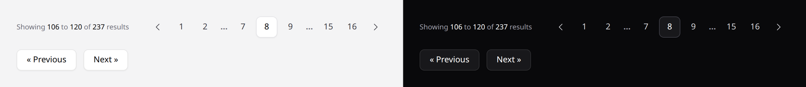

# Pagination

Two Laravel paginator views, not components, each with a Livewire variant.



## Use it

Point the paginator at them once, in a service provider:

```php
use Illuminate\Pagination\Paginator;

public function boot(): void
{
    Paginator::defaultView('ds::pagination');
    Paginator::defaultSimpleView('ds::simple-pagination');
}
```

Then every paginated screen follows, with no change to your views:

```blade
{{ $reports->links() }}
```

Or name one explicitly:

```blade
{{ $reports->links('ds::simple-pagination') }}
```

## Which is which

| View | For |
|---|---|
| `ds::pagination` | `paginate()` — numbered pages, with a total. |
| `ds::simple-pagination` | `simplePaginate()` — previous and next only. |
| `ds::pagination-livewire` | The first, inside a Livewire component. |
| `ds::simple-pagination-livewire` | The second, inside a Livewire component. |

`simplePaginate()` does not count the total rows, so it is the faster query on a
large table — and the view matches, because there is no page count to show.

## With Livewire

In a Livewire component that uses `WithPagination`, name the Livewire variants
from the component itself:

```php
use Livewire\Component;
use Livewire\WithPagination;

class Reports extends Component
{
    use WithPagination;

    public function paginationView(): string
    {
        return 'ds::pagination-livewire';
    }

    public function paginationSimpleView(): string
    {
        return 'ds::simple-pagination-livewire';
    }
}
```

`{{ $reports->links() }}` in the component's view then renders the same row,
with buttons that call `gotoPage`, `previousPage` and `nextPage` instead of
links. Every control carries `wire:loading.attr="disabled"` and its own
`wire:key`, and honours a custom page name.

**Why `Paginator::defaultView()` alone is not enough.** `WithPagination`
replaces the default view with Livewire's own for as long as the component
renders, so the call in your service provider is ignored there. And the plain
`ds::pagination` view, named explicitly, renders `<a href>` links: every page
change would be a full page load, and the component's state, such as a live
search, would be lost with it.

Like Livewire's own views, these scroll the page back to the top on a page
change. Pass `scrollTo` to aim elsewhere, or `false` to stay put:

```blade
{{ $reports->links(data: ['scrollTo' => '#reports']) }}
{{ $reports->links(data: ['scrollTo' => false]) }}
```

These two views are the only place the package emits `wire:` directives (and
the scroll's `x-on:click`, which Livewire's bundled Alpine runs). Outside a
Livewire component they are inert attributes.

## What it replaces

Laravel's stock Tailwind pagination view is built on `gray` and `blue-300` focus
borders — a second neutral ramp and an off-system accent — and carries its own
hand-written `dark:` classes that assume a palette this system does not use.
These two use the system's tokens throughout, so they follow your theme and dark
mode with nothing extra.

## The current page is elevation, not colour

Marked the same way the active [nav item](nav-item.md) is: a raised card, never a
fill. "You are here" means the same thing in both places, and elevation survives
dark mode where a colour would have to be redefined.

More in [specs/pagination.md](../../specs/pagination.md).
