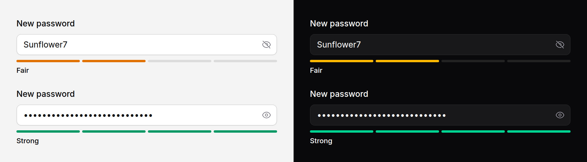

# Password strength

A meter under a new-password field that says how strong the password is, in
words, as it is typed. Paired with `reveal` on [input](input.md), which adds a
button to show the password.



> **Needs Alpine** and the package's script. See [getting started](../getting-started.md#3-add-the-script).

## Use it

```blade
<x-ds::input
    type="password"
    id="password"
    name="password"
    label="New password"
    autocomplete="new-password"
    help="At least 8 characters."
    :reveal="true"
    :error="$errors->first('password')"
/>
<x-ds::password-strength for="password" />
```

The meter is bound to the field by `for`, the field's `id`, the way a `label`
is. Give the input an `id` so there is something to point at.

## It is a hint, not a security control

The score is a small heuristic of the package's own, run in the browser: length
first, then the mix of character kinds, minus runs like `aaaa` or `1234` and
minus the commonest passwords dressed up with capitals and symbols
(`P@ssw0rd!` is Weak). It knows nothing about the person, the site, or the
breach lists a real checker consults, and anyone can switch it off in their
browser.

So: **your server's rules decide** what is accepted. Laravel's
`Password::min(8)->uncompromised()` checks against known breaches, which this
cannot. Use the meter to help someone choose before they press Save, never to
decide whether they may.

## Props

| Prop | Type | Default | What it does |
|---|---|---|---|
| `for` | string | *required* | The `id` of the password input it measures. |
| `minLength` | int | `8` | Shorter than this, a password is Weak whatever else it has. Match your server's rule. |
| `labels` | array | `['Weak', 'Fair', 'Good', 'Strong']` | The four level names, weakest first. Pass fewer to replace only the first ones. |

## The levels

| Level | Shown as |
|---|---|
| Nothing typed | Four empty bars, no words |
| Weak | One bar, danger |
| Fair | Two bars, warning |
| Good | Three bars, success |
| Strong | Four bars, success |

The level is never colour alone: the number of bars lit and the word under them
say it too.

## Reveal

`reveal` on `ds::input` adds a button inside the field that shows the password
as text and hides it again. It works on any `type="password"` input, with or
without the meter.

```blade
<x-ds::input type="password" name="password" label="Password" autocomplete="current-password" :reveal="true" />
```

- The button is named "Show password" and says whether the password is showing
  with `aria-pressed`. The name does not change; the eye icon does.
- Pressing it keeps focus and the caret in the field, so someone checking what
  they typed can carry on typing.
- It never submits the form, and when the form submits the field goes back to
  hidden, so the browser offers to save a password rather than a line of text.

`reveal` only applies to `type="password"`. On any other type it is ignored.

## Accessibility

- The level is spoken through a polite live region, as a whole sentence:
  "Password strength: Good". It speaks when the level changes, not on every key.
- The bars are decoration (`aria-hidden`); the words carry the meaning.
- The reveal is a toggle button with a fixed name and `aria-pressed`, as the
  WAI-ARIA pattern for toggle buttons asks. A name that also flipped to "Hide
  password" would be read as "Hide password, pressed": two answers to one
  question.

## Don't

- **Don't block a submit on the meter.** See above.
- **Don't use it on a sign-in form.** Measuring a password someone already has
  tells them nothing and tells anyone watching the screen something.
- **Don't put the rules only in the meter.** Say them in the field's `help`
  ("At least 8 characters"), where they are read before typing, not after.

More in [specs/password-strength.md](../../specs/password-strength.md).
