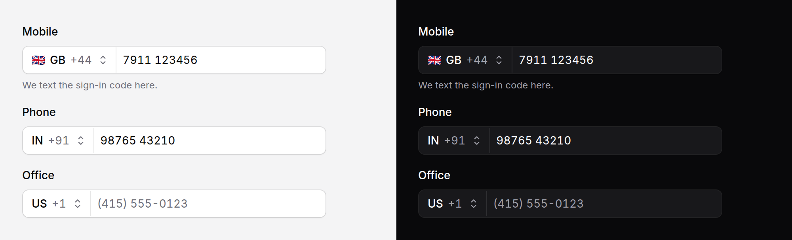

# Phone input

A phone number with its country: picked from a list you can search by name,
code or dial code, formatted as it is typed, and posted as E.164
(`+447911123456`).



> **Needs Alpine** and the package's script for the country picker, the
> formatting and E.164. Without them it is a native select of dial codes and a
> tel field, posting `name[country]` and `name[number]`. See
> [getting started](../getting-started.md#3-add-the-script).

> **This is not libphonenumber.** It knows each country's dial code, one common
> way of writing its numbers and roughly how long they are. It will not tell a
> real number from a made-up one. **Validate on the server**, for example with
> [propaganistas/laravel-phone](https://github.com/Propaganistas/Laravel-Phone).

## Use it

```blade
<x-ds::phone-input name="phone" label="Phone" :value="$user->phone" />

<x-ds::phone-input
    name="phone"
    label="Mobile"
    country="IN"
    :preferred="['IN', 'US', 'GB']"
    countryName="phone_country"
    :flags="true"
/>

{{-- Only these, no search field (six or fewer) --}}
<x-ds::phone-input name="phone" label="Phone" :countries="['GB', 'IE', 'FR', 'DE']" />

<x-ds::phone-input name="phone" label="Phone" wire:model.blur="phone" />
```

## What it posts

| | With the script | Without it |
|---|---|---|
| `name` | `+447911123456` (E.164), or `""` | — |
| `name[country]` | — | `GB` |
| `name[number]` | — | `07911 123456`, as typed |
| `countryName` | `GB`, when you set it | — |

Accept both shapes in your request, or validate the no-script one by joining
the two. `wire:model` and `x-model` bind the E.164 string.

## Props

| Prop | Type | Default | What it does |
|---|---|---|---|
| `name` | string | — | The field the number posts under. |
| `label` | string | — | The field's label. |
| `value` | string | — | E.164. A number without "+" is read as national, in `country`. |
| `country` | string | the app locale's region, else `US` | ISO code of the country shown when `value` does not say. |
| `countries` | array | every country | ISO codes to offer. Only these are sent to the page. |
| `preferred` | array | `[]` | ISO codes pinned to the top, in this order. The rest follow by name. |
| `countryName` | string | — | With the script, the chosen country's ISO code posts under this name too. |
| `flags` | bool | `false` | Show each country's flag emoji. Off by default: Windows draws them as two letters. |
| `placeholder` | string | — | The number field's placeholder. |
| `countryLabel` | string | `"Country"` | The picker's name. |
| `searchPlaceholder` | string | `"Search countries"` | The search field, shown for more than six countries. |
| `emptyText` | string | `"No countries match"` | Said when the search matches nothing. |
| `help` | string | — | Guidance under the field. |
| `error` | string | — | Replaces `help`, marks the field invalid. |
| `size` | `md` \| `sm` | `md` | `sm` is 32px, for a table row. |
| `disabled` | bool | `false` | |

Anything else (`id`, `required`) goes on the number field; `class` on the root.
The country data is `resources/data/countries.php`; an unknown code throws.

## What it does

- **Typing** formats the number for its country (`98765 43210` for India,
  `(415) 555-0123` for the US) and keeps the caret where it was.
- **A leading 0**, the trunk prefix most countries dial at home, stays on
  screen and is dropped from E.164: `07911 123456` in the UK posts
  `+447911123456`. Italy and a few others keep theirs, as E.164 does.
- **A number starting `+` or `00`**, typed or pasted, chooses its country:
  paste `+1 415 555 0123` and the picker moves to the United States. Where
  several countries share a code, the field's own country wins if it is one of
  them, then the main one (+1 is the US, +44 the UK).
- **Leaving the field** checks the length only. A number clearly too short or
  too long for the country is marked invalid with a note. The form still
  submits: the server decides.
- **The picker** searches as you type: "germ" finds Germany, "gb" the United
  Kingdom first, "+44" every country on +44. Choosing one keeps the number and
  closes the list.

PHP has the same reading, for a value you hold:

```php
use Shipbytes\BladeUi\Support\Phone;

Phone::parse('+447911123456', ['GB', 'US'], 'US'); // ['country' => 'GB', 'national' => '7911123456']
Phone::e164('GB', '07911 123456');                 // "+447911123456"
```

## Accessibility

- The number is `type="tel"` with `inputmode="tel"` and
  `autocomplete="tel-national"`; the no-script select is
  `autocomplete="tel-country-code"`, so autofill fills both.
- The picker is a button that says the country ("Country: India, IN +91") and
  opens a [popover](popover.md) with a listbox; arrows, Home, End, Enter and
  Escape work as in every list here, and focus comes back to the button.
- The length note is announced politely and is part of the field's
  description. Flags are hidden from screen readers.

## Don't

- **Don't treat a number it accepts as valid.** See the note at the top.
- **Don't rely on `flags` alone** to tell countries apart. The code and name are
  always shown.
- **Don't offer every country when you serve three.** Pass `countries`; the
  page gets smaller and the list shorter.

More in [specs/phone-input.md](../../specs/phone-input.md).
