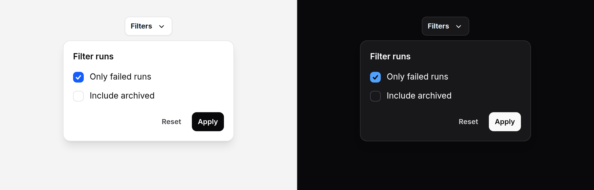

# Popover

A small panel of anything, opened from a button and anchored to it: filters
over a table, a share form, a few settings. It stays beside its trigger and on
screen, flipping above it near the bottom of the window, and closes when the
reader is done with it.



> **Needs Alpine** and the package's script. See [getting started](../getting-started.md#3-add-the-script).

## Use it

```blade
<x-ds::popover label="Filters">
    <x-slot:trigger>
        <x-ds::button variant="secondary" size="sm">
            Filters <x-ds::icon name="chevron-down" variant="mini" size="4" />
        </x-ds::button>
    </x-slot:trigger>

    <form method="GET" action="{{ route('reports.index') }}" class="flex flex-col gap-3">
        <x-ds::checkbox name="failed" value="1" label="Only failed runs" :checked="request()->boolean('failed')" />
        <x-ds::select name="owner" label="Owner" :options="$owners" :value="request('owner')" />
        <x-ds::button type="submit" size="sm">Apply</x-ds::button>
    </form>
</x-ds::popover>
```

The trigger is your own button; the popover finds it and gives it
`aria-expanded` and `aria-controls`. A press opens and closes it.

### When the host owns the state

Pass `open` to drive it from your own Alpine, a Livewire property, or a button
inside it that closes it:

```blade
<div x-data="{ shareOpen: false }">
    <x-ds::popover open="shareOpen" labelledby="share-title" placement="bottom-end" width="lg">
        <x-slot:trigger>
            <x-ds::button size="sm">Share</x-ds::button>
        </x-slot:trigger>

        <h3 id="share-title" class="text-section font-semibold text-fg">Share this report</h3>
        <x-ds::input name="email" label="Email" class="mt-3" />
        <x-ds::button size="sm" class="mt-3" @click="shareOpen = false">Send</x-ds::button>
    </x-ds::popover>
</div>
```

Like a [modal](modal.md)'s, `open` is a **reference** the component writes back
to, not a condition: `open="mode === 'share'"` is refused when the page renders.

### Nested, and with fields inside

A popover can open another, and can hold a [combobox](combobox.md),
[select](select.md) or [dropdown](dropdown.md): a press inside any of them is
inside the popover, so it stays open, and Escape closes the innermost thing
first.

## Props

| Prop | Type | Default | What it does |
|---|---|---|---|
| `placement` | string | `bottom-start` | The preferred side and alignment: `top`, `bottom`, `left` or `right`, then `-start`, `-end`, or nothing for centred. It flips to the opposite side when there is no room, and shifts along the edge to stay 8 px inside the window. |
| `open` | string | — | An assignable Alpine reference holding the state. Left out, the popover holds its own. |
| `label` | string | — | The dialog's name, when nothing in it says what it is. |
| `labelledby` | string | — | The id of a heading inside that names it. Preferred over `label`. With neither, the panel is named by the trigger. |
| `describedby` | string | — | The id of the text inside that says more, read with the name. |
| `role` | string | `dialog` | `alertdialog` for a panel that asks one question before something happens, as [confirm popover](confirm-popover.md) does. |
| `width` | string | `md` | `sm` (14rem), `md` (18rem) or `lg` (24rem), never wider than the window. |
| `dismissible` | bool | `true` | Escape, a press outside and focus leaving close it. `false` for a panel you close yourself. |

Slots: `trigger` (your button) and the default slot (the panel's content).
`id` names the panel; any other attribute goes on the wrapper.

## What it does

- **Opens** on a press of the trigger and moves focus to the first thing in it
  you can focus (or an element marked `data-ds-autofocus` or `autofocus`), or
  to the panel itself.
- **Closes** on Escape, on a press anywhere outside it, and when focus moves
  out of it, Tab included. Escape and closing from inside give focus back to
  the trigger; a press elsewhere leaves focus where you pressed.
- **Stays beside its trigger**, on screen, as the page scrolls or the window
  resizes, and is not cut off by a parent with `overflow: hidden`.
- **Fades and scales in** from the side it opened on, over 150 ms; with reduced
  motion it simply appears.

## Accessibility

- The panel is `role="dialog"`, **not modal**: there is no `aria-modal`, no
  backdrop and no focus trap. Tab moves through it and on past it, which
  closes it.
- The trigger carries `aria-expanded` and `aria-controls`.
- Name it: `labelledby` a visible heading when it has one, `label` when it
  does not. A panel with neither is named by its trigger, which is right when
  the trigger says what the panel is ("Filters").
- Everything inside must be reachable by keyboard in the order it reads, since
  the panel sits right after the trigger in the page.

## Limits

- **Inside a transformed ancestor** (a `transform`, `filter`, `contain` or
  `will-change` for one), the panel is positioned correctly but can still be
  clipped by that ancestor's own `overflow: hidden`, and is scaled with it.
- **A list inside a panel that has hit its height cap** (a long panel near
  both edges of a short window) scrolls with the panel, and a combobox's list
  opening near the bottom of it is clipped by it.

## Don't

- **Don't use it for a menu of actions.** That is a [dropdown](dropdown.md),
  which has `role="menu"` and arrow keys.
- **Don't use it for a decision the page must wait on.** That is a
  [modal](modal.md): this one closes when the reader looks away.
- **Don't open it on hover.** For a preview on hover, use a
  [hover card](hover-card.md).
- **Don't drive it with a condition** (`open="tab === 'share'"`); hold the
  state in a property.

More in [specs/popover.md](../../specs/popover.md).
