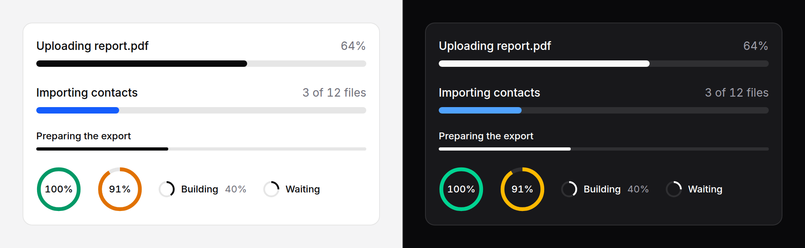

# Progress

How far along a task is, as a bar or a ring, or that it is running with no
known end.



## Use it

```blade
<x-ds::progress label="Uploading report.pdf" :value="$percent" :showValue="true" />
<x-ds::progress label="Importing contacts" :value="$done" :max="$total">{{ $done }} of {{ $total }} files</x-ds::progress>
<x-ds::progress label="Preparing the export" />
<x-ds::progress label="Syncing" :value="64" variant="circle" :showValue="true" />
```

## Props

| Prop | Type | Default | What it does |
|---|---|---|---|
| `value` | number or `null` | `null` | How far along, from 0 to `max`. `null` is indeterminate. Out-of-range values are clamped. |
| `max` | number | `100` | What `value` counts up to. |
| `label` | string | — | What is in progress. Always the accessible name. Required, unless you pass `aria-labelledby`. |
| `hideLabel` | bool | `false` | Keeps the name for screen readers and takes it off the screen. |
| `showValue` | bool | `false` | Prints the percentage beside the label, or inside an `md` ring. |
| `tone` | `neutral` `accent` `success` `warning` `danger` | `neutral` | The fill's colour. `neutral` is the primary button's fill. |
| `size` | `sm` `md` | `md` | A 4px or 8px bar; a 20px or 56px ring. |
| `variant` | `bar` `circle` | `bar` | The shape. |

The **default slot** replaces the printed percentage with your own words: "3 of
12 files", "2.1 of 4 MB". It shows whenever it has content, with or without
`showValue`.

## Indeterminate

Leave `value` off, or pass `null`, when the work has no known length. The bar
sweeps a segment across the track and the ring spins. Both are `motion-safe`:
with reduced motion the bar is a static striped track and the ring a dashed
circle, which say "working" without suggesting an amount.

The screenshot freezes the sweep at its first frame, so the indeterminate bar
there looks like a value. On a page it moves.

## Driving it live

The component holds no state. Its fill reads one CSS custom property,
`--ds-progress`, a plain number from 0 to 100 set on the component's own
element, so a host moves the bar with one binding on the tag. Bind
`aria-valuenow` beside it so a screen reader hears the same number, and word
the value through the slot:

```blade
<div x-data="{ done: 10 }">
    <x-ds::progress
        label="Uploading"
        :value="10"
        ::style="{ '--ds-progress': done }"
        ::aria-valuenow="done"
    ><span x-text="done + '%'">10%</span></x-ds::progress>
</div>
```

Three things make this work, and the behaviour suite drives exactly this
markup:

- **`::style` in the object form.** It sets one property and leaves the
  server-rendered one to be overwritten, so the first paint is right before
  Alpine boots and the binding takes over after.
- **The value is a number of percent, not of `max`.** `--ds-progress` is always
  0 to 100. With a `max` of 12, bind `done / 12 * 100` to it and `done` to
  `aria-valuenow`.
- **`::value` does nothing.** `value` is a PHP prop, read once when the view
  renders; binding it from Alpine sets an attribute nothing reads. The same
  rule as [tone and size](../getting-started.md#driving-components-from-client-side-state).

Clamp in your own code when you bind: the component clamps what it renders,
not what you bind afterwards.

### From Livewire

A Livewire property needs nothing extra. Each response re-renders the
component with the new `value`, and Livewire's morph patches the `style` and
`aria-valuenow` in place, so the width transitions rather than jumps:

```blade
<div wire:poll.1s>
    <x-ds::progress label="Importing" :value="$import->percent" :showValue="true" />
</div>
```

For progress **during** one long request, stream the number with
`wire:stream` and let Alpine read it:

```blade
<div x-data="{ done: 0 }">
    <span hidden wire:stream="import-progress"
        x-init="new MutationObserver(() => done = Number($el.textContent) || 0)
            .observe($el, { childList: true, characterData: true, subtree: true })"></span>

    <x-ds::progress label="Importing" :value="0"
        ::style="{ '--ds-progress': done }" ::aria-valuenow="done"
    ><span x-text="done + '%'">0%</span></x-ds::progress>
</div>
```

```php
foreach ($rows as $i => $row) {
    // …import the row…
    $this->stream(to: 'import-progress', content: (int) (($i + 1) / count($rows) * 100), replace: true);
}
```

## Accessibility

- `role="progressbar"` with `aria-valuemin`, `aria-valuemax` and
  `aria-valuenow`. Indeterminate **omits** `aria-valuenow`, which is how a
  progressbar says "unknown"; a 0 would be read as "0 percent" for the whole
  wait.
- The name is `label`, as `aria-label`, whether or not it is shown. The visible
  label and value are hidden from assistive technology so they are not read
  twice.
- A progress with no `label` and no `aria-labelledby` **throws**, because a
  nameless progress bar on a page with two of them cannot be told apart.
- It is not focusable and has no keyboard interaction. It does not announce
  changes by itself: if the end of the task matters, say so in a
  [toast](toast.md) or a live region.

## Don't

- **Don't use it for an allowance.** "42 of 50 credits" is a measurement, not a
  task. Use [usage meter](usage-meter.md).
- **Don't bind `::value`.** Bind `--ds-progress` (see above).
- **Don't use indeterminate for something that has a length.** A real number,
  even a coarse one, is worth more than a sweep.
- **Don't put other content in the ring.** It carries the value and nothing
  else.

More in [specs/progress.md](../../specs/progress.md).
