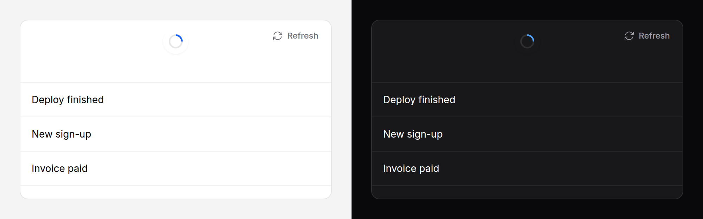

# Pull to refresh

Pull a list down at its top to refresh it, on a touch screen. Everyone else
gets a Refresh button that does the same.



> **Needs Alpine** and the package's script. See [getting started](../getting-started.md#3-add-the-script).
> Without them it is its Refresh button: a link, or a submit for its form.

## Use it

```blade
<x-ds::pull-refresh :href="route('inbox')" label="Inbox" class="h-[70vh]">
    @foreach ($messages as $message)
        <a href="{{ route('messages.show', $message) }}" class="block px-4 py-3">{{ $message->subject }}</a>
    @endforeach
</x-ds::pull-refresh>
```

Nobody answering the `refresh` event, a pull (or the button) follows `href`:
the page that comes back is the refreshed one. Give the root a height to make
it the scrolling box; without one, the page scrolls it.

## Props

| Prop | Type | Default | What it does |
|---|---|---|---|
| `threshold` | int (px) | `72` | How far the content has to come down before letting go refreshes. |
| `timeout` | int (ms) | `10000` | Ends a refresh nobody ends. `0` for none. |
| `refreshing` | bool | `false` | Render it refreshing. A re-render without it ends a refresh. |
| `href` | string | — | Where the Refresh button goes. Without it the button submits its form. |
| `button` | string \| `false` | `Refresh` | The button's words; `false` for none. |
| `label` | string | — | The region's name. |
| `updatedLabel` | string | `Updated` | Said when a refresh ends. |

## Events

| Event | On | When |
|---|---|---|
| `refresh` | the root, bubbling, cancelable | A pull past the threshold, or the button. `preventDefault()` to answer it yourself. |
| `refreshed` | dispatch it on the root | You are done. |

While it refreshes the root is `data-refreshing` and `aria-busy="true"`.

## With Livewire

Answer `refresh` and call the component. The script marks the root
`data-refreshing`; the re-render that brings the new rows is rendered without
it, the morph drops it, and that ends the refresh. Nothing to dispatch.

```blade
<x-ds::pull-refresh label="Inbox" class="h-[70vh]" x-on:refresh.prevent="$wire.reload()">
    @foreach ($messages as $message) … @endforeach
</x-ds::pull-refresh>
```

```php
public function reload(): void
{
    $this->messages = Message::latest()->limit(50)->get();
}
```

A component that renders nothing new still re-renders the root, so the
refresh ends. Render `:refreshing="true"` to show one the server started.

With Alpine and `fetch` instead:

```blade
<x-ds::pull-refresh x-on:refresh.prevent="await load(); $el.dispatchEvent(new Event('refreshed'))">
```

## Behaviour

- **Touch only.** A mouse or a pen does not pull; the button is there.
- The pull resists more the further it goes; the ring fills to the threshold.
- Scrolled down, a pull scrolls the box back up, as usual.
- `overscroll-behavior-y: contain` on the box keeps the browser's own pull to
  refresh out of it. The page's own is the browser's.
- "Updated" is said, politely, when a refresh ends.

## Don't

- **Don't hide the button** (`button="false"`) unless the page has its own
  Refresh. The gesture is touch only.
- **Don't leave `refresh` unanswered with no `href` and no form.** The
  spinner then runs until the timeout.

More in [specs/pull-refresh.md](../../specs/pull-refresh.md).
