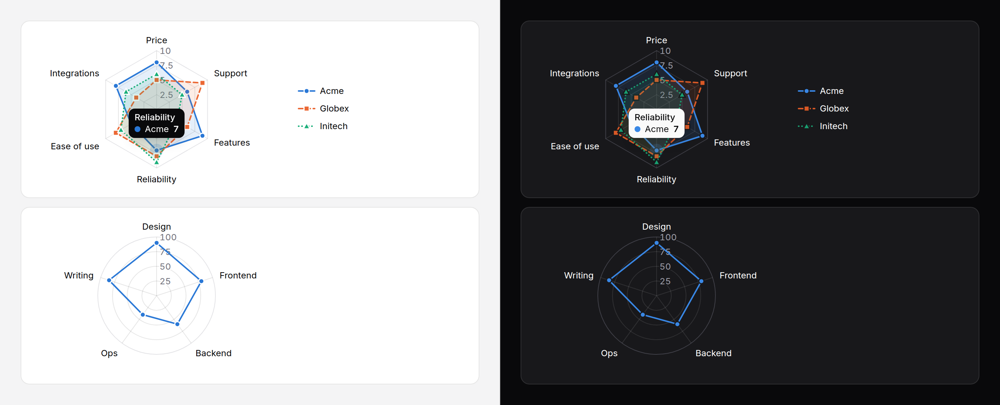

# Radar chart

One to four items scored on the same 3 to 8 measures, each a polygon over a
web of spokes, so the shape of a profile reads at a glance. Static SVG with
a generated summary and, by default, every value in a visually hidden table.



> **Needs Alpine** and the package's script for the readout, keyboard
> access to each point and the legend toggles. Without them the radar is a
> correct static image with a generated text alternative and its table. See
> [getting started](../getting-started.md#3-add-the-script).

## When to use it

For the **shape** of a profile: which measures an item is strong and weak
on, and whether two items are strong in the same places. A skills profile,
a product's scores against a rubric, two vendors side by side.

**A grouped [bar chart](bar-chart.md) is better** whenever the exact values
matter, or the items are to be ranked: bars share one baseline and are read
precisely, while a radar's values sit on angled spokes against rings and
are read roughly. It is also better past four items, for measures with no
common scale, and for readers who have to compare across two charts.
The radar's area is no guide either: reorder the axes and it changes.

## Use it

```blade
{{-- Two vendors on six measures, scored out of 10 --}}
<x-ds::radar-chart label="Vendor scores" :max="10"
    :axes="['Price', 'Support', 'Features', 'Reliability', 'Ease of use', 'Integrations']"
    :data="['Acme' => [8, 6, 9, 7, 5, 8], 'Globex' => [5, 9, 6, 8, 8, 4]]" />

{{-- One profile, a round grid, no fill --}}
<x-ds::radar-chart label="Skills" shape="circle" :fill="false" size="sm"
    :axes="['Design', 'Frontend', 'Backend', 'Ops', 'Writing']" :data="['Ada' => [90, 80, 60, 40, 85]]" />

{{-- Measures in different units: a top per axis, values keyed by axis --}}
<x-ds::radar-chart label="Plans" :axes="['Seats', 'Storage', 'Rating']"
    :max="['Seats' => 50, 'Storage' => 500, 'Rating' => 5]"
    :data="[['label' => 'Pro', 'values' => ['Seats' => 20, 'Storage' => 200, 'Rating' => 4.5]]]" />
```

## Props

| Prop | Type | Default | What it does |
|---|---|---|---|
| `axes` | array | — | The measures, 3 to 8 names, clockwise from the top. Fewer or more throws. |
| `data` | array | — | The items, at most 4 (more throws): `['Acme' => [8, 6, 9], …]`, or rows with `label`, `values` (in axis order, or keyed by axis name) and an optional `tone` or `series`. Every value a number of zero or more. |
| `max` | number or array | a round number above the data | The scale's top: one number for every axis, or one per axis (a list, or keyed by axis name). Per axis, the rings are not numbered and values read "4.5 of 5". A value past its top is drawn at the edge. |
| `rings` | int, 2 to 10 | `4` | Grid levels between the centre and the edge. |
| `shape` | `polygon` `circle` | `polygon` | The grid's shape. |
| `fill` | bool | `true` | Fill each item's area faintly. |
| `legend` | `beside` `below` `none` | `beside` | The legend, from two items up: each item's marker and line style, with its name. `beside` wraps underneath when there is no room. |
| `size` | `sm` `md` `lg` | `md` | The grid 160, 224 or 288px across; the chart 336, 400 or 464px wide with its axis names. |
| `label` | string | — | What is compared; the start of the summary and the table's caption. |
| `format` | array | `[]` | How values read; [counter's keys](counter.md#format). |
| `summary` | string | generated | The text alternative, in place of the generated one. |
| `table` | bool | `true` | Every value as a visually hidden table, axis by item. Leave it on: it is how a radar is read exactly. |
| `interactive` | bool | `true` | With the script: the readout, keyboard access and legend toggles. |
| `empty` | string | `No data to show` | The empty state's title, when there are no items. |

The chart has a fixed size and shrinks, text with it, only in a box
narrower than itself; use `size="sm"` in narrow columns and on phones.

## Accessibility

- Without the script the radar is `role="img"`: "Vendor scores. Acme:
  highest Features at 9, lowest Ease of use at 5. Globex: highest Support at
  9, lowest Integrations at 4." The table follows it with every value.
- With it, one Tab stop; Right and Left move through the points, Down and
  Up to the same axis of the next or previous item, Home and End to the
  ends, Escape puts the readout away. Each point is named "Reliability,
  Acme: 7". The legend's entries are toggle buttons.
- Items are told apart by a marker each (circle, square, triangle,
  diamond) and a line style each, in the chart and in the legend, never by
  colour alone.

## Don't

- **Don't use it to compare exact scores.** That is a grouped bar chart.
- **Don't read the area.** It depends on the order of the axes.
- **Don't put measures in different units on one scale.** Give `max` per
  axis.
- **Don't draw more than four items.** It throws.

More in [specs/radar-chart.md](../../specs/radar-chart.md).
