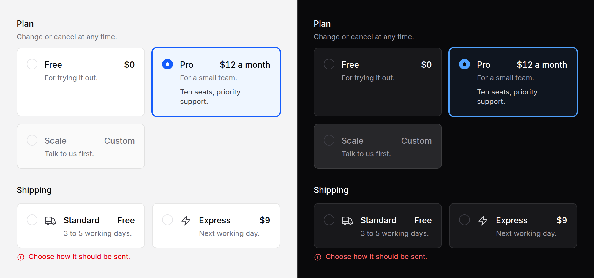

# Radio cards

Options large enough to compare before choosing: a plan, a shipping method, a
workspace region. The whole card is the label of a real radio.



No script. The browser does the arrow keys, `required` and posting.

## Use it

```blade
<x-ds::radio-cards name="plan" label="Plan" help="Change or cancel at any time." :columns="3">
    @foreach ($plans as $plan)
        <x-ds::radio-card
            :value="$plan->slug"
            :title="$plan->name"
            :description="$plan->tagline"
            :checked="old('plan', $current) === $plan->slug"
        >
            <x-slot:meta>{{ $plan->price }}</x-slot:meta>
            {{ $plan->summary }}
        </x-ds::radio-card>
    @endforeach
</x-ds::radio-cards>
```

With an icon:

```blade
<x-ds::radio-card value="express" title="Express" description="Next working day.">
    <x-slot:icon><x-ds::icon name="bolt" size="5" /></x-slot:icon>
    <x-slot:meta>$9</x-slot:meta>
</x-ds::radio-card>
```

## Livewire and Alpine

Put the binding, and `required`, on the group. Both are written onto every
card's radio:

```blade
<x-ds::radio-cards name="shipping" label="Shipping" required wire:model.live="shipping">
    …
</x-ds::radio-cards>
```

Pass `:checked` from the same value, so the first paint is right before
Livewire or Alpine starts.

## Props

`ds::radio-cards`:

| Prop | Type | Default | What it does |
|---|---|---|---|
| `name` | string | — | Shared by every card. Required. |
| `label` | string | — | What is being chosen. The group's legend. Required. |
| `help` | string | — | Under the legend. |
| `error` | string | — | Under the cards, replacing `help`; marks the group invalid. |
| `columns` | int | `1` | 1 to 4 across. Two from `sm`, three or four from `lg`, always one on a phone. Anything else throws. |

`required`, `wire:model` and `x-model` go on the radios; `id`, `class` and
the rest on the fieldset.

`ds::radio-card`:

| Prop / slot | Type | Default | What it does |
|---|---|---|---|
| `value` | string | — | What the card posts when chosen. Required. |
| `title` | string | — | The option's name. Required. |
| `description` | string | — | One line under the title. |
| `checked` | bool | `false` | Chosen on the first paint. |
| `disabled` | bool | `false` | Cannot be chosen; greyed, skipped by the arrow keys. |
| slot | | | Short text under the description. |
| `meta` slot | | | Right of the title: a price, a delivery date. |
| `icon` slot | | | Before the text, usually a `ds::icon` at `size="5"`. |

`class` goes on the card; `id` names the radio, and anything else goes on it.

## What it does

- **Choosing**: a press anywhere on the card, or the arrow keys once the group
  has focus. The chosen card takes an accent border, a ring and a faint wash,
  by `:has(:checked)`. Nothing slides between cards.
- **Focus** is drawn around the whole card, not the small radio.
- **Columns** are a grid, so every card in a row is as tall as the tallest.

## Accessibility

- A `fieldset` with `role="radiogroup"`, named by its `legend`; `aria-invalid`
  with an error, `aria-required` when `required`.
- Each radio is named by the title and the meta, "Pro, $12 a month", and
  described by the description and body.
- The radio is visible, so "one of these" is shown, not only implied by the
  layout.
- Ids are built from the name and value, so they are the same on every render
  and Livewire updates a card rather than replacing it. Pass `id` on a card if
  the same name and value appear twice on one page.

## Don't

- **Don't put links or buttons in a card.** The card is a label; a press on
  anything inside it chooses the card.
- **Don't use cards for two short options.** That is a [radio](radio.md)
  group, or a [switch](switch.md).
- **Don't fill the body with a feature list.** Say what tells the options
  apart, and link to the full comparison outside the group.

More in [specs/radio-cards.md](../../specs/radio-cards.md).
