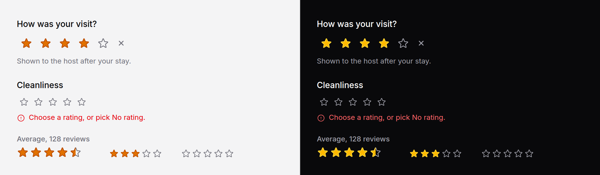

# Rating

A row of stars to choose a score with, or to show one: a review form, an
average under a product name.



No script. The stars are radios underneath, so a form posts one plain value
and the browser does the keyboard.

## Use it

```blade
<x-ds::rating name="score" label="How was your visit?" :value="old('score')" />
```

To show a score, `readonly`. It needs no `name` and posts nothing:

```blade
<x-ds::rating :readonly="true" :value="$product->average_rating" label="Average" />
```

## Props

| Prop | Type | Default | What it does |
|---|---|---|---|
| `name` | string | — | The field name. Required unless `readonly`; a rating without one throws when the view renders. |
| `label` | string | — | What is being rated. The group's legend, and shown above a readonly rating. |
| `max` | int | `5` | How many stars, 1 to 10. Anything else throws. |
| `value` | int, float | — | The rating. A whole number to choose; any number to show, drawn to the nearest half. |
| `readonly` | bool | `false` | Display only: one image of the rating, named "3.5 out of 5". |
| `size` | string | `md` | `sm`, `md`, `lg`. |
| `help` | string | — | Guidance under the stars. |
| `error` | string | — | Replaces `help`, marks the group invalid. |
| `disabled` | bool | `false` | Every star disabled; the chosen ones stay drawn, greyed. |

`required`, `wire:model` and `x-model` go on the radios. `id`, `class` and
anything else go on the group.

## What it posts

The star's number, as a string: `"4"`. A rating that is not `required` also
has **No rating**, posted as an empty string, so a validation rule of
`nullable|integer|between:1,5` reads it as "not answered".

## Taking a rating back

A radio group has no way back to "nothing chosen" once something is. So after
the stars there is a faint cross, **No rating**: a radio of its own, last in
the group. It is transparent while it is itself the choice, so a fresh form
shows five plain stars, and it appears once a star is chosen. The arrow keys
reach it from the last star, and from the first by wrapping.

With `required` it is left out, and the browser refuses to submit the form
until a star is chosen.

## What it does

- **Hovering** lights the stars up to the one under the pointer, a preview
  that replaces the choice while it lasts. Moving away restores the choice.
- **The keyboard** is a radio group's: Tab into it, the arrow keys move the
  rating, and the star with focus is lit and outlined.
- **Readonly** draws the value to the nearest half: 3.24 is three stars, 3.3
  is three and a half. The name says what is drawn, so a screen reader and an
  eye agree. No value is "Not rated", five outlines.

## Livewire and Alpine

```blade
<x-ds::rating name="score" label="Rate this answer" wire:model.live="score" />
```

The binding reaches every radio, as `wire:model` on a radio group does.

## Accessibility

- A `fieldset` with `role="radiogroup"`, named by its `legend`; `aria-invalid`
  with an error, `aria-required` when `required`.
- Each star is a real radio named "1 star", "2 stars", …; the cross is "No
  rating".
- Readonly is `role="img"` with a name of "4.5 out of 5" and nothing to focus.
- Star outlines hold 3:1 against the page: muted text colour unlit, a darker
  amber than the fill when lit, since the fill's amber alone falls short on a
  light page.

## Don't

- **Don't use it for a yes or no.** Two stars is a [radio](radio.md) group, or
  a [switch](switch.md).
- **Don't show an average as a picture alone.** Put the number and the count
  beside it: "4.5 · 128 reviews". The stars round; the number does not.
- **Don't make it `required` unless an answer truly is.** It also removes the
  way back.

More in [specs/rating.md](../../specs/rating.md).
