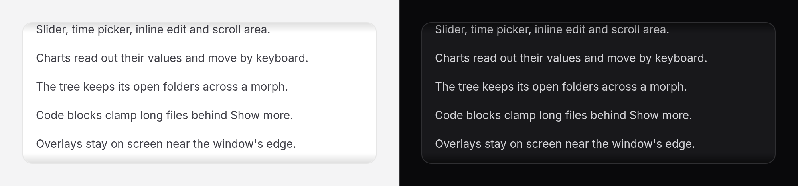

# Scroll area

A box that scrolls within a height, with a quiet native scrollbar and a
shadow at each edge that has more content past it.



No Alpine needed. With Alpine and the package's script, the edge shadows also
show in browsers that cannot draw them from CSS alone.

## Use it

```blade
<x-ds::scroll-area maxHeight="20rem" label="Release notes" class="rounded-panel border border-border bg-surface">
    <div class="p-4">{!! $notes !!}</div>
</x-ds::scroll-area>

<x-ds::scroll-area orientation="horizontal" scrollbar="hidden-until-hover" label="Tags">
    <div class="flex w-max gap-2">…</div>
</x-ds::scroll-area>
```

The scrolling is the browser's own: the wheel, touch, the scrollbar and the
keyboard all work as they do on any scrolling box. Put the border and the
rounding on the component; the content is clipped to them.

## Props

| Prop | Type | Default | What it does |
|---|---|---|---|
| `maxHeight` | number \| CSS length | — | The tallest it grows before it scrolls: pixels, or `20rem`, `50dvh`, `calc(…)`. |
| `height` | number \| CSS length | — | A fixed height instead. |
| `orientation` | `vertical` `horizontal` `both` | `vertical` | Which way the content may scroll. |
| `shadows` | bool | `true` | A shadow at an edge while there is more content beyond it. |
| `label` | string | — | The region's name. **Required when the content holds nothing focusable**; see below. |
| `scrollbar` | `auto` `thin` `hidden-until-hover` | `thin` | The browser's width, a thin bar, or a thin bar that appears on hover and on keyboard focus. |

## The keyboard

A box of plain text has to be a Tab stop of its own, or a keyboard cannot
scroll it at all. So when the content has nothing focusable in it, the
region gets `tabindex="0"`, `role="region"` and your `label` as its name, and
it throws without a `label`. When the content has links, buttons or fields,
Tab already scrolls the box to each of them, and the region adds no stop.

## The shadows

Drawn by CSS where the browser has scroll-driven animations; by
`x-ds-scroll-shadows`, from the package's script, where it does not; and not
at all with neither, which leaves the content scrolling the same.

## The scrollbar

Native, styled with `scrollbar-width` and `scrollbar-color` from the tokens,
with the gutter kept so the content never moves when the bar shows.
`hidden-until-hover` never hides it when the reader asks for more contrast or
uses forced colours.

## Accessibility

- A Tab stop, a `region` and a name when the content has nothing focusable;
  nothing extra when it has.
- The focus ring is drawn inside the box, so the clipping cannot cut it.
- The shadows are decorative and hidden from assistive technology.

## Don't

- **Don't nest two on the same axis.** A wheel that scrolls one box and then
  the other is a trap.
- **Don't use it to make a page fit the window.** Let the page scroll.
- **Don't hide the scrollbar to tidy a design.** Use `hidden-until-hover` only
  where the shadows already say the box scrolls.

More in [specs/scroll-area.md](../../specs/scroll-area.md).
