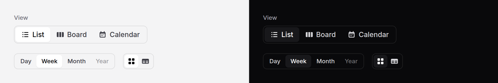

# Segmented control

One of a few views or modes, side by side in a track: List, Board, Calendar;
Day, Week, Month. Each segment is a real radio, so the control posts with the
form and binds like any other input. Or each segment is a link, for switching
views by moving to a URL.



No script needed. With Alpine and the package's script on the page, one
highlight slides from segment to segment. Without them, the chosen segment
draws its own face, which is also what every page shows for the moment before
the script runs. Either way it works and posts the same.

## Use it

```blade
<x-ds::segmented-control name="view" label="View">
    <x-ds::segment value="list" icon="list-bullet" :checked="$view === 'list'">List</x-ds::segment>
    <x-ds::segment value="board" icon="view-columns" :checked="$view === 'board'">Board</x-ds::segment>
    <x-ds::segment value="calendar" icon="calendar-days" :checked="$view === 'calendar'">Calendar</x-ds::segment>
</x-ds::segmented-control>
```

The request carries `view=board`. With `old()`, check from it as you would any
radio: `:checked="old('view', $view) === 'board'"`.

Icon only, keeping the words as the name:

```blade
<x-ds::segmented-control name="layout" label="Layout" :hideLabel="true" size="sm">
    <x-ds::segment value="grid" icon="squares-2x2" :iconOnly="true" :checked="true">Grid</x-ds::segment>
    <x-ds::segment value="rows" icon="table-cells" :iconOnly="true">Rows</x-ds::segment>
</x-ds::segmented-control>
```

Links, for views that live at their own URLs; a control of links is a `nav`
and the current one carries `aria-current="page"`:

```blade
<x-ds::segmented-control label="Report">
    <x-ds::segment :href="route('reports.overview')" :active="request()->routeIs('reports.overview')">Overview</x-ds::segment>
    <x-ds::segment :href="route('reports.traffic')" :active="request()->routeIs('reports.traffic')">Traffic</x-ds::segment>
</x-ds::segmented-control>
```

A control is all inputs or all links. Mixing them throws when the view renders.

## Livewire and Alpine

Put the binding on the control. It is written onto every segment's radio,
which is where Livewire and Alpine read a radio group from:

```blade
<x-ds::segmented-control name="view" label="View" wire:model.live="view">
    <x-ds::segment value="list" :checked="$view === 'list'">List</x-ds::segment>
    <x-ds::segment value="board" :checked="$view === 'board'">Board</x-ds::segment>
</x-ds::segmented-control>
```

The highlight also watches the bound value, so a host that changes `view` from
code, which checks a radio without any event, still moves it. Pass `:checked`
from the same data so the first paint is right.

## Props

`ds::segmented-control`:

| Prop | Type | Default | What it does |
|---|---|---|---|
| `name` | string | — | Shared by every segment's radio. Not needed for links. |
| `label` | string | — | What the segments choose between: the fieldset's legend, or the nav's name. Required. |
| `hideLabel` | bool | `false` | Keep `label` as the accessible name only, for a control whose meaning is plain from what is around it. |
| `size` | string | `md` | `sm` (32px), `md` (44px on phones, 36px from `sm` up, like a button), `lg` (44px). |
| `fullWidth` | bool | `false` | Stretch to the container, the segments sharing it equally. |

`id`, `class` and anything else go on the fieldset (or nav); `wire:model` and
`x-model` go on the radios.

`ds::segment`:

| Prop | Type | Default | What it does |
|---|---|---|---|
| `value` | string | — | What the segment posts when chosen. Required for a radio segment. |
| `checked` | bool | `false` | Chosen on the first paint. |
| `icon` | string | — | A Heroicons name, drawn before the words. |
| `iconOnly` | bool | `false` | The icon alone; the words stay as the accessible name. Needs `icon`. |
| `disabled` | bool | `false` | Cannot be chosen, or followed. |
| `href` | string | — | Makes it a link segment. |
| `active` | bool | `false` | The link segment for the view on screen: drawn chosen, `aria-current="page"`. |

The segment's words are its slot.

## What it does

- **Choosing** moves the highlight to the new segment over 150 ms. With
  reduced motion it moves at once. When the control changes size, or the
  segments' words do, the highlight follows without animating.
- **Before the script, or without it,** the chosen segment carries the same
  raised face itself. Once the script has placed the highlight, that face
  hands over to it, so nothing flashes.
- **The keyboard** is native radios: Tab into the control, the arrow keys move
  the choice, skipping disabled segments. Right-to-left pages work, the
  highlight included.
- **Disabled** segments are greyed and skipped. A disabled link loses its
  `href`.

Why a missing script does not throw, when the package's other script-backed
components do: the glide is the only thing the script adds here, and it is
decoration. The control renders `x-data` with no behaviour name and a
directive Alpine simply skips when it is not registered, so the rule that a
missing script should fail loudly is kept for the components it would break,
and this one stays a plain Blade component that is nicer with the script.

## Accessibility

- Radios: a `fieldset` named by its `legend` (or a visually hidden one with
  `hideLabel`), each segment a `label` around a visually hidden radio, so its
  name is its words.
- Links: a `nav` named by the label; the current one has `aria-current="page"`.
- Focus is a ring around the whole segment.
- The highlight is `aria-hidden`; the radios carry the state.

## Don't

- **Don't use it for more than about five options,** or for long words. Use
  a [select](select.md) or [radio group](radio.md).
- **Don't use it for actions.** A segment chooses; a [button group](button-group.md) acts.
- **Don't use it for tabs over panels on one page.** Use [tabs](tabs.md), which
  carry the tab and panel roles.
- **Don't mix links and radios.** It throws.

More in [specs/segmented-control.md](../../specs/segmented-control.md).
