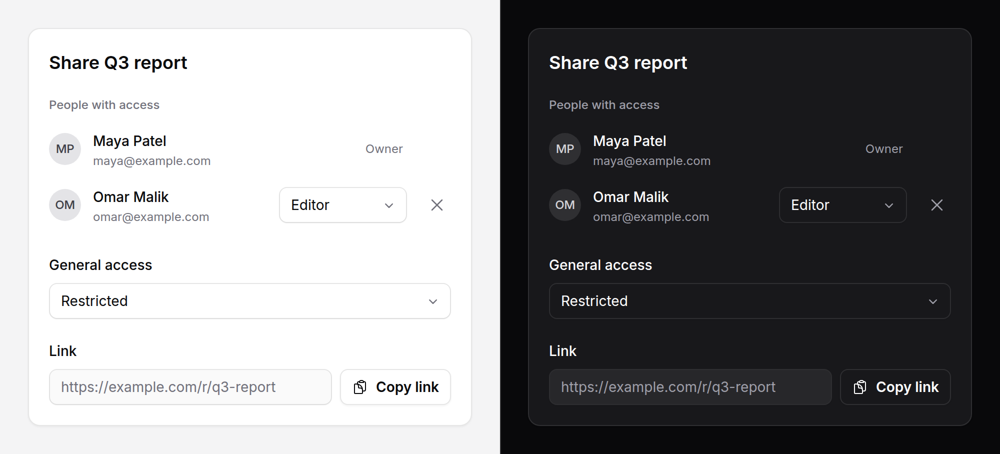

# Share sheet

Who has access and how to send the link: people with their roles, general
access, the link with a copy button, and the device's own share sheet where
the browser has one.



> **Works without Alpine.** Every control is a named form control, so inside a
> form it posts. With Alpine each change is also dispatched as an event, and
> the device share button appears where the browser has one.

## Use it

```blade
<form method="post" action="{{ route('reports.sharing', $report) }}">
    @csrf
    <x-ds::share-sheet
        :url="route('reports.show', $report)"
        label="Share {{ $report->title }}"
        :title="$report->title"
        :access="$report->access"
        :accessOptions="['restricted' => 'Restricted', 'link' => 'Anyone with the link']"
        :roles="['viewer' => 'Viewer', 'editor' => 'Editor']"
        :people="$report->members->map(fn ($m) => [
            'id' => $m->id, 'name' => $m->name, 'email' => $m->email,
            'avatar' => $m->photo_url, 'role' => $m->pivot->role, 'locked' => $m->is($report->owner),
        ])->all()"
    />
    <x-ds::button type="submit">Save</x-ds::button>
</form>
```

It posts `roles[<id>]` for each person, `access`, and, when a remove button was
the one pressed, `remove=<id>`:

```php
if ($id = $request->input('remove')) {
    $report->members()->detach($id);
} else {
    foreach ($request->input('roles', []) as $id => $role) {
        $report->members()->updateExistingPivot($id, ['role' => $role]);
    }
    $report->update(['access' => $request->input('access')]);
}
```

## Props

| Prop | Type | Default | What it does |
|---|---|---|---|
| `url` | string | *required* | The link, in a read-only field with a copy button. |
| `label` | string | `Share` | The heading, and the section's name. |
| `title`, `text` | string | — | For the device's own share sheet. |
| `access` | string | — | The current general access value. |
| `accessOptions` | array | `[]` | value => label. Empty: no access field. |
| `accessLabel` | string | `General access` | Words over the access field. |
| `people` | array | `[]` | One row each: `id`, `name`, `email`, `avatar`, `role`, `locked`. |
| `roles` | array | `[]` | value => label. Empty: each role is shown as words. |
| `peopleLabel` | string | `People with access` | |
| `linkLabel` | string | `Link` | |
| `copyLabel` | string | `Copy link` | |
| `shareLabel` | string | `Share…` | The device share button. |

A `locked` person shows their role as words and has no remove button: the
owner, say.

### Slots

| Slot | What goes in it |
|---|---|
| `invite` | A field and a button to add people, above the list. Yours: a `ds::combobox`, a `ds::tag-input`, an email field. |
| `peopleList` | List items of your own in place of the rows drawn from `people`. |
| `accessField` | Your own control in place of the access select. |

## Events

With Alpine, each change is dispatched from the control, bubbling:

| Event | `detail` |
|---|---|
| `role-change` | `{ id, role }` |
| `access-change` | `{ value }` |
| `remove` | `{ id }` |

The remove button is still a submit: inside a form, it posts. Outside one it
only dispatches.

## With Livewire

No form, no post: the component keeps the members, the events call it.

```blade
<x-ds::share-sheet
    :url="route('reports.show', $report)"
    :access="$access"
    :accessOptions="['restricted' => 'Restricted', 'link' => 'Anyone with the link']"
    :roles="['viewer' => 'Viewer', 'editor' => 'Editor']"
    :people="$people"
    x-on:role-change="$wire.setRole($event.detail.id, $event.detail.role)"
    x-on:access-change="$wire.set('access', $event.detail.value)"
    x-on:remove="$wire.remove($event.detail.id)"
>
    <x-slot:invite>
        <x-ds::input type="email" wire:model="invite" label="Add people" class="flex-1" />
        <x-ds::button wire:click="add">Invite</x-ds::button>
    </x-slot:invite>
</x-ds::share-sheet>
```

```php
public array $people = [];
public string $access = 'restricted';
public string $invite = '';

public function setRole(int $id, string $role): void { /* authorise, save */ }
public function remove(int $id): void { /* authorise, detach, reload $people */ }
```

Each event is a request: authorise it on the server as you would a post.

## The device share button

It shows only where the browser has a share sheet of its own
(`navigator.share`, most phones and some desktops), and is hidden until Alpine
has looked, so a browser without one never shows a button that does nothing.
Closing the device sheet without sharing is not an error.

## Don't

- **Don't keep who has access in the browser.** The component reports; the
  server decides.
- **Don't listen for `change` expecting these events.** They are named so they
  never collide with `x-model` and `wire:model`.

More in [specs/share-sheet.md](../../specs/share-sheet.md).
