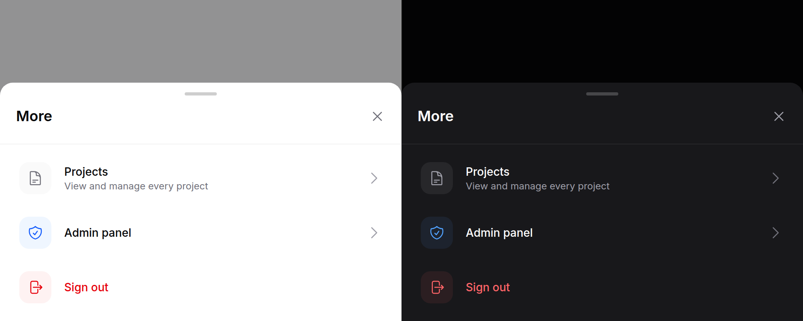

# Sheet

The mobile form of a modal or a drawer. Covers `sheet` and `sheet-item`.



> **Needs Alpine.** See [getting started](../getting-started.md#alpine).
> The sheet is `lg:hidden` — it does not render above the `lg` breakpoint.

## Use it

```blade
<div x-data="{ moreOpen: false }">
    <x-ds::button @click="moreOpen = true">More</x-ds::button>

    <x-ds::sheet open="moreOpen" title="More services">
        <x-ds::sheet-item href="/projects" label="Projects" description="View and manage every project">
            <x-slot:icon><x-ds::icon name="document-text" size="5" /></x-slot:icon>
        </x-ds::sheet-item>

        <x-ds::sheet-item label="Sign out" tone="danger" as="button">
            <x-slot:icon><x-ds::icon name="arrow-right-on-rectangle" size="5" /></x-slot:icon>
        </x-ds::sheet-item>
    </x-ds::sheet>
</div>
```

## `sheet` props

| Prop | Type | Default | What it does |
|---|---|---|---|
| `open` | Alpine **reference** | *required* | The boolean **you** declare. Must be assignable: the component sets it to `false` from the ✕ and the backdrop, so `open="mode === 'more'"` opens and then never closes. It throws rather than rendering that. |
| `title` | string | — | Heading and close button. |
| `maxHeight` | CSS length | `85vh` | Cap on the panel height, and what `full` means. |
| `snap` | array \| string | — | Snap points, lowest to highest or in any order: `'25%'` (of the window), `320` or `'320px'`, `'full'`. A string is split on commas. |
| `initialSnap` | int \| string | first point | Where it opens: an index into `snap`, or one of its values. |
| `draggable` | bool | `true` with any 2.0 prop | Drag the handle or the header; below the top, the content too. |
| `dismissible` | bool | `true` | The ✕, the backdrop, Escape, and a drag below the lowest point. |
| `handle` | bool | `true` | The handle row. A button when there is more than one point. |
| `modal` | bool | `true` | `false`: a region over the page, with no backdrop, no trap and no scroll lock. Needs a `title` (or an `aria-label`). |

## `sheet-item` props

| Prop | Type | Default | What it does |
|---|---|---|---|
| `label` | string | *required* | |
| `description` | string | — | Second line. |
| `href` | string | — | Makes it a link. |
| `tone` | `neutral` `accent` `danger` | `neutral` | |
| `as` | string | — | Force the element — `button` for a submit. |
| `disabled` | bool | `false` | |
| `chevron` | bool | follows the element | |

Plus an `icon` slot.

## Snap points and drag

```blade
<div x-data="{ map: { places: false } }">
    <x-ds::sheet open="map.places" title="Places" :snap="['25%', '60%', 'full']" initialSnap="60%"
                 x-on:snap="console.log($event.detail.index, $event.detail.value)">
        …
    </x-ds::sheet>
</div>
```

> **Snap points and drag need the package's script.** See
> [getting started](../getting-started.md#3-add-the-script). Without it the
> sheet opens at its natural height, exactly as one with none of these props,
> and the handle is only a picture.

Any of `snap`, `initialSnap`, `draggable`, `dismissible`, `handle` or `modal`
turns them on. A sheet with none of them renders exactly as it did in 1.x.

- **Drag** the handle or the header, with any pointer. Below the highest
  point a finger on the content moves the sheet, and the content does not
  scroll; at the highest it scrolls, and a pull down from its top drags the
  sheet. On release it settles on the nearest point, by where it is and how
  fast it was going; past the lowest, a dismissible sheet closes.
- **The handle is a button**: Enter, Space or a press step up through the
  points and wrap; the arrow keys move one. "Expanded", "Half" or "Collapsed"
  is said as it moves. Tabbing into the content below the top raises it.
- **`snap`** is dispatched, bubbling, with `{ index, value }` (the index into
  `snap` as you wrote it) whenever the reader moves it.
- Percentages are of the visible window, and the sheet sits on top of an
  on-screen keyboard where the browser reports one. The content keeps clear
  of the home indicator (`safe-area-inset-bottom`).

### A sheet that stays: `modal="false"`

```blade
<x-ds::sheet open="map.nearby" title="Nearby" :snap="[96, '50%']" :modal="false" :dismissible="false">
```

A region over the page, at `z-40`: the page behind stays usable, nothing is
trapped, nothing is locked. The map-and-list pattern.

### A sheet over a sheet

Open one sheet from another (or a modal from a sheet) and they stack: the one
below scales back and dims, the top one has the focus trap, Escape closes the
top one only, and the page is unlocked when the last one closes. See
[Stacking overlays](../getting-started.md#stacking-overlays). A plain 1.x
sheet, with none of the 2.0 props, does not take part.

## It stops short of the top

Capped at 85% of the viewport, never full height. Leaving the page visible
behind it is what makes a sheet feel *dismissible* — a full-height takeover
reads as a new screen, and the reader loses the thread of where they were.

## The chevron follows the element, not the styling

A chevron is a claim that the row goes somewhere. A link gets one; a submit
button does not. Sign out is a `POST`, so giving it a chevron would promise a
page it never shows. Disabled rows render as a `div` and fall out of the same
rule.

> **`sheet-item`'s `tone` resolve to classes on the server.** They are chosen when the view
> renders, so binding it to Alpine state does nothing — `::tone="…"` sets an
> attribute nothing reads. To change it in the browser, bind the classes yourself
> with Alpine's **object** syntax, or re-render server-side. See
> [Driving components from client-side state](../getting-started.md#driving-components-from-client-side-state).

## Tone: three, not ten

`neutral` | `accent` | `danger`. **Not a free-form colour.**

Only two kinds of row earn a tone, and they differ in *kind* rather than in
feature: `accent` for a role-gated door out of the app, `danger` for the one row
that ends the session. If a new row wants a tone, the question is which of those
two it belongs to — not which colour is still unused.

## Don't

- **Don't stack more than two sheets.** A sheet over a sheet works (see
  above); a third is a page.
- **Don't use one above `lg`.** It is the mobile form of a modal, not a second one.
- **Don't give a non-navigating row a chevron.**

More in [specs/sheet.md](../../specs/sheet.md).
