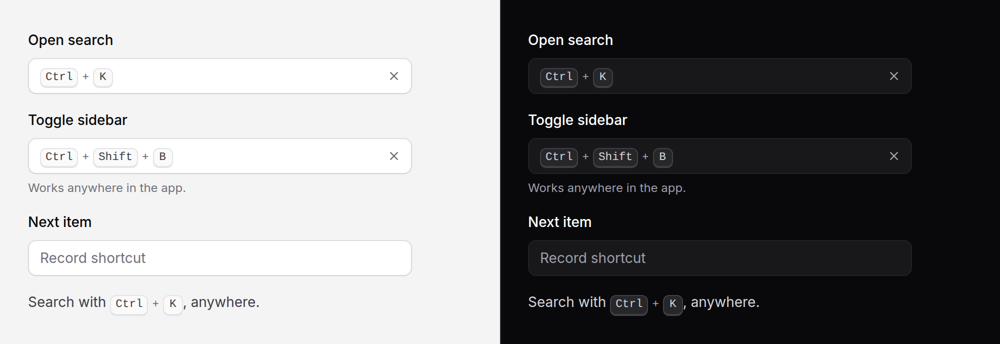

# Shortcut input

Lets someone set a keyboard shortcut by pressing it: a settings row for
"Open search" that records `mod+shift+k`, shows it as ⌘⇧K on a Mac and
Ctrl + Shift + K elsewhere, and warns when it is taken.



> **Needs Alpine** and the package's script for recording. Without them it is
> a plain text field holding the string, which can be typed: `mod+shift+k`. See
> [getting started](../getting-started.md#3-add-the-script).

## Use it

```blade
<x-ds::shortcut-input
    name="shortcuts[search]"
    label="Open search"
    :value="$settings->shortcuts['search'] ?? 'mod+k'"
    :conflicts="['mod+j' => 'Jump to', 'mod+shift+p' => 'Command palette']"
/>

<x-ds::shortcut-input name="toggle" label="Toggle sidebar" wire:model.live="toggle" />

<x-ds::shortcut-input name="next" label="Next item" :allowBare="true" by="code"
    @change="console.log($event.detail.value, $event.detail.previous)" />
```

It posts one string: the modifiers in a fixed order, then the key, lower case.
`mod` is Cmd on a Mac and Ctrl elsewhere, so one stored value works on both.
Show it anywhere with [kbd](kbd.md):

```blade
<p>Search with <x-ds::kbd :shortcut="$settings->shortcuts['search']" />.</p>
```

## Props

| Prop | Type | Default | What it does |
|---|---|---|---|
| `name` | string | — | The field the shortcut posts under. |
| `label` | string | — | What the shortcut does. |
| `value` | string | — | The shortcut. Normalised: `Shift+Mod+K` is `mod+shift+k`. |
| `placeholder` | string | `"Record shortcut"` | Shown while there is none. |
| `portable` | bool | `true` | Record Cmd on a Mac and Ctrl elsewhere as `mod`. Off, they are `meta` and `ctrl`. |
| `by` | `key` \| `code` | `key` | `key`: what the key types. `code`: where the key is, written as on a US keyboard, for shortcuts that should stay put across layouts. |
| `allowBare` | bool | `false` | Take a key without Ctrl, Cmd or Alt: `k`, `f2`, `shift+k`. |
| `reserved` | array | the browser's | Refused with a message. Defaults to `mod+w`, `mod+t`, `mod+n`, `mod+q`, `mod+shift+t`, `mod+shift+n`, `mod+shift+w`. |
| `conflicts` | array | `[]` | Shortcut ⇒ what uses it. Warned "Already used by …"; still kept. |
| `help` | string | — | Guidance under the field. |
| `error` | string | — | Replaces `help`, marks the field invalid. |
| `size` | `md` \| `sm` | `md` | `sm` is 32px, for a table row. |
| `disabled` | bool | `false` | |

Anything else (`id`, `required`) goes on the text field; `class` on the root.
`change` comes from the text field, bubbling, with `{ value, previous }` in
its detail; `wire:model` and `x-model` bind the string.

## Recording a shortcut

1. Tab to the field, or click it. Press **Enter** or **Space**, or click: it
   says "Press keys…".
2. Press the combination: hold the modifiers, press the key. A modifier on its
   own does nothing yet.
3. It is set, read out, and recording stops.

While recording, **Escape** cancels, **Backspace** or **Delete** clears, and
**Tab** is never taken: it cancels and moves on, as Tab always does. So focus
cannot get stuck in the field, and a shortcut that includes Tab cannot be
recorded. Not recording, Backspace or Delete clears too, and so does the ✕.

## What it refuses

- **A key on its own**, unless `allowBare`: "Hold Ctrl or Alt with the key".
  Shift does not count, since it is how capitals are typed.
- **The browser's own shortcuts.** Close tab, new tab, new window, quit and
  their Shift versions go to the browser before the page sees them.

A shortcut in `conflicts` is kept, with "Already used by Jump to." under the
field: the person may mean to move it. There is no global registry; you pass
what is taken.

## Showing shortcuts the same way

ds::kbd's `shortcut` prop draws a stored string, Ctrl + Shift + K from the
server, ⌘⇧K once the script sees a Mac. The same drawing is in PHP and in the
script:

```php
use Shipbytes\BladeUi\Support\Shortcut;

Shortcut::normalise('Shift+Mod+K'); // "mod+shift+k"
Shortcut::keys('mod+shift+k');      // ['Ctrl', 'Shift', 'K'], for <x-ds::kbd :keys>
Shortcut::keys('mod+shift+k', true);// ['⌘', '⇧', 'K']
Shortcut::words('mod+shift+k');     // "Control+Shift+K"
```

```js
import { caps } from '.../resources/js/shared/shortcut.js';
caps('mod+shift+k'); // [{ cap: '⌘', word: 'Command' }, …] on a Mac
```

## Accessibility

- The field is a button: its name is the label and what it shows ("Open
  search, Control+Shift+K"), and how to record is its description.
- Recording, the shortcut taken, a refusal and a warning are all announced
  through a status region.
- The keys are drawn as symbols on a Mac but always read as words, Command,
  Option, Control, Shift: screen readers say "⌘" inconsistently or not at all.

## Don't

- **Don't record Tab, or anything the browser keeps.** Both are refused for a
  reason.
- **Don't treat a conflict as an error.** Warn, as it does, and let the person
  decide.
- **Don't store the symbols.** Store the string; draw it with kbd.

More in [specs/shortcut-input.md](../../specs/shortcut-input.md).
